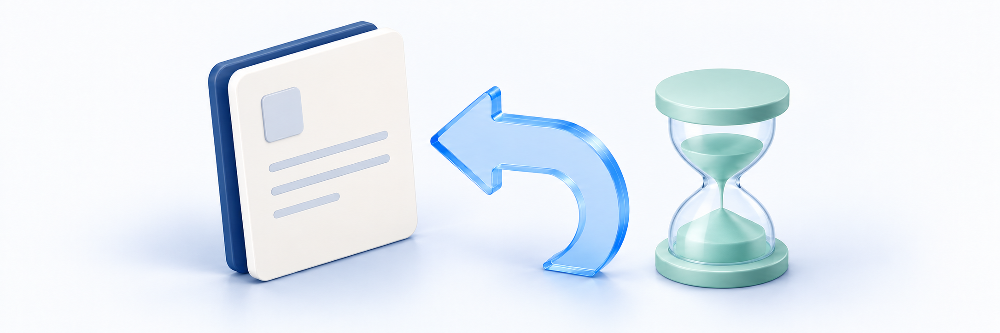

# 상품 취소·환불 신청하기

<figure><figcaption></figcaption></figure>

취소하려면 먼저 학원에 신청 경로를 확인하세요. 취소할 상품·수량과 해당 상품을 구매한 주문을 준비하고, 이용·발송 사실과 아래 조건을 확인합니다. 현재 화면의 취소 버튼이나 금액만 보고 이번 취소의 신청 가능 여부나 환불액을 확정하지 않습니다.

**신청과 환불은 다릅니다:** 예상액 확인·문의·신청 접수는 실제 환불이 아닙니다. 처리 후 카드·계좌 반영도 따로 확인해야 합니다.

아래 조건이 학원의 공개 취소 약관과 실제 신청 화면에 어떻게 적용되는지는 아직 확인이 필요합니다. 신청 전에 학원에 적용 조건과 신청 방법을 확인하세요. 이 안내는 법정 환불 기준이나 법률 검토가 완료된 안내는 아닙니다.

## 시작 전 확인 <a href="#before-you-start" id="before-you-start"></a>

| 확인할 것 | 내용 |
| --- | --- |
| 사이트·계정 | 상품을 구매한 학원 사이트와 계정인지 확인합니다. 다른 계정의 주문을 대신 신청하거나 계정을 공유하지 않습니다 |
| 원 주문(해당 상품을 구매한 주문)·대상 | 주문번호·상품명과 묶음에 포함된 강좌/교재/디지털 자료 중 어떤 구성품을 취소할지 정합니다 |
| 수량·기존 신청 | 구매 수량·이미 취소된 수량·이번 요청 수량과 진행 중인 신청을 구분합니다 |
| 이용·배송 사실 | 이번 구매의 시청·자료 이용·다운로드 시도·발송 여부와 문제 발생 시각을 정리합니다 |
| 원하는 도움 | 단순 변심인지, 하자·제공 실패인지, 이용 기록에 이의가 있는지 구체적으로 설명합니다 |
| 개인정보 | 주문번호·연락처는 필요한 담당자에게만 전달합니다. 비밀번호·인증번호·결제 키·전체 카드/계좌 정보를 보내지 않습니다 |

## 1. 원 주문과 취소할 구성품 확인하기 <a href="#step-1" id="step-1"></a>

1. **마이페이지 → 구매 내역 → 결제**에서 원 주문을 찾습니다. 자세한 방법은 [주문·결제 내역 확인하기](../orders/order-and-payment-history.md)를 참고합니다.
2. 구매한 상품과 취소할 강좌·교재·디지털 자료를 구분합니다. **구성품**은 묶음 상품에 포함된 강좌·교재·디지털 자료 각각을 뜻하며, 취소 가능 여부는 구성품별로 확인합니다.
3. 교재 구성이나 수량이 화면에 충분히 보이지 않으면 주문번호·상품명을 학원에 알려 확인합니다. 이름이 같은 다른 구매 건이나 주문 대표 이름만으로 대상을 고르지 않습니다.

**취소 신청 한 건은 구매 당시 구성품 하나와 그 구성품의 신청 수량**을 대상으로 합니다. 여러 구성품을 한 신청에 합치거나, 강좌·교재·자료가 섞인 주문 전체를 일반 취소로 한꺼번에 신청하지 않습니다. 같은 구성품의 진행 중 신청이 있다면 새 신청보다 기존 접수 건을 먼저 확인합니다.

결제가 완료된 구매는 결제대기 상태, 결제 결과가 불명확한 경우, 학원에서 직접 지급받은 경우와 구분합니다. 주문이 보이지 않거나 취소 버튼이 없다고 재구매·재결제하지 않습니다. 0원 주문도 모든 경우에 같은 신청 경로가 제공된다고 가정하지 않습니다.

> **화면 예시 준비 중** · 같은 원 주문과 취소할 구성품을 확인합니다.

## 2. 상품 유형별 확인 조건 정리하기 <a href="#step-2" id="step-2"></a>

상품 종류에 따라 확인할 조건이 다릅니다. **학생 화면에서 실제로 사용할 수 있는 신청 기능은 아직 확인되지 않았으므로**, 학원에 신청 경로부터 확인하세요. 이번 구매의 이용·배송 기록에 따라 판단하므로, 취소 가능 여부를 확인하려고 영상을 재생하거나 자료를 시험 다운로드하지 않습니다.

| 대상 | 일반 취소에서 확인하는 것 | 주의할 점 |
| --- | --- | --- |
| 강좌 | 수강 기간과 이번 구매로 이용한 영상·자료를 정리해 학원에 알립니다 | 이용하지 않은 경우와 일부 이용한 경우의 계산이 다릅니다. 학습 진도율만으로 환불액을 계산하지 않습니다. 자세한 계산 기준은 아래에서 확인합니다 |
| 강의 첨부 자료를 이용한 강좌 | 해당 구매에서 자료 다운로드 주소(URL)가 발급됐는지, 자료 이용을 강좌 이용분으로 계산한 기준·기록은 무엇인지 학원에 확인합니다 | 근거 부족을 미이용 또는 전부 이용으로 단정하지 않습니다. 추가 심사가 필요하거나 환불액이 아직 정해지지 않을 수 있습니다 |
| 별도 디지털 자료 | 결제 시각부터 정확히 7×24시간 이내인지, 유효한 구매 권리에 다운로드 URL 발급 이력이 없는지 둘 다 확인합니다. | 경계 시각까지 포함하며 날짜만으로 판단하지 않습니다. 실제 파일 저장 실패라도 URL 발급 이력은 생길 수 있습니다 |
| 출고 전 교재 | 배송 대기/준비 상태인지, 발송 이력이 없는지, 취소 가능한 수량이 남아 있는지 | 송장이 없다는 이유만으로 출고 전이라고 단정하지 않습니다. 배송 근거가 없거나 불명확하면 확인·심사가 필요합니다 |
| 이미 발송된 교재 | 실제 발송 사실과 반품/동일 교재 교환 대상인지 | 출고 전 취소와 다른 절차입니다. 임의 반송이나 배송 상태 되돌리기로 처리하지 않습니다. [교재 반품·교환 신청하기](request-return-or-exchange.md)에서 다룹니다 |

예를 들어 디지털 자료를 10월 1일 오후 2시에 결제했다면 일반 취소 기간 경계는 10월 8일 오후 2시입니다. 그날 자정까지로 늘려 해석하지 않습니다. 신청 접수 뒤에도 승인 단계와 실제 취소 처리 단계에서 최신 조건을 다시 확인합니다. 접수했다는 이유만으로 기간·자격 조건이 이후에도 계속 유지된다고 판단하지 않습니다.

강좌의 학습 화면에 보이는 완료 수업 비율과 실제 이용률은 다릅니다. 시스템은 구매 당시 영상 길이와 이번 구매로 시청한 구간을 기준으로 계산합니다. 현재 강좌 가격·진도율·반복 시청시간으로 환불액을 직접 계산하지 마세요. **화면의 기간·이용 기준이 이 안내와 다르거나 예상 환불액을 알 수 없다면, 신청을 진행하지 말고 학원에 확인하세요.** 실제 화면과 환불 조건이 일치하는지는 아직 확인되지 않았습니다.

하자·제공 실패와 이용 기록 이의는 일반 취소와 다른 심사 사유입니다. **판매자 귀책**은 문제에 판매자 측 책임이 있다는 뜻입니다. 사유를 선택하거나 불편을 설명한 것만으로 판매자 귀책 인정·전액 환불이 확정되지는 않습니다. 이용 기록에 이의를 제기해 심사를 받더라도 원본 기록이 삭제되는 것은 아닙니다. 다른 정상 이용 기록에 따른 취소 조건이나 수강 기간에 따른 취소 조건이 모두 면제되는 것도 아닙니다. 해당하는지 모르겠다면 실제 겪은 문제를 학원에 설명하고 확인받으세요.

교재 배송 근거와 주소 확인은 [교재 배송과 배송지 확인하기](../orders/textbook-shipping-and-address.md)를 참고합니다.

## 3. 최신 예상액과 신청 가능 여부 구분하기 <a href="#step-3" id="step-3"></a>

> **신청 기능 확인 필요**
> 아래 신청 기능의 실제 제공 여부·이용 권한과 접수·환불 결과는 아직 확인이 필요합니다. 먼저 학원에 사용할 신청 경로를 확인하세요. 버튼이 없거나 안내와 다르면 새 신청을 시도하지 말고 같은 주문을 기준으로 문의합니다.

학원에서 이용 가능한 경로를 확인받았고 해당 화면이 제공되는 경우에만 다음 설명을 참고합니다. 주문 상세의 **취소 신청 → 구성품 취소 신청** 창에서 대상·신청 수량·사유를 확인합니다. **조건 확인**은 가능 여부와 예상액 조회이며, **신청하기**는 실제 제출입니다. 최신 신청 가능 여부와 예상액을 확인합니다. 금액 미확정과 실제 0원을 구분하고, 조건이 바뀌었는지도 확인합니다. 기존 신청 결과가 불명확하면 새 제출을 반복하지 않습니다.

| 확인할 결과 | 의미·확인할 것 |
| --- | --- |
| 신청 가능·자동 처리 경로 | 이후 접수와 실제 처리 결과를 확인해야 합니다. 예상액 조회나 자동 경로 표시 자체가 환불 완료는 아닙니다 |
| 신청 가능·관리자 심사 | 심사 접수가 가능하다는 뜻일 수 있습니다. 자동 승인이나 최종 환불액 확정으로 읽지 않습니다 |
| 예상액 미확정 | 이용·금액 등의 추가 확인이 필요합니다. 금액이 비어 있거나 미확정이면 0원이나 주문 총액으로 해석하지 않습니다 |
| 실제 0원 | 미확정과 다릅니다. 금액 환급이 생기지 않아도 대상 취소·이용 권리 결과는 따로 확인해야 합니다 |
| 신청 제한 | 제한 사유와 대상·기간·이용/발송·기존 신청·원 결제 근거를 확인합니다. 다른 사유/수량으로 바꿔 우회하지 않습니다 |
| 조건·금액 변경 | 최신 결과를 다시 확인해야 합니다. 예전 금액으로 자동 제출하거나 같은 요청을 반복하지 않습니다 |

### 환불 금액을 읽는 기준

**결제 배분액**은 할인·쿠폰을 반영한 실제 결제액 중 해당 구성품에 배정된 금액입니다. 환불액은 **구매 당시 구성품의 결제 배분액**과 남은 수량·기존 취소액 등을 기준으로 시스템에서 계산합니다. 화면 단가×수량·현재 상품가·주문 총액으로 대신 계산하거나 쿠폰을 한 번 더 빼지 않습니다.

강좌를 취소하려면 학원에 구매로 받은 수강권이 유효한지 확인해 달라고 요청하세요. 이번 구매의 실제 이용 내역을 확인할 근거가 있는지도 함께 문의하세요. 이용하지 않았다면 해당 수량의 원 결제 배분액 전액을 기준으로 환불액을 확인합니다. 일부 이용했다면 이용하지 않은 부분의 금액을 시스템에서 계산하고 관리자가 심사합니다. 다른 구매의 시청 기록을 환불 이용률로 쓰지 않습니다. 강좌를 전부 이용했거나 수강 기간이 만료됐거나 수강권이 비활성 상태인 경우의 일반 취소 제한도 확인해야 합니다. 학생이 직접 이용률을 계산하기보다 이번 구매의 실제 이용 사실을 학원에 알려 확인을 요청하세요.

출고 전 교재를 일부 취소해 남은 교재가 있다면 최초 배송비는 함께 취소되지 않습니다. 마지막 유효 교재 수량을 취소할 때는 시스템에서 남은 최초 배송비를 반영합니다. 일부 취소 후 무료배송 기준을 못 채웠다는 이유로 남은 상품에 배송비를 임의로 추가해서는 안 됩니다.

**에스크로**는 결제한 돈을 결제업체 등이 보관했다가 상품을 받은 뒤 판매자에게 지급하는 방식입니다. 실제로 에스크로로 결제한 주문은 **구매확정 전에 결제 금액의 일부를 취소할 때 별도 제한**이 있습니다. 전체 취소를 예외적으로 신청할 수 있는지도 원 결제와 모든 구성품의 조건 등을 다시 확인해야 합니다. 부분 취소 제한을 피하려고 임의로 전체 취소를 신청하지 않습니다. 결제 방식이나 취소 조건을 화면에서 확인하기 어렵다면 학원에 원 주문 확인을 요청합니다.

> **화면 예시 준비 중** · 한 신청의 대상과 수량을 확인합니다.

> **화면 예시 준비 중** · 최신 예상 결과와 실제 접수를 구분합니다.

> **동작 예시 준비 중** · 기존 조건·예상액을 읽고 돌아가는 예시입니다.

## 4. 신청 접수와 실제 환불 구분하기 <a href="#step-4" id="step-4"></a>

**대상 주문·구성품·수량·사유**를 확인합니다. **신청을 구분할 수 있는 정보와 접수 시각, 최신 처리 상태와 금액**도 확인합니다. 학생 화면에서 신청 대상·상태 등을 찾기 어렵다면 보이는 안내와 확인 시각을 학원에 알려 같은 접수 건을 확인합니다. 문의 접수를 정식 신청이나 신청 기한 연장으로 해석하지 않습니다.

| 구분 | 확인할 것 |
| --- | --- |
| 예상액 확인 | 신청이 접수되거나 이용이 일시 제한되거나 환불된 것은 아닙니다 |
| 신청 접수 | 신청이 기록된 단계입니다. 이미 진행 중이던 신청을 다시 확인한 것인지, 이번에 새로 접수된 것인지 구분합니다 |
| 이용 제한 반영 | 대상 구매 권리의 시청·새 자료 URL 발급 등이 일시 제한될 수 있습니다. 접수와 반영은 별개이며 전체 계정 정지·기간 자동 연장을 뜻하지 않습니다 |
| 심사/처리 중 | 조건·금액 확인 또는 금융·권리 등의 후속 처리가 남아 있을 수 있습니다. 새 신청·재결제로 해결하지 않습니다 |
| 거절·결과 불명확 | 안내받은 사유·시각과 기존 신청을 확인합니다. 이용 재개·변경/철회 버튼이 있다고 가정하지 않고 학원에 문의합니다 |
| 취소 처리 완료 | 취소된 구성품·수량·확정 금액과 권리/배송 등 해당 결과를 확인합니다. 주문 전체·다른 구매의 권리까지 취소됐다고 단정하지 않습니다 |
| 카드/계좌 반영 | 서비스 처리 결과와 결제수단의 실제 반영을 구분합니다. 구체적인 소요일은 학원·결제수단 안내를 확인합니다 |

이용 제한은 해당 구매의 권리와 관련됩니다. 같은 강좌에 다른 유효 권리가 있다면 이용 결과가 다를 수 있으며, 재생 가능 여부만으로 신청 미접수나 환불 완료를 판단하지 않습니다. 자료를 이미 받았다면 취소가 저장된 파일을 원격 삭제하는 것은 아닙니다.

처리 결과가 불명확하면 같은 주문·신청을 기준으로 확인합니다. 새로고침 후 안내가 사라졌거나 오류가 나더라도 성공/실패를 임의 확정하거나 중복 신청하지 않습니다. 증빙 확인은 [영수증과 거래명세서 확인하기](../orders/receipt-and-invoice.md)를 참고합니다.

> **화면 예시 준비 중** · 접수·권리 반영·실제 환불은 다른 결과입니다.

## 5. 상황별로 학원에 문의하기 <a href="#step-5" id="step-5"></a>

| 상황 | 먼저 전달할 내용 |
| --- | --- |
| 취소할 구성품이나 수량이 안 보여요 | 원 주문번호·상품/구성품명·구매/요청 수량, 해당 대상과 가능한 정식 경로 확인 요청 |
| 예상액이 없거나 생각한 금액과 달라요 | 같은 구성품·수량·표시 금액/미확정 문구·확인 시각. 원 결제 배분과 기존 취소·배송비 확인 요청 |
| 이용하지 않았는데 기록이 있다고 해요 | 이번 구매·문제가 된 강좌/자료·시각·실제 시도/결과와 이용 기록 이의 확인 요청. 원본 삭제 요청은 하지 않음 |
| 자료 저장에 실패했어요 | 자료명·다운로드 시도 시각·오류와 실제 저장 여부. URL 발급 이력 확인 요청. 반복 다운로드로 확인하지 않음 |
| 교재가 발송됐거나 배송 여부가 불명확해요 | 대상 교재·수량·안내받은 배송 사실/시각. 출고 전 취소인지 반품/교환인지 확인 요청 |
| 접수됐는지 모르겠어요 | 원 주문과 기존 신청 식별정보가 있다면 함께 전달. 안내 문구·시각/오류를 남기고 중복 신청 전 확인 요청 |
| 접수 후 강의·자료를 이용할 수 없어요 | 해당 구매·신청과 제한 문구/시각. 대상 권리와 반영 상태 확인 요청. 다른 계정·재구매로 우회하지 않음 |
| 완료 안내가 있는데 환불이 안 보여요 | 대상 신청·확정 금액·완료 안내 시각·확인한 결제수단 결과. 재취소보다 금융 반영 확인 요청 |
| 거절됐거나 사유·수량을 바꾸고 싶어요 | 기존 신청과 안내 사유·바꾸려는 내용. 임의 철회/수정/재접수 대신 허용된 후속 절차 확인 요청 |

### 문의 내용 예시 <a href="#inquiry-example" id="inquiry-example"></a>

```text
문의 목적: 상품 취소 가능 여부 / 기존 신청·환불 처리 확인
주문번호: 내 주문의 번호
상품·구성품: 구매한 상품명 / 취소할 강좌·교재·디지털 자료 하나
수량: 구매한 수량 / 이미 취소한 수량 / 이번 요청 수량
사유·실제 상황: 단순 변심 / 하자·제공 실패 / 이용 기록 이의와 구체적인 내용
확인한 내용: 이용·URL 발급 시도·발송 사실 / 예상액·미확정·오류 문구와 시각
기존 신청: 안내받은 식별정보·접수 시각·상태가 있다면 기재
필요한 도움: 정확한 대상·조건·금액 / 정식 신청 경로 / 기존 처리 결과 확인
```

문의 방법은 [사이트에 1:1 문의하기](../communication/site-inquiries.md)를 참고합니다. 로그인할 수 없으면 학원이 제공한 별도 연락처로 문의합니다. **문의 등록만으로 정식 취소·반품·교환 신청이 접수되거나 환불이 확정되지는 않습니다.**

연락처·추가 증빙이 필요하면 학원이 안내한 본인 확인이 가능한 개별 창구로 전달합니다. 공개 Q&A·공지 댓글에는 주문/연락처를 올리지 않습니다. 결제 키·영수증/다운로드 URL·전체 카드/계좌 정보·타인 정보를 보내지 않으며, 이번 취소 신청 화면에 첨부 파일 기능이 있다고 가정하지 않습니다.

> **화면 예시 준비 중** · 필요한 정보만 정리해 학원에 문의합니다.

## 완료 확인 <a href="#completion-checklist" id="completion-checklist"></a>

- [ ] 구매한 학원 사이트·계정과 원 주문번호를 확인했다.
- [ ] 취소할 구성품 하나를 정하고 구매 수량·남은 수량·신청할 수량을 구분했으며, 이미 진행 중인 신청이 있는지 확인했다.
- [ ] 강좌 이용·자료 URL 발급·교재 발송의 실제 사실을 정리했다.
- [ ] 학습 진도율·화면 단가로 취소 가능 여부나 환불액을 계산하지 않고, 안내가 다르면 학원에 확인했다.
- [ ] 시스템에서 계산한 예상액·미확정·실제 0원과 조건 변경을 구분했다.
- [ ] 조회·문의·정식 접수·권리 제한·심사/처리·완료를 구분했다.
- [ ] 취소된 대상/수량·확정 금액과 실제 결제수단 반영을 별도로 확인하도록 정리했다.
- [ ] 재신청·재결제·추가 재생/다운로드·임의 반송으로 우회하지 않았다.
- [ ] 필요한 정보만 문의하고 개인정보·금융/다운로드 URL은 공개하지 않았다.

## 관련 안내 <a href="#related-guides" id="related-guides"></a>

- [취소·반품·교환 처리 상태 확인하기](request-status.md)
- [교재 반품·교환 신청하기](request-return-or-exchange.md)
- [상품 구성·가격·이용 기간 확인하기](../purchase/product-and-access-period.md)
- [결제하고 무료 상품 신청하기](../purchase/payment-and-free-order.md)
- [수강 기간과 학습 현황 확인하기](../learning/access-period-and-progress.md)
- [강의 첨부 자료 받기](../resources/lecture-materials.md)
- [구매하거나 지급받은 디지털 자료 이용하기](../resources/my-digital-resources.md)
- [주문·결제 내역 확인하기](../orders/order-and-payment-history.md)
- [교재 배송과 배송지 확인하기](../orders/textbook-shipping-and-address.md)
- [영수증과 거래명세서 확인하기](../orders/receipt-and-invoice.md)
- [사이트에 1:1 문의하기](../communication/site-inquiries.md)
- [가이드 홈](../README.md)
