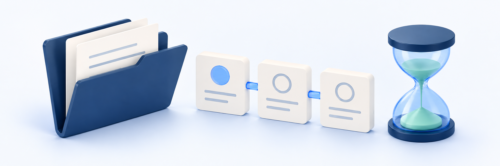

# 취소·반품·교환 처리 상태

<figure><figcaption></figcaption></figure>

처리 결과를 확인하려면 **마이페이지 → 구매 내역 → 결제**에서 원 주문(해당 상품을 구매한 주문)을 찾습니다. **주문번호·대상 확인 → 현재 상태·안내 읽기 → 취소/반품/교환별 결과 구분 → 필요한 경우 같은 신청으로 문의** 순서로 확인합니다.

**확인 순서:** 신청한 주문·상품·수량 → 현재 상태 → 다음에 필요한 일. 완료 안내가 있어도 실제 카드·계좌 환불이나 교환 교재 수령은 따로 확인합니다. 접수·심사·회수/검수는 최종 완료 전 단계입니다.

## 시작 전 확인 <a href="#before-you-start" id="before-you-start"></a>

| 확인할 것 | 내용 |
| --- | --- |
| 사이트·계정 | 구매하고 신청한 학원 사이트와 본인 계정인지 확인합니다 |
| 원 주문·대상 | 주문번호·상품/강좌/교재/자료명과 신청한 수량을 준비합니다. 같은 상품의 다른 주문과 구분합니다 |
| 신청 유형 | 취소·반품·동일 교재 교환 중 무엇을 신청했는지 확인합니다 |
| 기존 신청 | 안내받은 신청 식별정보·접수 시각·현재 상태가 있다면 준비합니다. 문의번호와 정식 신청번호를 같은 것으로 판단하지 않습니다 |
| 확인할 결과 | 신청 접수인지, 실제 환불인지, 회수·교환 배송인지 구분합니다 |
| 개인정보 | 주문·신청 정보는 필요한 담당자에게만 전달하고 비밀번호·인증번호·금융/조회 URL은 공유하지 않습니다 |

신청 조건·예상액과 정식 경로는 [상품 취소·환불 신청하기](request-cancellation.md), [교재 반품·교환 신청하기](request-return-or-exchange.md)를 참고합니다. 이 페이지에서는 기존 신청의 처리 결과만 확인합니다. 상태를 확인하려고 새 신청을 제출하거나 취소 버튼을 누르지 않습니다.

## 1. 구매 내역에서 원 주문 찾기 <a href="#step-1" id="step-1"></a>

1. 학원 사이트에 로그인한 뒤 **마이페이지 → 구매 내역 → 결제**를 엽니다.
2. 주문명·금액·날짜를 대조해 해당 주문의 행 또는 카드를 엽니다. PC는 표, 모바일은 카드로 보일 수 있습니다.
3. 상세의 **주문번호**와 상품을 확인합니다. 같은 상품을 여러 번 구매했다면 신청한 원 주문이 맞는지 먼저 확인합니다.
4. 학원에서 안내받은 신청 대상·수량과 비교합니다. 구성품·신청 정보가 충분히 보이지 않으면 주문 대표 이름이나 카드 개수로 대신 판단하지 않습니다.

구매 내역의 기본 목록이 모든 결제 시도·실패·입금대기 주문을 보여주는 것은 아닙니다. 주문이 안 보인다고 미접수·삭제·환불 완료로 단정하지 않습니다. 목록 이동과 주문 찾기는 [주문·결제 내역 확인하기](../orders/order-and-payment-history.md)를 참고합니다.

> **화면 예시 준비 중** · 신청한 원 주문과 표시 상태를 먼저 확인합니다.

> **동작 예시 준비 중** · 기존 주문과 신청 상태를 읽고 돌아갑니다.

## 2. 현재 화면의 상태와 환불 안내 읽기 <a href="#step-2" id="step-2"></a>

상세의 결제 요약에 있는 **상태**와 환불 안내를 함께 확인합니다. 환불 거절 안내에 **사유**가 있으면 읽습니다. 환불 안내가 주문의 결제 상태보다 우선 표시될 수 있으므로 배지 하나만으로 전체 주문의 결과를 판단하지 않습니다.

**주문의 환불 요청 표시와 구성품별 취소·반품·교환 신청 상태는 서로 다른 표시입니다.** 한 배지가 모든 신청의 유형·수량·회수/교환 진행을 보여준다고 생각하지 않습니다.

| 현재 표시 | 읽는 방법·다음 확인 |
| --- | --- |
| 결제완료 | 원 주문의 결제 표시입니다. 신청이 없거나 환불이 거절됐다는 뜻은 아닙니다 |
| 부분취소 | 일부 항목이 취소된 상태입니다. 상세의 취소 항목과 이번 신청 대상을 구분합니다 |
| 취소완료·환불완료·환불 완료 | 처리 결과와 실제 결제수단 반영을 대조합니다. 전액 환불·반영 시각을 배지만으로 보장하지 않습니다 |
| 환불 요청중 | 관리자 확인을 기다리는 기존 환불 신청 표시입니다. 접수와 승인·실제 환불은 다릅니다 |
| 환불 처리중 | 기존 환불 처리가 진행 중인 표시입니다. 같은 신청의 결과를 확인하며 중복 신청하지 않습니다 |
| 환불 거절 | 안내받은 사유를 확인하고 필요한 경우 학원에 문의합니다. 자동 철회·재신청 가능으로 해석하지 않습니다 |
| 환불 실패 | 완료나 미접수로 확정하지 않습니다. 같은 주문·신청과 확인 시각을 학원에 알려 실제 결과를 확인합니다 |
| 환불 신청됨·취소됨 | 상품 카드의 접수 직후 안내 또는 항목 취소 표시일 수 있습니다. 새로고침 후 최신 조회 결과와 원 주문 대상을 다시 확인합니다 |

취소/전체 취소 버튼이 사라졌다고 환불 완료나 거절을 뜻하지 않습니다. 반대로 버튼이 보여도 재신청 가능·최종 자격이 확인된 것은 아닙니다. **상태 확인용으로 취소 / 전체 취소를 누르지 않습니다.**

처리 중이거나 이용 권한 반영을 기다릴 때 갱신 안내가 보일 수 있지만, 즉시 모든 처리가 끝나거나 정해진 시간 안에 자동 복구된다는 뜻은 아닙니다. 같은 신청의 최신 결과를 확인하며, 조회하거나 화면을 이동하는 것과 신청·환불·수령 처리를 다시 실행하는 것은 다릅니다.

> **화면 예시 준비 중** · 현재 환불 안내와 주문·항목 상태를 함께 읽습니다.

현재 **교환 요청중·교환 진행중·교환 거절·교환 완료** 표시를 기존 환불 표시와 구분합니다. 배지 하나만으로 원 주문에 속한 모든 신청의 상태나 실제 회수·환불 결과를 알 수는 없습니다. 신청별 상태는 아래 설명과 대조합니다.

## 3. 신청별 접수·처리·완료 구분하기 <a href="#step-3" id="step-3"></a>

신청별로 확인할 정보는 **원 주문 + 신청 식별정보 + 구성품 하나 + 신청 수량 + 유형**입니다. 한 주문에 여러 대상의 신청이 있으면 각각 확인해야 합니다. 현재 학생 화면에서 이 정보를 찾기 어렵다면 학원에 같은 신청의 결과를 확인합니다.

아래는 처리 의미를 설명하는 구분이며 **확정된 학생 화면의 배지 이름·일렬 진행 순서가 아닙니다.** 취소·반품·교환은 서로 다른 경로이고 일부는 표시되지 않거나 별도 확인이 필요할 수 있습니다.

| 처리상 구분 | 의미·확인할 것 |
| --- | --- |
| 접수 | 신청이 기록된 단계입니다. 문의·예상액 조회와 구분하고 기존 신청을 다시 확인한 것인지 봅니다 |
| 심사 | 조건·사유·근거를 확인하는 단계입니다. 자동 승인·최종 금액 확정은 아닙니다 |
| 반품 진행 | 회수 안내·물품 도착·검수와 후속 환불을 나눠 확인합니다 |
| 교환 진행 | 회수·검수·동일 교재 재배송·수령을 나눠 확인합니다. 환불 처리중과 같은 뜻이 아닙니다 |
| 거절 | 신청 결과와 안내 사유를 확인합니다. 관련 이용 제한 해제·후속 절차 반영은 별도로 확인합니다 |
| 환불 처리 | 취소·반품 금액을 처리하거나 강좌·자료의 이용 상태 등에 결과를 반영하는 절차가 남을 수 있습니다. 확정 금액만으로 전체 완료를 판단하지 않습니다 |
| 처리 완료 | 해당 신청 유형의 후속 처리가 끝난 결과인지 확인합니다. 교환 완료를 환불 완료로 읽지 않습니다 |

접수·처리 결과와 강좌/자료 이용 제한의 반영은 별개입니다. 접수 직후 제한이 아직 반영되지 않았거나 거절 뒤 해제가 남아 있을 수 있습니다. 재생이 가능하거나 자료가 보인다는 사실만으로 신청 미접수·취소 실패를 판단하지 않습니다. 같은 강좌에 다른 유효 권리가 있으면 이용 결과가 다를 수 있습니다.

원 주문의 **취소·반품·교환 신청** 영역에서 신청별 대상/수량·유형·상태·금액과 표시되는 최신 처리 사유를 읽습니다. 전체 이력이나 별도 상세 화면, 철회·수정·재신청 기능이 모두 제공된다고 가정하지 않습니다. 정보가 없거나 불명확하면 원 주문·대상과 접수 안내 문구·시각을 학원에 전달합니다. 신청 ID를 추측하거나 타인의 링크로 확인하려 하지 않습니다.

> **화면 예시 준비 중** · 신청별 상태와 최신 표시 사유를 나눠 읽습니다. 화면·동작 확인 후 추가합니다.

## 4. 반품·교환의 물류 결과 확인하기 <a href="#step-4" id="step-4"></a>

| 유형 | 구분할 결과 |
| --- | --- |
| 반품 회수 안내·승인 | 회수 방법을 안내받거나 승인된 단계입니다. 자동 기사 방문·실제 물품 이동을 뜻하지 않습니다 |
| 반품 물품 도착·검수 | 회수 물품 도착과 검수 결과를 구분합니다. 검수 통과만으로 환불 완료가 아닙니다 |
| 반품 환불 | 해당 신청의 확정 금액·처리 완료와 실제 결제수단 반영을 확인합니다 |
| 교환 회수·검수 | 원 교재를 회수·검수하는 단계입니다. 교환 교재가 이미 발송됐다는 뜻은 아닙니다 |
| 교환 재배송 | 원 주문 배송과 **동일 교재의 새 배송**을 구분합니다. 원 송장을 교환 송장으로 보지 않습니다 |
| 교환 수령·완료 | 교환 교재·수량과 실제 수령, 최종 처리 결과를 대조합니다. 수령 기록 뒤에도 전체 결과 반영이 남을 수 있습니다 |

송장 등록·택배 배송완료 표시·서비스의 수령 기록·내 실제 수령은 각각 대조해야 합니다. 새 배송이 없거나 움직이지 않으면 같은 교환 신청으로 문의하며 임의 반송·중복 택배 예약·재배송 신청·취소/재구매로 해결하지 않습니다.

회수 주소·방법·비용과 교재 상태 확인은 [교재 반품·교환 신청하기](request-return-or-exchange.md), 원 주문 배송과 배송지는 [교재 배송과 배송지 확인하기](../orders/textbook-shipping-and-address.md)를 참고합니다. 학생용 배송/수령 확정 버튼이 있다고 가정하지 않습니다.

> **화면 예시 준비 중** · 반품 단계는 실제 환불 완료와 다릅니다. 화면·동작 확인 후 추가합니다.

> **화면 예시 준비 중** · 교환 완료와 실제 수령·원 배송을 구분합니다. 화면·동작 확인 후 추가합니다.

## 5. 금액과 실제 환불·이용 결과 대조하기 <a href="#step-5" id="step-5"></a>

| 확인할 것 | 구분 |
| --- | --- |
| 주문의 결제 요약 금액 | 원 주문의 표시 금액입니다. 이번 신청의 환불액·현재 잔액·누계와 같다고 판단하지 않습니다 |
| 예상액 미확정 | 추가 확인이 필요한 값입니다. 미확정을 0원·전액 환불·실패로 해석하지 않습니다 |
| 예상액과 확정액 | 같은 대상·수량·신청의 금액인지 확인합니다. 예상액 조회·확정액 표시만으로 실제 환불이 끝난 것은 아닙니다 |
| 실제 0원 | 미확정과 다릅니다. 금액 환급 없이 대상 취소·이용 결과를 확인해야 하는 경우가 있습니다 |
| 교환의 취소액 0원·확정 취소액 없음 | 교환은 금액 취소와 별도 경로입니다. 환불 실패·무료 교환·배송비 납부 완료로 해석하지 않습니다 |
| 실제 카드/계좌 내역 | 서비스 완료 안내와 별도로 대조합니다. 구체적인 반영 시각·소요일은 학원·결제수단 안내를 확인합니다 |

완료된 대상·수량을 확인하고 다른 구성품·다른 구매의 권리까지 취소됐다고 생각하지 않습니다. 이용 결과를 시험하려고 영상을 추가 재생하거나 자료 URL을 새로 발급받지 않습니다. 저장한 파일이 취소로 원격 삭제되는 것도 아닙니다.

필요한 증빙 확인은 [영수증과 거래명세서 확인하기](../orders/receipt-and-invoice.md)를 참고합니다. 영수증 버튼이 있거나 명세서를 열 수 있다는 사실만으로 이번 신청의 금액·환불 반영이 맞다고 확정하지 않습니다.

> **화면 예시 준비 중** · 원 결제와 신청 금액·실제 환불을 나눕니다. 화면·동작 확인 후 추가합니다.

## 상태가 안 보이거나 결과가 다를 때 <a href="#section-7" id="section-7"></a>

| 상황 | 다음 확인·문의 |
| --- | --- |
| 결제 목록이 열리지 않거나 상태 표시가 비정상이에요 | 알고 있는 원 주문번호·상품·시각과 현재 화면을 학원에 전달합니다. 빈 목록·미접수·미결제로 단정하거나 새 결제/신청으로 확인하지 않습니다 |
| 주문이나 신청이 안 보여요 | 구매한 사이트·계정과 원 주문을 확인하고 목록에 표시되는 범위와 조회 오류를 구분합니다. 주문에서 신청 정보를 보는 화면으로 이동할 수 있는지는 아직 확인이 필요합니다. 보이지 않는다고 미접수·삭제로 단정하지 않습니다 |
| 목록과 상세의 상태가 달라요 | 같은 주문인지 확인하고 잠시 뒤 다시 엽니다. 각각의 문구·확인 시각을 학원에 전달합니다 |
| 접수 안내 뒤 상태가 사라졌어요 | 접수 당시 문구/시각·기존 신청 식별정보를 전달합니다. 새로 신청해 성공 여부를 시험하지 않습니다 |
| 오래 처리 중이거나 실패라고 나와요 | 같은 주문/신청·대상/수량·현재 안내와 시각으로 결과 확인을 요청합니다. 특정 소요일·자동 재처리 성공을 가정하지 않습니다 |
| 거절됐는데 이용 제한이 남아 있어요 | 기존 신청의 사유·대상·제한 문구/시각을 전달해 후속 반영을 확인합니다. 다른 계정·재구매로 우회하지 않습니다 |
| 교재는 도착했는데 환불·교환이 끝나지 않았어요 | 원 교재 수령/회수 도착/교환 수령 중 어떤 사실인지 구분하고 같은 신청의 검수·후속 결과를 확인합니다 |
| 완료 안내인데 금액이나 실제 환불이 달라요 | 신청 유형·대상/수량·확정 금액·완료 안내 시각과 실제 결제수단 결과를 나눠 전달합니다 |
| 교환 완료인데 환불이 없어요 | 동일 교재 교환인지 먼저 확인합니다. 교환 완료를 환불 완료로 읽지 않고 교재/수량·수령·비용을 확인합니다 |
| 주문을 찾을 수 없습니다. | 상세의 돌아가기 후 내 목록·계정을 확인합니다. 조회 실패도 같은 안내일 수 있어 주문 삭제·타인 주문 접근으로 단정하지 않습니다 |

> **화면 예시 준비 중** · 결과가 불명확하면 같은 주문·신청으로 문의합니다.

## 학원에 문의할 때 <a href="#contact-academy" id="contact-academy"></a>

[사이트에 1:1 문의하기](../communication/site-inquiries.md)에서 같은 주문·신청의 결과를 문의합니다. 로그인할 수 없으면 학원의 별도 연락처를 이용합니다. 문의 자체는 정식 취소/반품/교환 신청·철회·환불·회수 예약이나 기한 연장이 아닙니다.

```text
문의 목적: 기존 취소·반품·교환 신청의 처리 결과 확인
원 주문·대상: 내 주문번호 / 강좌·교재·자료명 / 신청 수량
신청: 취소·반품·동일 교재 교환 중 유형 / 안내받은 신청 식별정보·접수 시각
현재 안내: 목록/상세 중 확인한 화면 / 표시 문구·금액 / 확인 시각
실제 결과: 카드/계좌 반영 여부 또는 회수·교환 교재 수령 상황
차이가 있는 점: 접수 후 안 보임 / 상태·금액 다름 / 이용 제한·물류 결과 반영 등
필요한 도움: 같은 신청의 현재 결과와 남은 절차 확인
```

모르는 신청 식별정보·시각·금액은 추측하지 말고 확인하지 못했다고 적습니다. 연락처 등 추가 본인 확인은 학원이 안내한 개별 창구에서 진행합니다. 공개 Q&A에는 주문/신청·연락처·주소를 올리지 않으며, 비밀번호·인증번호·카드/계좌 전체 정보·결제 키/토큰·영수증/파일/배송 조회 URL·타인 정보를 보내지 않습니다.

## 완료 확인 <a href="#completion-checklist" id="completion-checklist"></a>

- [ ] 구매·신청한 학원 사이트·계정과 원 주문번호를 확인했다.
- [ ] 신청 유형·대상·수량과 기존 신청을 구분했다.
- [ ] 주문·환불 표시와 구성품별 취소·반품·교환 신청 상태를 따로 확인했다.
- [ ] 접수·심사·회수/검수·환불/교환·처리 완료와 권리 반영을 구분했다.
- [ ] 반품의 검수/환불과 교환의 원/새 배송·수령 결과를 나눠 확인했다.
- [ ] 원 결제 표시·예상/확정액·미확정/실제 0원과 교환 금액 의미를 구분했다.
- [ ] 서비스 완료 안내와 실제 결제수단 반영·교환 교재 수령을 별도로 대조했다.
- [ ] 상태 확인을 위해 중복 신청·취소/재결제·추가 시청/다운로드·임의 반송을 하지 않았다.
- [ ] 불명확한 결과는 같은 신청으로 문의하고 개인정보·금융/조회 URL을 공개하지 않았다.

## 관련 안내 <a href="#related-guides" id="related-guides"></a>

- [주문·결제 내역 확인하기](../orders/order-and-payment-history.md)
- [상품 취소·환불 신청하기](request-cancellation.md)
- [교재 반품·교환 신청하기](request-return-or-exchange.md)
- [교재 배송과 배송지 확인하기](../orders/textbook-shipping-and-address.md)
- [영수증과 거래명세서 확인하기](../orders/receipt-and-invoice.md)
- [내 계정과 로그인 방식 확인하기](../account/check-account-and-login-method.md)
- [수강 기간과 학습 현황 확인하기](../learning/access-period-and-progress.md)
- [사이트에 1:1 문의하기](../communication/site-inquiries.md)
- [가이드 홈](../README.md)
