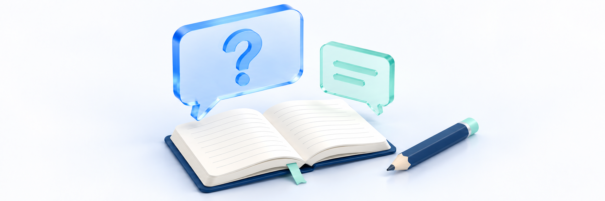

# 학습 질문 올리고 답변 확인하기

> **검토용 가이드** · 실제 서비스 화면·동작 확인과 이미지 보완이 남아 있습니다. 본문의 실행 보류·주의사항을 먼저 확인하세요.

<figure><figcaption></figcaption></figure>

강의를 듣다가 궁금한 내용은 **학습 Q&A**에 남깁니다. **강좌·강의 선택 → 제목·내용 작성 → 공개 범위 확인 → 등록 → 내 질문과 답변 확인** 순서로 이용합니다. 같은 질문에 덧붙일 내용은 해당 질문의 댓글에서 이어갑니다.

**완료 기준:** 선택한 강좌·강의에 내 질문이 등록됐는지 확인하고, 답변이 올라오면 작성자·내용을 읽어 궁금한 부분을 확인합니다. 버튼 클릭이나 답변 상태 표시만으로 등록·학습 이해가 끝났다고 판단하지 않습니다.

## 시작 전 확인 

| 확인할 것 | 내용 |
| --- | --- |
| 사이트와 계정 | 수강 중인 학원 사이트와 내 계정이 맞는지 확인합니다. 다른 계정의 질문이 자동으로 합쳐지는 것은 아닙니다 |
| 질문 종류 | 수업 내용·풀이 질문은 학습 Q&A에 남깁니다. 결제·계정·배송 등 이용 문의는 학원이 안내한 1:1 문의/연락처를 이용합니다 |
| 강좌와 강의 | 질문할 강좌와 실제 수업 이름을 먼저 확인합니다. 강의 시간·교재 쪽/문제 번호도 준비합니다 |
| 수강 기간 | 새 질문 작성에는 해당 강좌의 유효한 수강 자격이 필요합니다. 기존 글 열람과 작성·수정·삭제는 다른 조건입니다 |
| 개인정보 | 비밀번호·인증번호·연락처·학생 명단·타인 얼굴 등은 본문이나 이미지에 넣지 않습니다. 비공개 체크를 개인정보 보관 수단으로 쓰지 않습니다 |

## 1. 학습 Q&A 열기 

| 들어가는 곳 | 이용 방법 |
| --- | --- |
| 마이페이지 → 내 학습 → 학습 Q&A | 내가 작성한 질문과 강좌·강의, 답변 상태를 확인합니다. 새 질문은 **작성하기**를 누릅니다 |
| 강의실 → Q&A | 현재 보고 있는 강의에 연결된 질문을 확인합니다. 새 질문은 패널의 **작성하기**를 누릅니다 |

PC 강의실에서는 Q&A 도구로 패널을 열고, 모바일에서는 하단 Q&A 탭을 이용합니다. 수업 이름을 먼저 확인하며 다른 수업의 질문을 찾는 화면과 혼동하지 않습니다. 강의실 진입·재생 방법은 [PC·모바일에서 영상 보기](../learning/watch-on-desktop-and-mobile.md)를 참고합니다.

강의실에 `수강 기간 만료 후에는 Q&A를 작성할 수 없습니다.`가 보이면 새 질문 등록을 시도하지 말고 수강 기간과 이용 가능 범위를 학원에 확인합니다. 다른 주소나 계정으로 제한을 우회하지 않습니다.

> **화면 예시 준비 중** · 질문할 수업과 Q&A 진입 경로를 확인합니다.

## 2. 내 질문과 답변 상태 확인하기 

1. **학습 Q&A** 목록에서 제목·강좌·강의·작성일을 대조합니다. 목록은 **최신순**으로 확인합니다. 검색창·강좌 필터·다른 정렬 메뉴가 보이지 않으면 최신순 목록과 페이지 이동으로 찾습니다.
2. PC는 페이지 번호, 모바일은 **더 보기**가 있을 때 추가 목록을 확인합니다. 불러오는 중에는 기다립니다.
3. 필요한 질문 제목이나 행/카드를 눌러 상세를 엽니다. 강의실 목록과 달리 내 학습 목록은 내가 작성한 질문을 찾는 곳입니다.
4. 목록과 상세의 상태 표현이 다를 수 있으므로 아래 기준으로 읽고 실제 댓글 내용을 확인합니다.

| 표시 | 확인할 것 |
| --- | --- |
| 목록의 답변대기 | 완료 상태가 아니라는 표시입니다. 아직 아무 답변도 없다는 뜻으로 단정하지 않습니다 |
| 상세의 답변필요·답변중 | 현재 답변 진행 상태입니다. 답변중이어도 이미 등록된 답변/댓글이 있을 수 있습니다 |
| 답변완료 | 답변 처리 상태입니다. 내가 답변을 읽었거나 질문이 이해됐다는 표시가 아닙니다 |
| 댓글 수 | 질문 아래 댓글 개수입니다. 학생의 추가 질문도 포함될 수 있어 선생님 답변 수와 같지 않습니다 |
| 잠금 표시 | 비공개 질문 표시입니다. 내 글의 공개 범위를 다시 확인하고 타인의 제한된 글은 열람을 시도하지 않습니다 |

`작성한 질문이 없습니다.`와 `Q&A 목록을 불러오지 못했습니다.`는 다른 상황입니다. 강의실 목록은 일부 항목만 표시되거나 조회 실패가 빈 화면처럼 보일 수 있으므로, 보이지 않는다는 이유로 질문을 다시 등록하지 않습니다. 먼저 내 학습 Q&A에서 제목·강좌를 확인하고 반복 실패는 학원에 문의합니다.

> **화면 예시 준비 중** · 답변 상태와 실제 댓글 내용을 함께 확인합니다.

## 3. 강좌와 강의를 선택하고 질문 쓰기 

<figure><figcaption></figcaption></figure>

1. **작성하기**를 누릅니다.
2. 내 학습에서 작성한다면 **강좌 선택** 후 **강의 선택**에서 질문할 수업을 고릅니다. 선택 가능한 강의가 없으면 계정·강좌를 확인하고 학원에 문의합니다.
3. 강의실에서 작성한다면 현재 강좌·강의에 연결됩니다. 별도 강의 선택란이 없더라도 질문 대상이 맞는지 수업 이름을 확인합니다.
4. **제목**에는 질문의 핵심을 짧게 적고, **내용**에는 질문 위치·시도한 풀이·이해되지 않는 부분을 적습니다. 긴 본문은 핵심부터 정리하며 빈 줄만 넣어 등록하지 않습니다.

| 항목 | 작성 예시 |
| --- | --- |
| 제목 | 3강 예제 2번에서 부호가 바뀌는 이유가 궁금합니다 |
| 질문 위치 | 3강 12분 30초 / 교재 24쪽 2번 |
| 내가 해 본 풀이 | 양변에 같은 수를 더하는 단계까지 계산했습니다 |
| 궁금한 부분 | 다음 줄에서 부등호 방향이 바뀌는 이유를 알고 싶습니다 |

**강좌를 바꾸면 작성 중인 강의 선택·제목·내용·비공개 설정이 초기화될 수 있습니다.** 강좌를 먼저 정하고 작성합니다. 취소·뒤로 이동·패널 닫기·새로고침 후 자동 임시저장/복원을 기대하지 말고, 필요한 초안은 개인정보 없이 별도로 보관합니다.

> **화면 예시 준비 중** · 강좌와 강의를 먼저 정하고 질문을 작성합니다.

## 4. 비공개 여부와 이미지 확인하기 

새 질문은 **비공개 질문**이 체크되지 않은 상태에서 시작합니다. 학원 안내와 질문 내용에 맞게 공개 범위를 선택하고 등록 전 다시 확인합니다. 공개 질문은 다른 수강생에게 보일 수 있으므로 내 질문 목록에만 보인다고 개인 보관함으로 여기지 않습니다.

비공개 질문은 질문 접근을 제한하는 옵션입니다. **작성자와 답변 권한이 있는 담당자의 실제 열람 범위는 학원 설정·권한을 기준으로 아직 확인이 필요하며, 본문 이미지의 개별 주소까지 비공개 보호된다고 보장하지 않습니다.** 개인정보·민감한 자료는 공개 여부와 관계없이 올리지 않습니다.

이미지가 필요하다면 다음 순서로 확인합니다.

1. 문제와 풀이가 읽히도록 필요한 부분만 준비하고 이름·얼굴·연락처·계정 정보는 업로드 전에 가립니다.
2. 편집기의 이미지 삽입 기능으로 추가합니다. 파일 선택/붙여넣기 방식은 기기·브라우저에 따라 다를 수 있습니다.
3. **이미지 업로드 중...** 표시가 사라지고 본문에 이미지가 나타나는지 확인합니다. 실패 문구가 보이면 형식·용량을 확인하고 필요한 내용을 글로도 남깁니다.
4. 등록 전에 이미지의 방향·글씨와 질문 내용을 함께 확인합니다. 이미지를 선택한 것과 질문 등록은 별개입니다.

이미지를 삽입하면 질문을 등록하기 전에도 파일이 업로드될 수 있습니다. 이후 **취소**하거나 질문을 삭제했다고 업로드한 파일이 즉시 지워졌다고 판단하지 않습니다. PDF·영상·압축파일을 올리거나 여러 파일을 한꺼번에 첨부할 수 있다고 가정하지 않습니다.

> **화면 예시 준비 중** · 공개 범위와 이미지 내용을 등록 전에 확인합니다.

> **동작 예시 준비 중** · 질문 대상과 입력 내용을 확인합니다.

## 5. 등록하고 내 질문 확인하기 

1. 선택한 강좌·강의, 제목·내용, 비공개 여부와 이미지 표시를 마지막으로 확인합니다.
2. **등록**을 한 번 누르고 처리 결과를 기다립니다. 버튼이 비활성이면 강의 선택·제목·내용이 채워졌는지 확인합니다. 이미지 업로드 중에는 등록하지 않습니다.
3. 성공 후 돌아온 목록에서 같은 제목과 작성일을 찾습니다. 내 학습에서 등록했다면 내 질문 목록, 강의실에서는 현재 강의 Q&A 목록을 확인합니다.
4. 질문 상세를 열어 제목·본문·이미지와 강좌/강의가 의도한 내용인지 확인합니다. 목록의 잠금 표시 등 공개 범위도 대조합니다.

처리가 오래 걸리거나 오류가 나면 입력 내용을 필요한 범위에서 보관하고, 내 질문 목록에서 같은 글이 이미 등록됐는지 먼저 확인합니다. 화면 전환·성공 알림이 없다고 바로 같은 질문을 여러 번 등록하지 않습니다. 결과가 불명확하면 학원에 확인합니다.

> **화면 예시 준비 중** · 내 질문이 올바른 수업에 등록됐는지 확인합니다.

## 6. 답변 읽고 추가 질문 남기기 

1. 내 학습 Q&A에서 해당 질문을 다시 엽니다. 강의실에서도 열 수 있지만 상태 배지만 확인하고 닫지 않습니다.
2. 본문 아래 **댓글**에서 작성자·작성 시각·내용을 읽습니다. 담당자의 답변에 **관리자** 배지가 보일 수 있으며, 이를 특정 강사/질답조교 이름으로 대신 해석하지 않습니다.
3. 답변의 설명을 내 풀이와 대조합니다. 답변완료는 학생의 읽음/이해 확인이나 정해진 답변 시간 보장이 아닙니다. 별도 알림 수신만 기다리지 말고 질문 상세에서도 확인합니다.
4. 같은 질문에 덧붙일 내용이 있으면 **댓글 작성**에 추가 내용을 적고 **등록**을 누릅니다. 댓글별 답글 달기 버튼을 찾기보다 하단의 댓글 입력란을 사용합니다.
5. 등록 후 내 댓글이 실제 목록에 나타나는지 확인합니다. 입력란이 비워졌다는 사실만으로 저장 성공을 판단하지 않습니다. 댓글 추가로 답변 상태가 자동으로 다시 대기/답변중이 되는 것도 아닙니다.

새로운 수업·다른 문제는 새 질문으로 구분합니다. 추가 댓글 입력이 안 되거나 완료된 질문의 보완이 필요하면 제목과 궁금한 부분을 학원에 전달합니다. 학생이 답변 처리 상태를 직접 바꾸거나 담당자의 답변을 대신 수정하려 하지 않습니다.

> **화면 예시 준비 중** · 답변을 읽고 같은 질문은 댓글로 이어갑니다.

## 7. 내 질문을 수정하거나 삭제해야 할 때 

질문 제목·내용의 **더보기**에서 메뉴가 보이면 내 글인지와 현재 수강 기간·답변 상태를 먼저 확인합니다. **답변 완료된 질문은 학생이 수정·삭제할 수 없으며, 수강 기간이 끝난 경우에도 처리가 제한될 수 있습니다.** 메뉴가 보이는 것만으로 처리 가능함을 판단하지 않습니다.

| 하려는 일 | 절차와 주의 |
| --- | --- |
| 질문 제목·내용 수정 | 내 질문의 더보기 → **수정** → 제목/내용 확인 → **저장** → 상세 재확인. 취소는 변경을 저장하지 않습니다 |
| 강좌·강의·공개 범위 변경 | 현재 수정 화면에는 제목·내용만 있습니다. 잘못 선택했거나 공개 범위를 바꿔야 하면 임의 삭제/재등록보다 학원에 먼저 확인합니다 |
| 질문 삭제 | 내 질문의 더보기 → **삭제** → 확인창에서 대상 확인. 최종 삭제는 질문과 연결 댓글을 함께 제거하는 동작이며 복구를 보장하지 않습니다 |
| 내가 쓴 댓글 수정·삭제 | 해당 댓글에 본인용 메뉴가 표시될 때만 이용하고 처리 후 다시 확인합니다. 질문 메뉴와 댓글 메뉴를 구분하며 메뉴가 없으면 학원에 확인합니다 |

**삭제 확인창의 마지막 삭제 버튼을 누르기 전에 질문과 연결 댓글이 더 이상 필요하지 않은지 확인합니다. 이 작업은 되돌리기를 보장하지 않습니다.** 답변이 마음에 들지 않거나 수정 메뉴가 없다는 이유로 다른 글/댓글을 조작하지 않습니다. 내 댓글 메뉴는 진입 화면에 따라 다르게 표시될 수 있습니다.

> **화면 예시 준비 중** · 본인 메뉴와 처리 제한·삭제 영향을 확인합니다.

## 질문을 올리거나 답변을 확인할 수 없을 때 

| 상황 | 확인할 것·다음 행동 |
| --- | --- |
| 강좌나 강의를 선택할 수 없어요 | 사이트·계정·강좌를 확인합니다. 선택 목록이 전체 강좌를 항상 보여준다고 가정하지 말고 학원에 문의합니다 |
| 등록 버튼을 누를 수 없어요 | 강의 선택·제목·내용을 확인합니다. 이미지 업로드 중이면 기다리고, 형식/용량/내용 오류가 반복되면 문구를 전달합니다 |
| 강좌를 바꾸니 내용이 사라졌어요 | 강좌 변경 시 입력이 초기화될 수 있습니다. 대상 강좌를 먼저 정하고 작성하며 자동 복원을 보장하지 않습니다 |
| 등록 여부가 불명확해요 | 내 학습 Q&A에서 제목·강좌·작성일을 먼저 확인합니다. 중복 등록을 반복하지 않습니다 |
| 목록은 답변대기인데 답변이 있어요 | 상세 상태와 실제 댓글을 확인합니다. 답변중도 목록에서는 대기로 보일 수 있습니다 |
| 질문 내용을 불러오는 데 실패했습니다. | 화면의 재시도 또는 목록으로를 이용합니다. 삭제·비공개·권한 문제 중 하나로 단정하지 않습니다 |
| 강의실이 비어 있거나 계속 로딩돼요 | 내 학습 Q&A에서 내 글을 확인하고 기기/화면 문구를 문의합니다. 빈 목록을 삭제 증거로 쓰지 않고 주소 숫자를 바꾸지 않습니다 |
| 이미지가 안 보이거나 실패해요 | 업로드 완료/오류·본문 표시를 확인합니다. 민감한 원본/이미지 주소를 전달하거나 보안 설정을 해제하지 않습니다 |
| 추가 댓글을 썼는데 상태가 그대로예요 | 내 댓글 등록 결과와 실제 답변을 확인합니다. 자동 재개·담당자 알림/배정을 보장하지 않습니다 |
| 수정·삭제 메뉴가 없거나 거절돼요 | 본인 질문/댓글인지·답변 완료 여부·수강 기간을 확인합니다. 다른 경로로 우회하지 말고 학원에 문의합니다 |

> **화면 예시 준비 중** · 등록·조회·이미지 문제를 구분해 문의합니다.

## 학원에 문의할 때 

학원 사이트, 질문 제목·강좌/강의·작성일, 내 학습/강의실 중 이용한 경로, 발생 시각·기기/브라우저와 화면 문구를 전달합니다. 등록 문제는 이미 같은 글/댓글이 보이는지, 이미지 문제는 업로드 중/실패·본문 표시 여부를 함께 설명합니다.

**비밀번호·인증번호·토큰/세션·파일/시청 URL·타인의 비공개 질문·민감한 원본 이미지는 보내지 않습니다.** 캡처에서 실제 학생 정보와 주소창을 가립니다. 로그인할 수 없을 때는 로그인 후에만 이용할 수 있는 1:1 문의 대신 학원이 별도로 안내한 연락처로 문의합니다.

## 완료 확인 

- [ ] 학원 사이트·내 계정과 학습 질문/이용 문의의 차이를 확인했다.
- [ ] 내 학습 Q&A와 현재 강의 Q&A의 목록 범위를 구분했다.
- [ ] 질문할 강좌·강의와 문제 위치를 확인하고 제목·내용을 작성했다.
- [ ] 비공개 여부를 확인하고 개인정보 없는 이미지만 업로드 완료를 확인했다.
- [ ] 등록 후 목록/상세에서 같은 질문·본문·공개 범위를 확인했다.
- [ ] 목록/상세의 상태·댓글 수와 실제 답변/학생 읽음을 구분했다.
- [ ] 추가 질문은 댓글에 남기고 등록 결과·상태를 다시 확인했다.
- [ ] 본인 질문/댓글 메뉴·답변 완료/기간 제한·삭제 영향을 확인했다.
- [ ] 불명확한 결과를 중복 실행/권한 우회하지 않고 최소 정보만 문의했다.

## 관련 안내 

- [사이트에 1:1 문의하기](site-inquiries.md)

- [내 계정과 로그인 방식 확인하기](../account/check-account-and-login-method.md)
- [내 강의 찾고 수강 시작하기](../learning/find-course-and-start.md)
- [PC·모바일에서 영상 보기](../learning/watch-on-desktop-and-mobile.md)
- [수강 기간과 학습 현황 확인하기](../learning/access-period-and-progress.md)
- [공지사항 확인하기](read-notices.md)
- [가이드 홈](../README.md)
