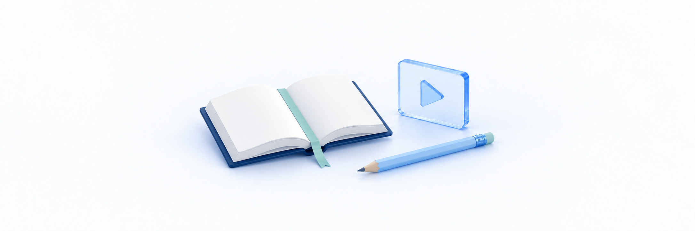

# PC·모바일에서 영상 보기

> **검토용 가이드** · 실제 서비스 화면·동작 확인과 이미지 보완이 남아 있습니다. 본문의 실행 보류·주의사항을 먼저 확인하세요.

<figure><figcaption></figcaption></figure>

강의실에서 **수업 제목을 확인하고 재생을 누른 뒤 화면과 소리를 확인**합니다. PC에서는 측면 도구, 모바일에서는 하단 탭으로 목차 등을 엽니다. 영상 자체의 조작 버튼은 브라우저 또는 YouTube/Vimeo 재생기에 따라 달라집니다.

**완료 기준:** 원하는 수업의 화면·소리를 확인하고, 제공되는 재생/일시정지 조작과 목차 열기/닫기·수업 이동을 구분합니다. 재생 위치·시청 상태·수강완료 표시는 서로 다른 정보이며, 모든 영상의 동일한 조작·이어보기·진도 저장을 보장하지 않습니다.

## 시작 전 확인 

| 확인할 것 | 내용 |
| --- | --- |
| 사이트·계정·수업 | 수강권을 받은 학원 사이트·계정이 맞는지, 열린 강좌와 수업 제목이 원하는 대상인지 확인합니다 |
| 강의실 진입 | 아직 강좌를 찾지 못했다면 [내 강의 찾고 수강 시작하기](find-course-and-start.md)를 먼저 참고합니다 |
| 영상 종류 | 일반 업로드 영상인지 YouTube/Vimeo 외부 영상인지 화면과 안내로 구분합니다 |
| 현재 화면 | 목차 패널·영상 전체화면·기기 전용 재생 화면은 서로 다릅니다. 어떤 화면에 있는지 먼저 확인합니다 |
| 이용 제한 | 기간 만료·시청 한도 안내가 있으면 조작 문제와 구분합니다. 재구매나 제한 우회로 확인하지 않습니다 |

## PC와 모바일의 화면 차이 

| 목적 | PC 화면 | 모바일 화면 |
| --- | --- | --- |
| 영상 보기 | 영상 영역의 재생기 | 영상 영역 또는 기기에서 제공하는 재생 화면 |
| 수업 목록 열기 | 오른쪽 도구의 커리큘럼 | 하단의 목차 |
| 질문/노트 패널 위치 | 오른쪽 도구 또는 열린 패널 옆 Q&A·노트 | 하단 Q&A·노트 또는 열린 패널 옆 탭 |
| 열린 패널 | 영상 옆에 표시 | 강의실을 덮는 화면으로 표시 |
| 영상으로 돌아가기 | 패널 닫기 아이콘으로 닫음 | 패널 닫기 아이콘으로 닫고 재생 화면 확인 |
| 수업 이동 | 화면 아래 이전·다음 또는 목차의 수업 제목 | 강의실 화면의 이전·다음 또는 목차의 수업 제목 |

화면 너비에 따라 도구 배치가 바뀔 수 있습니다. PC 브라우저를 좁혔다고 실제 휴대폰의 재생·소리·전체화면을 검수한 것은 아닙니다.

## 1. PC에서 재생하고 도구 확인하기 

1. 강의실의 수업 제목을 확인합니다. 일반 영상은 준비된 재생기에서 **재생** 아이콘을 누릅니다. 화면이 열렸다고 자동으로 시작되는 것은 아닙니다.
2. 화면이 움직이고 강의 소리가 들리는지 확인합니다. 다른 수업이 열렸거나 제한 안내가 나오면 계속 재생하지 않습니다.
3. 영상을 멈추려면 재생기의 **일시정지**를 누릅니다. 목차나 다른 패널을 여는 동작이 영상을 자동으로 멈춘다고 가정하지 않습니다.
4. 강의실 제목·오른쪽 도구가 숨겨졌다면 영상 주변의 강의실 영역으로 포인터를 옮깁니다. 키보드로 조작하는 경우 포커스가 도구에 있는지도 확인합니다.
5. **커리큘럼**을 열어 수업 목록을 확인합니다. 열린 패널은 상단 **패널 닫기** 아이콘으로 닫습니다.

외부 영상의 내부 영역은 포인터 움직임이 강의실로 전달되지 않을 수 있습니다. 도구가 안 보이면 영상 바깥 강의실 영역을 확인하고, 외부 재생기를 일시정지한 뒤 도구 표시를 확인합니다. 이것을 모든 기기의 공통 해결 방법으로 보장하지는 않습니다.

> **화면 예시 준비 중** · PC에서는 측면 도구에서 목차를 엽니다.

## 2. 소리·재생 위치·배속·전체화면 조절하기 

일반 영상은 **브라우저 기본 재생기**, 외부 영상은 **YouTube/Vimeo 재생기**를 사용합니다. 클킷 공통 설정창이나 동일한 버튼 위치가 있는 것으로 안내하지 않습니다.

| 하고 싶은 일 | 화면에서 확인할 조작 | 주의할 점 |
| --- | --- | --- |
| 재생/일시정지 | 재생 또는 일시정지 아이콘 | 버튼 이름·위치는 재생기에 따라 다를 수 있음 |
| 소리 켜기 | 음소거/스피커 표시와 제공되는 음량 조절 | 기기 음량·실제 소리 출력 대상도 확인. 음량 슬라이더가 모든 기기에 있는 것은 아님 |
| 앞뒤 구간 보기 | 재생 막대에서 원하는 위치 선택 | 건너뛴 구간을 모두 시청한 것으로 보지 않음. 수업의 이전/다음 버튼과 다름 |
| 배속 바꾸기 | 재생기 메뉴에 속도 항목이 있을 때 선택 | 공통 배속 목록·설정 저장·기기 간 동기화를 보장하지 않음 |
| 영상 크게 보기 | 재생기가 제공하는 전체화면 조작 | 강의실 전체와 영상만의 전체화면은 다름. 표시되지 않는 버튼을 찾거나 화면을 강제로 우회하지 않음 |
| 강의실로 돌아오기 | 전체화면/기기 재생 화면의 종료 조작 | 돌아온 뒤 수업 제목·목차 탭이 보이는지 확인 |

자막·화질 선택·작은 창 재생·외부 기기 전송·다운로드는 모든 영상에 공통 제공되는 기능으로 안내하지 않습니다. 재생기에 보이는 항목만 이용하며 별도 앱 설치나 오프라인 저장이 필수라고 설명하지 않습니다.

> **화면 예시 준비 중** · 재생기에 제공되는 조작을 확인합니다.

## 3. 모바일에서 영상 보기 

1. 수강할 수업을 열고 제목을 확인합니다. 영상 영역을 터치해 해당 재생기에서 제공하는 조작을 확인하고 **재생**을 누릅니다.
2. 소리가 들리지 않으면 재생기의 음소거 표시와 기기 음량·연결된 이어폰 등 출력 대상을 확인합니다. 화면에 음량 슬라이더가 없다고 영상 오류로 판단하지 않습니다.
3. 기기 전용 재생 화면이나 전체화면으로 전환됐다면 그 화면의 조작으로 시청합니다. 목차를 보려면 해당 재생 화면을 종료하고 강의실로 돌아옵니다.
4. 하단 **목차**를 누릅니다. 강의실을 덮는 패널이 열리면 원하는 수업 제목을 확인합니다.
5. 다시 영상만 보려면 패널 상단 **패널 닫기** 아이콘을 누릅니다. 닫은 뒤 현재 수업과 재생 상태를 확인합니다.

모바일 화면에 PC 측면 도구가 없는 것은 배치 차이일 수 있습니다. 가로 회전·자동 전체화면·화면을 끈 상태나 다른 앱에서의 계속 재생은 지원 확인 없이 보장하지 않습니다. 화면 잠금·앱 전환 전에 재생기를 일시정지하고, 돌아온 뒤 수업과 위치를 확인합니다.

> **화면 예시 준비 중** · 모바일에서는 하단 목차 탭을 이용합니다.

> **화면 예시 준비 중** · 영상 재생 화면에서 나와 강의실로 돌아옵니다.

## 4. 목차를 열고 영상 화면으로 돌아오기 

1. PC **커리큘럼** 또는 모바일 **목차**를 엽니다.
2. 섹션과 현재 선택된 수업을 확인합니다. 다른 수업을 들을 때만 해당 **수업 제목**을 누릅니다.
3. 패널의 **Q&A·노트** 탭은 수업/학습 정보를 보는 별도 패널입니다. 영상 조절 메뉴나 진도 저장 버튼이 아닙니다.
4. 화면 상단의 **패널 닫기** 아이콘을 눌러 영상으로 돌아옵니다. 패널을 닫으면 영상도 자동 정지·재시작한다고 가정하지 않습니다.

목차의 **자료**는 다운로드 동작입니다. 재생/패널 동작을 확인하기 위해 누르지 않습니다. Q&A·노트가 보여도 새 질문/노트 작성이 항상 허용되는 것은 아니며, 특히 외부 영상·만료 상태의 버튼 표시는 추가 확인 대상입니다. 이 문서에서는 질문/노트 입력이나 자료 발급을 실행하지 않습니다.

> **동작 예시 준비 중** · 목차를 확인한 뒤 패널을 닫습니다.

> **화면 예시 준비 중** · 패널 닫기로 영상 화면에 돌아옵니다.

## 5. 이전·다음 수업으로 이동하기 

1. 영상을 멈출 필요가 있으면 먼저 일시정지합니다. **이전·다음**은 현재 영상 안에서 몇 초 이동하는 버튼이 아닙니다.
2. 강의실 화면의 **이전·다음** 또는 목차의 **수업 제목**으로 이동합니다. 첫/마지막 수업에는 해당 방향 버튼이 비활성화될 수 있습니다.
3. 이동 후 상단 수업 제목이 맞는지 확인하고 새 영상의 재생을 시작합니다. 영상이 끝나면 다음 수업이 자동 재생된다고 가정하지 않습니다.
4. 상단 뒤로 화살표는 **강좌 소개**로 이동합니다. 내 강좌 목록은 사이트의 **마이페이지 → 내 학습 → 수강중 강좌**에서 다시 엽니다.

강의실 화면의 **수강완료**는 상태 표시이며 직접 누르는 완료 처리 버튼이 아닙니다. 외부 영상의 **시청 완료**와도 구분합니다. 표시가 바로 바뀌지 않더라도 끝 구간으로 반복 이동하거나 재생기를 새로 여는 방법으로 완료를 만들지 않습니다.

> **화면 예시 준비 중** · 이전/다음은 영상 구간이 아니라 수업을 이동합니다.

## 6. 일반 영상과 외부 영상의 기록 차이 확인하기 

| 구분 | 일반 업로드 영상 | YouTube/Vimeo 외부 영상 |
| --- | --- | --- |
| 재생기 | 브라우저 기본 재생기 | 해당 서비스 재생기 |
| 이어보기 | 저장된 위치가 있고 미완료인 수업은 그 위치로 이동을 시도 | 클킷에서 진도율·이어보기를 저장/제공하지 않음 |
| 저장 대상 | 허용된 상태에서 시청 구간·재생 위치를 전송 | 허용된 상태에서 재생 시작/종료 이벤트로 재생 여부 기록 |
| 상태 확인 | 목차의 학습 현황·조건부 수강완료 표시 | 표시되는 경우 시청 전·시청 시작·시청 완료 안내 |
| 의미 | 화면의 현재 재생 위치와 실제 누적 진도·완료는 다름 | 시청 완료 이벤트만으로 전 구간 시청·일반 영상 진도 100%를 뜻하지 않음 |

일반 영상도 모든 기기의 정확한 위치 복원·즉시 저장을 보장하지 않습니다. 수업 자동 선택은 가장 최근 시청순 복귀가 아니므로 [강좌 찾기 안내](find-course-and-start.md)에서 수업을 먼저 확인합니다. 이어보기가 기대와 다르면 수업 제목과 위치를 기록하고 문의하며 브라우저 저장정보 삭제로 복구하려 하지 않습니다.

같은 계정으로 재생했더라도 외부 서비스 자체의 기록·로그인 상태를 클킷의 기록으로 보지 않습니다. 학습 진도와 구매 수강권의 환불용 이용 근거도 별도입니다. 상세한 기간/진도 확인은 [수강 기간과 학습 현황 확인하기](access-period-and-progress.md)를 참고합니다.

> **화면 예시 준비 중** · 외부 영상의 시청 상태는 일반 진도와 다릅니다.

## 재생이나 조작이 안 될 때 

| 상황 | 확인할 것·다음 행동 |
| --- | --- |
| 재생 버튼·소리 조절이 안 보여요 | 목차 패널/전체화면 여부와 실제 재생기를 먼저 확인합니다. PC는 포인터, 모바일은 해당 재생기 터치로 조작을 확인합니다 |
| 소리가 안 들려요 | 재생기 음소거·기기 음량·출력 대상을 확인합니다. 계속 무음이면 수업명과 상황을 학원에 전달합니다 |
| 배속/전체화면 항목이 없어요 | 기기/브라우저·영상 종류별 제공 차이를 확인합니다. 공통 버튼이 있다고 가정하거나 확장 프로그램 설치/보안 해제를 안내하지 않습니다 |
| 영상 준비 중입니다.가 계속 보여요 | 영상 변환이 진행 중이라는 확정 안내는 아닙니다. 수업명·시각·문구를 기록해 문의합니다 |
| 이 영상 파일을 재생할 수 없습니다. | 파일/디코딩 문제 등은 주소 재발급으로 해결되지 않을 수 있습니다. 반복 시도보다 안내를 전달합니다 |
| 영상을 불러오지 못했습니다. / 영상 주소를 새로 받지 못했습니다. | 표시된 다시 시도는 재생 정보를 다시 요청하는 동작입니다. 반복 클릭하지 않고 제한 안내로 바뀌는지 확인하며 계속 실패하면 문의합니다 |
| 외부 영상이 비어 있거나 서비스 오류가 보여요 | 외부 영상 종류·화면 문구를 학원에 전달합니다. 학생이 공개 설정/허용 도메인을 바꾸거나 비공개 링크를 받아 우회하지 않습니다 |
| 기간 만료·월 시청시간 한도 안내가 나와요 | 이용 권한/사이트 한도 안내입니다. 재생기 조작으로 우회하거나 학생이 클킷 플랜/팩을 구매하는 절차가 아닙니다 |
| 영상이 멈추거나 끊겨요 | 표시 문구·기기/브라우저·접속 환경과 발생 구간을 기록합니다. 새로고침/재생 반복으로 결과를 만들지 않습니다 |

외부 재생기의 오류 문구가 항상 클킷의 별도 오류창에 표시되는 것은 아닙니다. 로그인 화면으로 이동했다면 로그인 후 내 학습에서 다시 수업을 찾고, 지원 브라우저/최소 버전·기기 수·속도 수치는 학원의 확인된 안내를 따릅니다.

> **화면 예시 준비 중** · 오류와 이용 제한을 구분해 학원에 전달합니다.

## 학원에 문의할 때 

학원 사이트 주소, 계정 식별에 필요한 최소 정보, 강좌·수업 제목, 일반/YouTube/Vimeo 구분, 발생 시각·재생 위치, PC/모바일·기기/브라우저 종류, 표시 문구, 화면/소리 중 어떤 문제가 있는지 전달합니다. 목차 패널이나 전체화면에서만 발생하는지도 함께 적습니다.

**비밀번호·인증번호·세션/토큰·영상/자료 URL·Vimeo 접근키는 보내지 않습니다.** 개인정보와 주소창을 가린 캡처만 전달합니다. 로그인할 수 없으면 학원이 별도로 안내한 연락처를 사용하며 로그인 후 1:1 문의만을 유일한 창구로 안내하지 않습니다.

## 완료 확인 

- [ ] 현재 학원 사이트·계정과 강좌/수업 제목을 확인했다.
- [ ] 일반 영상과 YouTube/Vimeo의 재생기·기록 차이를 구분했다.
- [ ] 실제 재생/일시정지와 화면·소리를 확인했다.
- [ ] 제공되는 음량/재생 위치·배속/전체화면 조작만 이용했다.
- [ ] PC 측면 커리큘럼과 모바일 하단 목차 위치를 구분했다.
- [ ] 목차 패널을 닫고 영상으로 돌아오는 방법을 확인했다.
- [ ] 이전/다음 수업 이동과 재생 위치 이동·소개 복귀를 구분했다.
- [ ] 현재 위치·이어보기·시청 완료·수강완료를 같은 결과로 보지 않았다.
- [ ] 제한·오류가 계속되면 반복 재생/재구매 없이 필요한 정보만 학원에 전달했다.

## 관련 안내 

- [영상이 재생되지 않거나 끊겨요](../troubleshooting/video-and-audio.md)

- [학습 질문 올리고 답변 확인하기](../communication/learning-qna.md)
- [강의 첨부 자료 받기](../resources/lecture-materials.md)
- [수강 기간과 학습 현황 확인하기](access-period-and-progress.md)
- [내 강의 찾고 수강 시작하기](find-course-and-start.md)
- [내 계정과 로그인 방식 확인하기](../account/check-account-and-login-method.md)
- [가이드 홈](../README.md)
