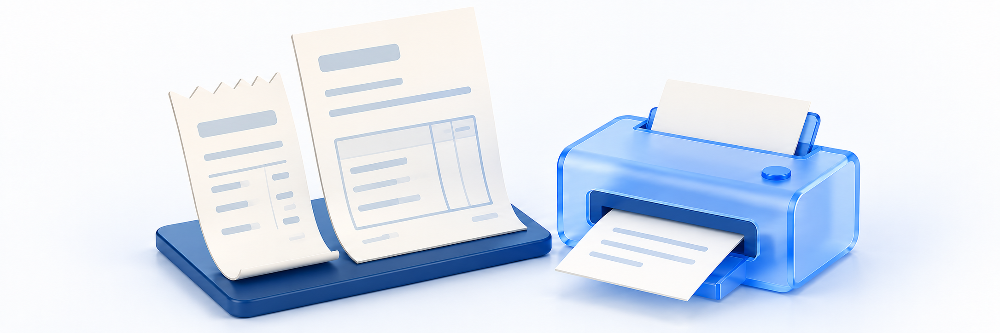

# 영수증·거래명세서 보기

> **이용 전 확인** · 사용할 수 있는 기능과 화면이 아직 확인되지 않은 항목이 있습니다. 화면이나 안내가 다르면 학원에 확인하고, 문서에서 멈추도록 안내한 작업은 진행하지 마세요.

<figure><figcaption></figcaption></figure>

구매 증빙이나 거래 내용을 확인하려면 **마이페이지 → 구매 내역 → 결제 → 해당 주문**을 엽니다. **주문번호 확인 → 영수증 또는 거래명세서 선택 → 내용 대조 → 필요한 경우 인쇄/저장** 순서로 진행합니다.

**문서를 받았다면:** 종류와 금액·품목·공급자 정보가 맞는지 확인합니다. 파일이 필요하면 저장한 파일을 열어 보세요. 내용이 빠졌거나 주문과 다르면 제출 전에 학원에 문의합니다.

## 시작 전 확인 

| 확인할 것 | 내용 |
| --- | --- |
| 사이트와 계정 | 구매한 학원 사이트와 계정으로 로그인합니다. 보호자나 다른 계정의 주문을 현재 계정에서 대신 조회할 수 있다고 가정하지 않습니다 |
| 찾을 주문 | 주문명·금액·시각을 대조한 뒤 상세의 주문번호를 확인합니다. 주문을 찾는 방법은 [주문·결제 내역 확인하기](order-and-payment-history.md)를 참고합니다 |
| 필요한 문서 | 영수증과 거래명세서는 다릅니다. 제출처가 요구하는 문서 종류를 먼저 확인하며 거래명세서를 세금계산서·현금영수증·카드매출전표로 대신 제출하지 않습니다 |
| 인쇄와 저장 | 현재 거래명세서의 **PDF 다운로드 / 인쇄하기**는 둘 다 브라우저 인쇄 창을 엽니다. 버튼을 누르는 것만으로 파일 저장이나 프린터 출력이 완료되는 것은 아닙니다 |
| 개인정보 | 본인 기기와 필요한 담당자에게만 문서를 보관·전달합니다. 비밀번호·인증번호·카드 전체 번호·결제 키·영수증 URL은 문의나 공개 캡처에 넣지 않습니다 |

운영자의 클킷 구독 청구서·판매자 정산명세서와 수강생의 구매 거래명세서는 다른 문서입니다. 학습 자료를 내려받는 메뉴와도 구분합니다.

## 1. 주문 상세에서 문서 버튼 찾기 

1. **마이페이지 → 구매 내역 → 결제**에서 해당 주문을 선택합니다.
2. 상세의 **주문번호**, 상품과 결제 정보를 확인합니다. 같은 상품의 다른 주문과 혼동하지 않습니다.
3. 결제 정보 아래의 **영수증 / 거래명세서**를 찾습니다. 영수증 버튼은 주문에 따라 보이지 않거나 비활성일 수 있습니다.

취소·환불 상태가 보이더라도 문서 열기를 위해 **취소 / 전체 취소**를 누르지 않습니다. 구매 내역에 주문이 없다는 사실만으로 미결제로 판단하거나 새로 결제하지 않습니다.

> **화면 예시 준비 중** · 해당 주문을 확인하고 필요한 문서 버튼을 찾습니다.

## 2. 영수증 열고 주문과 대조하기 

| 버튼 상태 | 다음 행동 |
| --- | --- |
| 영수증을 누를 수 있어요 | **영수증**을 눌러 별도 창 또는 탭으로 열린 결제 영수증을 확인합니다 |
| 영수증 버튼이 비활성이에요 | 영수증 주소가 없는 상태일 수 있습니다. 결제 여부를 버튼만으로 판단하지 말고 주문 정보와 학원 안내를 확인합니다 |
| 0원 결제라 영수증이 안 보여요 | 0원 결제 수단으로 기록된 주문은 영수증 버튼이 숨겨집니다. 유료 결제 영수증을 만들기 위해 다시 결제하지 않습니다 |
| 다른 창이 열리지 않아요 | 브라우저의 새 창 차단 안내가 있는지 확인합니다. 필요한 사이트에 한해 허용할 수 있지만 전체 보안 설정을 해제하지 않습니다 |

영수증에서는 표시된 주문·금액·승인/취소 정보를 원 주문(해당 상품을 구매한 주문)과 대조합니다. 외부 영수증의 항목·인쇄/저장 메뉴는 결제 제공사와 기기에 따라 다를 수 있으므로 사이트 거래명세서와 같은 버튼·형식을 기대하지 않습니다.

확인한 뒤 영수증 창/탭을 닫고 원래 주문 상세로 돌아갑니다. 주소를 복사해 다른 사람에게 전달하거나, 주소의 주문·결제 식별자를 바꿔 다른 문서를 열지 않습니다.

> **화면 예시 준비 중** · 영수증 제공 조건과 별도 창을 확인합니다.

## 3. 거래명세서의 기본 정보 확인하기 

1. 원래 주문 상세에서 **거래명세서**를 누릅니다. 같은 화면 안에서 거래명세서 보기로 전환됩니다.
2. 불러오기가 끝난 뒤 주문 상세에서 확인한 주문번호와 문서의 주문번호를 대조합니다.
3. 거래일자·공급자·품목·합계를 확인합니다. 빈 항목이나 맞지 않는 값이 있으면 인쇄/제출 전에 학원에 문의합니다.

| 보이는 항목 | 확인할 것 |
| --- | --- |
| 주문번호 | 해당 구매 주문이 맞는지 확인합니다. 주문명이나 영수증의 다른 식별자와 혼동하지 않습니다 |
| 거래일자 | 결제 시각을 우선 사용하지만 값이 없으면 주문 생성 시각일 수 있습니다. 날짜 표시만으로 승인 완료를 판단하지 않습니다 |
| 공급자 | 등록번호·상호/대표자·주소·연락처를 확인합니다. 일부 `-`나 누락 안내가 있으면 현재 사업자 정보를 임의로 채우지 않습니다 |
| 품명·수량 | 구매한 상품/옵션과 비교합니다. 이 표는 강좌·자료 지급이나 교재 배송 완료를 확인하는 곳이 아닙니다 |
| 단가·공급가액·세액 | 표시값을 확인하되 단가×수량으로 최종액을 다시 확정하지 않습니다. 할인·쿠폰·구성에 따라 금액의 표시 기준을 확인할 필요가 있습니다 |
| 합계·총계·쿠폰 할인 | 결제 정보와 대조합니다. 쿠폰 할인이 별도로 보인다고 합계에서 다시 빼거나 누락값을 0원으로 채우지 않습니다 |

**거래명세서는 거래 내용을 확인하는 문서이며 영수증이나 세금계산서 발급 메뉴가 아닙니다.** 다른 증빙이 필요하면 학원에 필요한 문서 종류를 알려 확인합니다. 거래명세서가 보인다는 사실만으로 제출 요건 충족을 판단하지 않습니다.

> **화면 예시 준비 중** · 주문번호와 거래명세서의 기본 내용을 대조합니다.

> **동작 예시 준비 중** · 거래명세서를 확인하고 주문 상세로 돌아갑니다.

## 4. 취소 주문과 0원·누락 정보를 구분하기 

| 상황 | 읽는 방법·다음 행동 |
| --- | --- |
| 취소 거래명세서가 보여요 | 취소일자와 합계를 확인하고 원 결제·취소 금액·실제 결제수단 반영을 구분합니다. 부분 취소도 이 제목으로 표시될 수 있어 전액 환불로 단정하지 않습니다 |
| 합계와 품목/총계가 맞지 않아요 | 취소 후 합계와 원거래 품목·세액이 서로 다른 기준일 수 있습니다. 직접 세액을 다시 계산하거나 파일을 수정하지 말고 문의합니다 |
| 면세·과세 상품이나 배송비가 섞였어요 | 화면에 전체 구분이 따로 표시되지 않을 수 있습니다. 세액·배송비가 정확히 구분됐다고 가정하거나 모든 금액에 같은 세율을 적용하지 않습니다 |
| 0원 주문 또는 직접 지급이에요 | 유료 결제 영수증 제공과 구분합니다. 직접 지급한 수강권이 구매 목록에 반드시 생기거나 모든 0원 주문의 거래명세서가 열리는 것은 아닙니다 |
| 공급자가 없거나 -로 보여요 | 기록 누락이나 조회 문제일 수 있습니다. 안내 문구·주문번호를 학원에 전달하고 현재 정보로 대신 작성하지 않습니다 |
| 불러오기가 끝났는데 일부 내용만 보여요 | 화면에 주문번호·품목이 남아 있어도 거래명세서 조회 성공을 보장하지 않습니다. 금액/공급자가 빠졌다면 저장·제출을 멈추고 문의합니다 |

**표시 금액이 맞지 않거나 필요한 정보가 누락됐다면 출력본도 그대로 제출하지 않습니다.** 취소 신청·환불 요청이 접수된 것과 확정 취소가 문서에 반영된 것, 카드/은행의 실제 환불 반영은 각각 다릅니다.

> **화면 예시 준비 중** · 취소와 누락 정보를 구분하고 불일치 시 문의합니다.

## 5. 필요한 경우 브라우저에서 인쇄하거나 저장하기 

1. 거래명세서 불러오기가 끝났고 필요한 내용이 맞는지 먼저 확인합니다. 불러오는 중이거나 정보가 불명확하면 출력하지 않습니다.
2. **PDF 다운로드** 또는 **인쇄하기**를 누릅니다. 현재 두 버튼 모두 브라우저 인쇄 창을 엽니다. 파일이 자동 다운로드되지 않는다고 버튼을 반복해서 누르지 않습니다.
3. 인쇄 미리보기에서 주문번호·품목·합계가 잘리지 않는지, 빈 페이지나 다른 화면 내용이 섞이지 않았는지 확인합니다. 문제가 있으면 취소하고 학원에 문의합니다.
4. 종이 출력이 필요하면 사용할 프린터와 출력 범위를 확인합니다. PDF 파일이 필요하고 브라우저가 PDF 저장 대상을 제공하면 해당 대상을 선택한 뒤 저장 위치와 파일명을 확인합니다.
5. 원하는 출력/저장을 마칩니다. 필요 없다면 인쇄 창을 취소해 닫습니다. 취소는 주문 취소가 아닙니다.

브라우저·운영체제·모바일 환경마다 인쇄 창과 PDF 저장 항목이 다릅니다. 모바일에서 저장 항목이 없거나 문서가 잘리면 PC에서 다시 확인하거나 학원에 문의합니다. 저장 버튼·파일명·저장 위치는 현재 사용하는 브라우저에서 확인하며, 모든 환경에 같은 버튼이나 고정 파일명·자동 저장 위치가 제공되는 것은 아닙니다.

현재 화면의 **PDF 다운로드**는 브라우저 출력 동작입니다. 별도의 PDF 파일을 자동으로 내려받거나 세금계산서를 새로 발급하는 기능은 아닙니다.

> **화면 예시 준비 중** · 브라우저 인쇄 창에서 필요한 출력 방식을 확인합니다.

## 6. 실제 파일을 확인하고 주문 상세로 돌아가기 

1. PDF로 저장했다면 선택한 위치에서 **실제 파일**을 엽니다. 인쇄 창을 닫았거나 다운로드 버튼을 눌렀다는 사실만으로 저장 완료로 판단하지 않습니다.
2. 파일의 주문번호·공급자·품목/수량·금액·필요한 모든 페이지를 확인합니다. 빈 파일·깨진 글자·잘림·다른 주문이면 제출하지 않습니다.
3. 공유가 필요하면 제출처가 요구한 문서인지 확인하고 필요한 수신자에게만 전달합니다. 공용 기기에 파일을 남기거나 공개 링크로 배포하지 않습니다.
4. 거래명세서 제목 왼쪽의 뒤로 버튼을 눌러 **주문 상세**로 돌아갑니다. 주문 상세에서 목록 복귀와 취소/전체 취소를 구분합니다.

종이 출력도 실제 출력물의 내용·페이지를 확인합니다. 문서를 열거나 저장한 것만으로 강좌/자료 지급·교재 배송·환불 처리가 완료되는 것은 아닙니다.

> **화면 예시 준비 중** · 실제 파일 내용을 확인하고 필요한 곳에만 전달합니다.

## 문서를 열거나 저장할 수 없을 때 

| 상황 | 확인할 것·다음 행동 |
| --- | --- |
| 원 주문이 보이지 않아요 | 구매한 사이트·계정·직접 지급 여부와 목록 범위를 확인합니다. 재결제로 문서를 만들지 않습니다 |
| 주문을 찾을 수 없습니다. | 내 결제 목록으로 돌아가 해당 주문을 확인합니다. 조회 오류도 같은 화면일 수 있으므로 삭제/취소로 단정하거나 주소를 추측하지 않습니다 |
| 영수증이 숨김/비활성이에요 | 0원 결제와 영수증 주소 유무를 구분하고 학원에 문의합니다. 다른 사람의 URL을 사용하지 않습니다 |
| 영수증 새 창이 열리지 않아요 | 브라우저의 차단 안내·사이트 허용 여부를 확인합니다. 보안 설정을 일괄 해제하거나 영수증 주소를 외부에 공유하지 않습니다 |
| 거래명세서 일부만 보이거나 공급자를 불러오지 못했어요 | 로딩이 끝났는지 확인하고 주문 상세로 돌아가 재확인합니다. 누락된 상태로 저장/제출하거나 자체 재발급하지 않습니다 |
| 합계·세액·취소 금액이 예상과 달라요 | 원 결제·확정 취소·현재 표시값을 나눠 문의합니다. 임의 재계산·문서 편집으로 맞추지 않습니다 |
| PDF 다운로드를 눌렀는데 인쇄 창이 떠요 | 현재 화면에서는 이 버튼이 브라우저 인쇄 창을 엽니다. 브라우저가 제공하는 PDF 저장 대상을 확인합니다. 저장 성공 여부는 실제 파일로 확인합니다 |
| 인쇄 창이 없거나 모바일에서 잘려요 | 기기/브라우저와 화면 문구를 기록합니다. PC에서 확인하거나 문의하며, 모든 기기에서 같은 저장 기능을 보장하지 않습니다 |
| 파일이 없거나 내용이 깨져요 | 실제 저장 위치·선택한 파일·전체 페이지를 확인합니다. 문제가 있는 파일은 제출하지 않고 필요한 정보만 문의합니다 |

> **화면 예시 준비 중** · 문제가 생긴 화면과 결과를 구분해 문의합니다.

## 학원에 문의할 때 

[사이트에 1:1 문의하기](../communication/site-inquiries.md)에서 주문번호·상품명, 필요한 문서 종류, 버튼 상태·화면 문구·표시 금액과 발생 시각·기기/브라우저를 전달합니다. 영수증 외부 창·거래명세서 화면·인쇄 미리보기·실제 파일 중 어디에서 문제가 생겼는지 구분합니다. 로그인할 수 없다면 학원의 별도 연락처를 이용합니다.

**비밀번호·인증번호·카드/계좌 전체 정보·결제 키/토큰·영수증 URL·타인의 주문은 보내지 않습니다.** 전체 문서를 공개 댓글이나 공용 링크로 올리지 말고, 필요한 부분만 가린 캡처를 전달합니다. 실제 증빙 제출과 오류 문의용 캡처를 구분합니다.

## 완료 확인 

- [ ] 구매한 학원 사이트·계정과 주문번호를 확인했다.
- [ ] 영수증·거래명세서·세금계산서와 운영자 구독/정산 문서를 구분했다.
- [ ] 영수증 활성·주소 없음·0원 숨김과 별도 창을 구분했다.
- [ ] 거래명세서의 주문번호·거래일자·공급자·품목/수량을 대조했다.
- [ ] 취소·0원·직접 지급과 누락 금액/공급자·혼합 세금 표시를 구분했다.
- [ ] 금액이 맞지 않거나 정보가 빠졌다면 임의 보정·제출을 멈췄다.
- [ ] PDF 다운로드와 인쇄하기가 모두 브라우저 인쇄 동작임을 확인했다.
- [ ] 저장/출력이 필요했다면 실제 파일/출력물의 내용과 전체 페이지를 확인했다.
- [ ] 필요한 수신자에게만 전달하고 조회·뒤로 이동과 주문 취소를 구분했다.

## 관련 안내 

- [취소·반품·교환 처리 상태 확인하기](../cancellations/request-status.md)
- [교재 반품·교환 신청하기](../cancellations/request-return-or-exchange.md)
- [상품 취소·환불 신청하기](../cancellations/request-cancellation.md)

- [내 계정과 로그인 방식 확인하기](../account/check-account-and-login-method.md)
- [상품 구성·가격·이용 기간 확인하기](../purchase/product-and-access-period.md)
- [결제하고 무료 상품 신청하기](../purchase/payment-and-free-order.md)
- [주문·결제 내역 확인하기](order-and-payment-history.md)
- [사이트에 1:1 문의하기](../communication/site-inquiries.md)
- [가이드 홈](../README.md)
