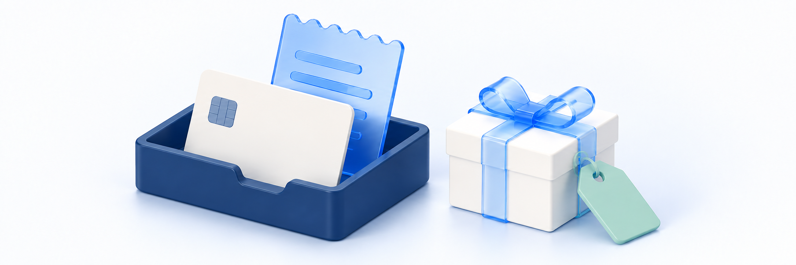

# 결제하고 무료 상품 신청하기

> **검토용 가이드** · 실제 서비스 화면·동작 확인과 이미지 보완이 남아 있습니다. 본문의 실행 보류·주의사항을 먼저 확인하세요.

<figure><figcaption></figcaption></figure>

구매할 상품과 최종 금액을 확인한 뒤 **유료 결제 또는 0원 신청**을 진행합니다. 완료 안내 뒤에는 **원래 주문의 상태**와 **구매한 콘텐츠의 이용 가능 여부**를 따로 확인합니다.

**완료 기준:** 본인 계정의 주문번호·상품·금액·처리 상태를 확인합니다. 강좌·자료·교재는 각각 맞는 경로에서 제공 여부를 확인하며, 결제 결과가 불명확하거나 이용 권리가 보이지 않으면 다시 구매하지 않고 학원에 문의합니다.

## 시작 전 준비 

| 준비할 것 | 확인할 내용 |
| --- | --- |
| 구매할 계정 | 학원 사이트·로그인 계정이 맞는지 확인합니다. 다른 계정의 주문이나 수강권이 자동으로 합쳐지지 않습니다 |
| 상품과 옵션 | 포함 강좌·자료·교재, 별도 옵션과 이용 기간을 확인합니다. 장바구니나 주문서에 옵션 명세가 모두 표시된다고 가정하지 않습니다 |
| 최종 금액과 조건 | 쿠폰 할인·배송비를 포함한 금액과 구매조건을 확인합니다. 상품의 무료 표시만으로 전체 주문이 0원이라고 판단하지 않습니다 |
| 기존 주문 | 결제창을 닫았거나 출금/승인 알림을 받았다면 기존 주문부터 확인합니다. 새로운 주문으로 결과를 확인하지 않습니다 |
| 교재 배송 정보 | 배송 상품이 있으면 받는 사람·주소를 확인할 수 있어야 합니다. 배송지 확인·변경 방법을 확인할 수 없으면 결제부터 진행하지 않습니다 |

계정은 [내 계정과 로그인 방식 확인하기](../account/check-account-and-login-method.md), 구성과 기간은 [상품 구성·가격·이용 기간 확인하기](product-and-access-period.md), 선택·쿠폰은 [장바구니와 쿠폰 이용하기](cart-and-coupons.md)를 먼저 참고합니다.

> **주문서 진입은 단순한 화면 열람이 아닙니다.**
> 조건이 갖춰지면 주문이 자동 생성되며 쿠폰·재고 예약으로 이어질 수 있습니다. 최종 금액이 0원이면 별도 결제 버튼을 누르기 전에 신청 처리가 진행될 수 있습니다. 구매할 상품과 금액을 확인한 뒤에만 **주문서 작성**을 누릅니다.

## 먼저 내 상황 고르기 

| 상황 | 진행할 단계 | 먼저 구분할 것 |
| --- | --- | --- |
| 결제할 금액이 있어요 | 주문서 확인 → 결제수단/필수 동의 → 결제 → 원 주문 확인 | 주문 생성과 결제 승인 |
| 최종 금액이 0원이에요 | 구매 조건 확인 → 주문서 진입 → 신청 결과/원 주문 확인 | 무료 신청도 계정에 남는 주문이며 단순 미리보기가 아님 |
| 교재가 포함돼 있어요 | 배송지·배송비 확인이 가능한지 먼저 확인 | 주소록, 주문에 반영된 배송지, 실제 배송 시작 |
| 결제 중 화면이 멈췄어요 | 기존 주문·승인/출금 안내 확인 → 필요하면 문의 | 오류 화면과 실제 결제 실패 |
| 입금대기 또는 처리 중이에요 | 원 주문 상태와 학원의 확인된 안내 확인 | 계좌 발급/접수와 입금·결제 완료 |
| 학원이 수강권을 지급했어요 | 본인 계정의 학습 목록 확인 | 직접 지급과 상품 구매. 결제부터 다시 하지 않음 |

## 1. 주문서로 이동하고 구매 내용 확인하기 

1. 장바구니에서 구매할 상품·옵션·쿠폰과 금액을 확인합니다. 선택한 내용이 불명확하거나 기존 주문 결과를 확인 중이라면 여기서 멈춥니다.
2. 구매를 진행할 때만 **주문서 작성**을 누릅니다. 주문서 준비 중에는 새로고침하거나 버튼을 반복해서 누르지 않습니다.
3. 유료 주문은 **결제하기** 화면의 상품명·상품 수와 **결제 확인**을 읽습니다. **상품 금액·할인 금액·쿠폰 할인·배송비·최종 결제 금액** 중 표시된 항목을 확인합니다.
4. 장바구니와 예상한 금액·할인 조건이 다르면 결제 버튼을 누르지 않습니다. 선택 상품이나 쿠폰이 바뀌었다는 안내가 나오면 최신 조건을 다시 확인합니다.
5. 0원 주문이 완료 화면으로 바로 이동하면 아래 무료 신청 결과 확인 단계로 이어갑니다. 결제수단 선택 화면이 나오지 않는 것만으로 오류라고 판단하지 않습니다.

주문서의 상품 행에 옵션 이름·수량이 모두 보이지 않을 수 있습니다. **상품 수나 합계만으로 포함 교재·추가 옵션을 확정하지 않습니다.** 주문서로 이동하면서 쿠폰이 제외되었는지도 확인합니다. 화면의 금액과 결제창의 요청 금액이 다르면 중단하고 문의합니다.

> **화면 예시 준비 중** · 상품과 실제 최종 결제 금액을 확인합니다.

## 2. 교재가 있다면 배송 정보 확인하기 

배송 상품이 포함되면 배송지와 배송비 확인이 필요합니다. 강좌·디지털 자료만 있는 주문과 다르며, 무료 교재도 배송비가 있으면 전체 주문은 0원이 아닐 수 있습니다.

**배송지 확인:** 배송지 영역에 선택한 수령 정보와 **배송지 설정**이 있으며 주소가 없으면 **배송지 설정하기**가 표시됩니다. 내용을 확인한 뒤 **이 배송지로 결제 계속하기**를 누르면 주문 생성이 이어질 수 있습니다. 배송 정보만 살펴보거나 오류를 확인하려는 목적으로 이 버튼을 누르지 않습니다.

| 화면·상황 | 할 일 |
| --- | --- |
| 배송지가 없거나 바꾸려 해요 | 배송지 설정에서 본인 수령 정보·선택 결과를 확인합니다. 창 열기/주소 저장과 주문의 배송 정보 확인은 별도이며 실제 반영 결과와 변경 권한은 아직 확인이 필요합니다 |
| 저장 주소가 자동 선택돼 있어요 | 수령인·주소·연락처·요청사항과 배송비를 먼저 읽습니다. 자동 선택을 확인 완료로 보지 않으며 변경 후에는 다시 확인합니다 |
| 예전 배송지가 저장돼 있어요 | 주소록을 바꾸면 이미 생성된 주문도 자동 변경된다고 가정하지 않습니다 |
| 결제 후 배송지를 바꾸고 싶어요 | 원 주문의 배송 정보와 [교재 배송/배송지](../orders/textbook-shipping-and-address.md)의 허용 조건을 확인합니다. 주소록 수정이나 재주문으로 해결하지 않습니다 |

배송지 확인에서 주문 생성으로 이어지는 과정은 검토했지만, 실제 서비스 화면과 주소·배송비 반영 결과는 아직 확인이 필요합니다. 배송 정보 확인 전에는 배송 상품의 주문 생성을 기다리고, 확인 후에는 유료 결제 또는 최종 0원 주문 처리가 이어질 수 있습니다. 확인 뒤 주소를 바꾸려고 원 주문을 반복 생성하지 않습니다.

> **화면 예시 준비 중** · 배송 정보 확인은 주문 생성으로 이어질 수 있습니다.

## 3. 유료 상품 결제하기 

1. 주문서의 최종 금액과 구매 내용을 확인합니다. **구매조건·개인정보처리방침**에서 필요한 내용을 읽습니다.
2. 결제 영역에서 **실제로 표시되는 결제수단**을 선택합니다. 모든 사이트에서 같은 카드·간편결제·계좌 수단이 제공된다고 가정하지 않습니다.
3. 결제 영역의 필수 동의 내용을 확인하고 동의합니다. 버튼이 비활성이라면 결제수단 준비·필수 동의·배송지 안내부터 확인합니다.
4. **N원 결제하기**를 누릅니다. 열린 결제창에서도 상품과 결제 금액을 확인하고 해당 수단의 안내에 따라 진행합니다.
5. 사이트로 돌아와 `결제를 승인하는 중입니다...`가 보이면 결과를 기다립니다. 창을 여러 개 열거나 같은 결제를 연속 시도하지 않습니다.
6. 결과가 표시되면 주문번호·금액을 기록하고 아래 원 주문 확인 단계로 이동합니다. 카드/은행 알림과 사이트 결과가 다르면 재결제하지 않습니다.

버튼을 누름·결제창 열림·외부 인증 완료는 사이트의 주문/결제 확정과 다릅니다. 에스크로 선택이나 특정 결제수단의 실제 제공 여부와 상세 절차는 아직 확인이 필요하므로, 화면에 없는 체크박스나 결제수단이 제공된다고 가정하지 않습니다.

> **화면 예시 준비 중** · 표시된 수단과 필수 동의·요청 금액을 확인합니다.

> **화면 예시 준비 중** · 금융 결과와 콘텐츠 제공 결과를 나눠 확인합니다.

## 4. 무료 상품 또는 최종 0원 주문 신청하기 

1. 주문서로 이동하기 **전에** 장바구니의 상품·옵션·쿠폰과 최종 금액을 확인합니다. 배송비나 유료 옵션이 있으면 무료 표시 상품도 결제가 필요할 수 있습니다.
2. 신청할 때만 **주문서 작성**을 누릅니다. 현재 흐름은 조건이 맞는 0원 주문을 자동 처리하므로 별도 **무료 신청** 버튼을 찾지 않습니다.
3. 완료 안내가 나오면 주문번호와 **0원 결제** 표시를 확인합니다. 화면이 준비되지 않거나 결과가 불명확하면 주문서 재진입을 반복하지 않습니다.
4. **결제 내역 보기** 또는 **마이페이지 → 구매 내역 → 결제**에서 같은 계정의 해당 주문을 확인합니다. 화면 문구만으로 신청 성공을 확정하지 않습니다.
5. 구매한 콘텐츠에 맞는 학습/자료 경로에서 실제 제공 여부를 확인합니다. 없다면 다시 신청하지 말고 원 주문번호로 학원에 문의합니다.

무료 주문은 외부 결제창을 거치지 않을 수 있지만 **주문·쿠폰 처리·이용 권리 지급은 별도**입니다. 무료 미리보기나 학원의 직접 수강권 지급과도 다릅니다. 현재 0원 결과 화면은 시스템에서 원래 주문을 조회하고 처리 중·오류 여부를 확인한 뒤, 결과에 따라 **주문이 완료되었습니다**·**구매 내역 보기**를 표시합니다. 완료 문구만으로 강좌/자료 이용·교재 배송을 판단하지 않으며 교재/자료만 신청했다면 강좌가 생긴다고 보지 않습니다.

> **화면 예시 준비 중** · 0원 표시와 원 주문의 실제 처리 결과를 확인합니다.

## 5. 원 주문과 실제 제공 내용 확인하기 

1. 결과 화면의 **결제 내역 보기**를 누르거나 **마이페이지 → 구매 내역 → 결제**로 이동합니다.
2. 상품명·금액·주문 시점을 대조해 해당 주문을 엽니다. 상세의 **주문번호·주문 상태·최종 결제 금액·결제 수단**을 확인합니다. 한 목록의 빈 표시나 조회 오류만으로 주문이 없다고 판단하지 않습니다.
3. 유료 결제·0원 신청 모두 상태를 확인합니다. **결제대기**는 완료가 아니며, 상태가 불명확하거나 출금/승인 안내와 다르면 학원에 문의합니다.
4. 결제 완료를 확인한 뒤에도 실제 제공 내용은 아래 경로에서 각각 확인합니다. 목록이 비었다면 계정·필터·조회 오류와 지급 지연을 구분합니다.

| 구매한 구성 | 확인할 경로·정보 | 완료 화면과 구분할 것 |
| --- | --- | --- |
| 강좌 | 마이페이지 → 내 학습 → 수강중 강좌에서 대상 강좌·이용 상태/기간 확인 | 결제 완료가 즉시 강좌 지급·재생 성공을 보장하지 않음 |
| 별도 디지털 자료 | 마이페이지 → 내 학습 → 내 자료에서 대상 자료·이용 가능 상태 확인 | 목록 확인과 다운로드 URL 발급·실제 저장은 별도 |
| 강의 첨부자료 | 지급된 강좌의 해당 수업 자료 안내 확인 | 별도 내 자료에 반드시 등록되는 것은 아님 |
| 교재 | 해당 주문번호·구매 구성 확인 후 학원의 배송 안내 확인 | 결제 완료가 배송 생성·발송·수령 완료는 아님 |
| 혼합/묶음 상품 | 포함된 강좌·자료·교재 각각 확인 | 한 강좌가 보이는 것만으로 전체 구성 지급을 확정하지 않음 |

결과 화면의 **내 강좌 보러가기**는 강좌 목록으로 이동하는 버튼입니다. 자료·교재 전용 주문의 공통 완료 화면에 있어도 해당 상품의 이용/배송 경로를 대신하지 않습니다.

**영수증 보기**는 결과 화면에 표시된 경우에만 이용합니다. 0원 주문이나 해당 정보가 없는 결제에도 항상 제공된다고 안내하지 않습니다. 영수증과 거래명세서, 콘텐츠 지급·배송 결과는 서로 다릅니다.

> **화면 예시 준비 중** · 결제·구성품 제공·배송/신청은 다른 결과입니다.

> **동작 예시 준비 중** · 새 주문을 만들지 않고 기존 주문을 확인합니다.

> **화면 예시 준비 중** · 구매한 구성에 맞는 경로에서 제공 여부를 확인합니다.

## 6. 결제 실패·입금대기·결과 불명확에 대응하기 

| 상황 | 먼저 할 일 | 하지 않을 일 |
| --- | --- | --- |
| 결제창을 닫았거나 실패 화면이 나왔어요 | 표시된 사유·원 주문과 카드/은행 안내 확인 | 실패 화면만으로 주문 취소·출금 없음·쿠폰 반환을 단정하지 않음 |
| 결제 확정 진행 중이라고 나와요 | 잠시 후 기존 주문 내역에서 상태 확인. 계속 불명확하면 문의 | 새 주문·다른 결제수단으로 중복 결제하지 않음 |
| 결제 세션/주문 정보가 맞지 않아요 | 계정·기존 주문번호·금액 확인 후 문의 | 주소창 수정·브라우저 저장정보 삭제로 복구하거나 결과 URL을 공유하지 않음 |
| 승인/출금 알림은 왔는데 오류예요 | 같은 주문의 처리 상태를 학원에 확인 | 오류를 미결제로 단정하거나 재결제부터 하지 않음 |
| 가상계좌/입금대기 안내가 있어요 | 실제 제공된 계좌·기한과 원 주문 상태를 학원의 확인된 안내로 대조 | 완료 제목만으로 입금 완료로 보거나 임의 계좌로 송금하지 않음 |
| 0원 완료 화면인데 주문/콘텐츠가 없어요 | 현재 계정·원 주문·조회 오류 확인 후 문의 | 완료 문구/주소만 믿거나 무료 신청을 반복하지 않음 |
| 상품·쿠폰·배송 조건이 변경됐어요 | 기존 주문이 있는지 먼저 확인한 뒤 최신 구성·할인·금액 재확인 | 예전 금액을 기대하며 반복 제출하지 않음 |

실패 화면에는 **다시 결제하기·장바구니로 돌아가기**가 있을 수 있습니다. 이는 기존 주문의 취소·실패 확정이나 안전한 재시도를 보장하는 버튼이 아닙니다. **실패/미승인 여부가 확인된 뒤에만** 학원의 안내에 따라 다시 진행합니다. 장바구니로 돌아오는 과정에서도 진행 중인 결제의 복귀 정보가 유지된다고 가정하지 않습니다.

가상계좌가 실제로 제공되는지, 입금 계좌/기한이 어디에 표시되는지는 확인 대기입니다. 입금대기와 승인 결과 불명확은 다른 상태이며 자동 취소·복구 시각이나 즉시 수강 가능을 약속하지 않습니다.

> **화면 예시 준비 중** · 결과가 불명확하면 재결제보다 원 주문 확인을 우선합니다.

### 결제 결과 안내를 읽을 때 

결과 화면에서는 0원 주문도 원래 주문의 조회 결과를 기준으로 결제 확인 중·콘텐츠 준비 중·입금 대기·이전 주문 결과 확인 필요 등을 구분합니다. 일부 처리 중 상태의 자동 갱신은 완료 기한 보장이 아닙니다. 원 승인/출금과 상태가 다르면 추가 결제를 멈추고 문의합니다. **다시 결제하기** 표시도 원 주문의 최종 결과/재시도 허용 확인을 대신하지 않습니다. 결과/복귀 URL을 다시 열면 조건부 승인 요청이 이어질 수 있어 읽기 점검용으로 재진입하지 않습니다.

## 학원에 문의할 때 

학원 사이트 주소, 구매 계정을 확인하는 데 필요한 최소 정보, 상품명, 주문번호, 시도한 시각, 표시 금액·상태, 결제수단의 종류와 승인/출금 안내 유무를 전달합니다. 강좌·자료·교재 중 무엇이 보이지 않는지도 함께 적습니다.

**비밀번호·인증번호·결제키·토큰·전체 카드/계좌번호·결제 복귀 URL은 보내지 않습니다.** 캡처의 개인정보와 주소창은 가립니다. 로그인할 수 없다면 로그인 후에만 이용할 수 있는 1:1 문의 대신 학원이 별도로 안내한 연락처를 확인합니다.

## 완료 확인 

- [ ] 구매할 사이트·계정과 기존 주문 유무를 확인했다.
- [ ] 상품 구성·옵션·이용 기간과 실제 최종 금액을 확인했다.
- [ ] 주문서 진입이 자동 주문 생성·0원 처리로 이어질 수 있음을 이해했다.
- [ ] 배송 상품의 정보가 불명확하면 결제 전에 멈추고 확인했다.
- [ ] 유료 주문은 표시된 결제수단·필수 동의·요청 금액을 확인하고 결과를 기다렸다.
- [ ] 0원 신청도 주문번호와 본인 계정의 원 주문을 따로 확인했다.
- [ ] 완료 문구·결제 상태와 강좌/자료 제공·교재 배송을 구분했다.
- [ ] 실패·입금대기·승인/출금 불명확 시 재결제보다 기존 주문 확인을 우선했다.
- [ ] 해결되지 않으면 민감정보 없이 필요한 내용만 학원에 전달했다.

## 관련 안내 

- [결제했는데 강의나 자료가 보이지 않아요](../troubleshooting/missing-purchased-content.md)

- [상품 취소·환불 신청하기](../cancellations/request-cancellation.md)

- [교재 배송과 배송지 확인하기](../orders/textbook-shipping-and-address.md)

- [영수증과 거래명세서 확인하기](../orders/receipt-and-invoice.md)

- [주문·결제 내역 확인하기](../orders/order-and-payment-history.md)

- [사이트에 1:1 문의하기](../communication/site-inquiries.md)

- [상품 구성·가격·이용 기간 확인하기](product-and-access-period.md)
- [장바구니와 쿠폰 이용하기](cart-and-coupons.md)
- [내 계정과 로그인 방식 확인하기](../account/check-account-and-login-method.md)
- [내 강의 찾고 수강 시작하기](../learning/find-course-and-start.md)
- [구매하거나 지급받은 디지털 자료 이용하기](../resources/my-digital-resources.md)
- [가이드 홈](../README.md)
