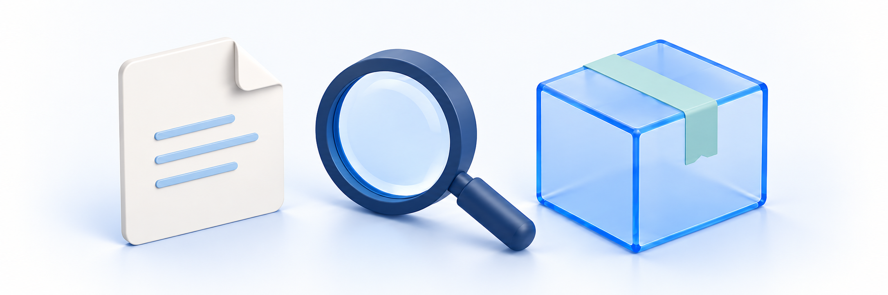
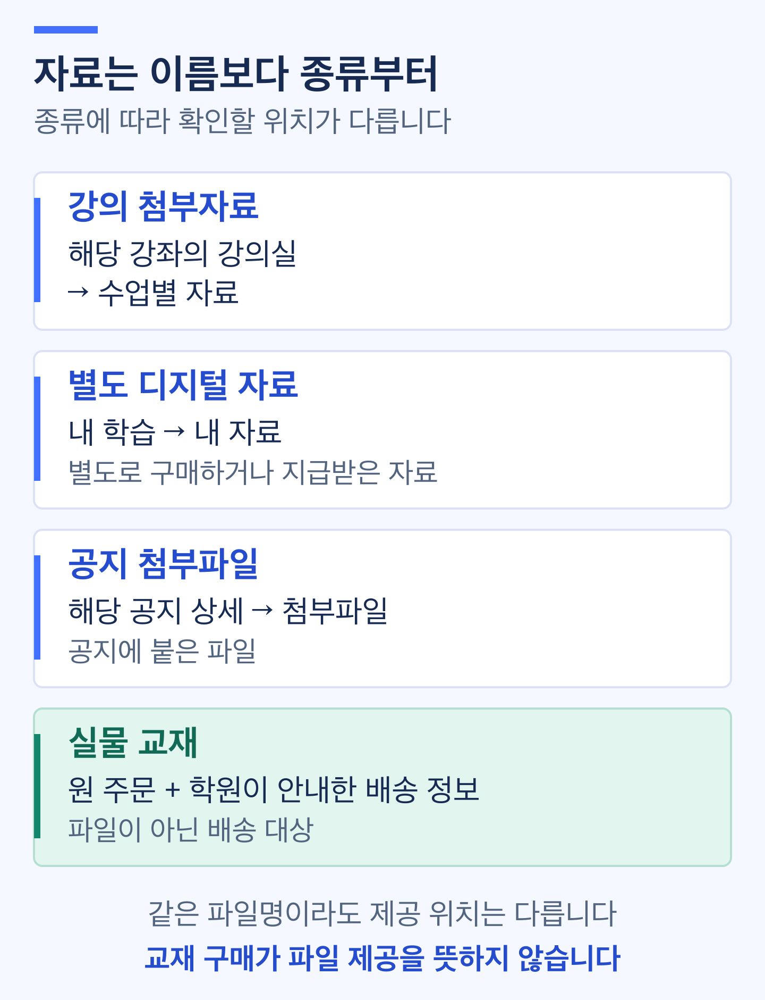

# 자료 다운로드나 교재 배송에 문제가 있어요

<figure><figcaption></figcaption></figure>

**자료의 종류와 문제가 생긴 단계를 먼저 구분합니다.** 목록에 없는 문제, 다운로드 주소 발급 실패, 기기에 저장/열기 실패, 실물 교재 배송 문제는 확인할 내용이 다릅니다. 확인하려고 재구매·무료 재신청·연속 다운로드를 하지 않습니다.

## 먼저 어떤 자료인지 확인하기 

| 자료 종류 | 확인할 위치 | 참고 안내 |
| --- | --- | --- |
| 강의에 붙은 첨부자료 | 해당 강좌의 강의실 → 수업별 자료 | [강의 첨부 자료 받기](../resources/lecture-materials.md) |
| 구매하거나 별도로 지급받은 디지털 자료 | 내 학습 → 내 자료 | [디지털 자료 이용하기](../resources/my-digital-resources.md) |
| 공지에 붙은 파일 | 해당 공지 상세의 첨부파일 | [공지사항 확인하기](../communication/read-notices.md) |
| 배송받는 실물 교재 | 원 주문(해당 상품을 구매한 주문)의 구성과 학원이 안내한 배송 정보 | [교재 배송과 배송지 확인하기](../orders/textbook-shipping-and-address.md) |

같은 이름의 자료라도 제공 위치가 다를 수 있습니다. **교재 상품을 구매했다고 파일이 생기거나, 강좌를 구매했다고 모든 별도 자료가 지급되는 것은 아닙니다.** 상품 구성과 학원 안내를 먼저 확인합니다.

> **화면 예시 준비 중** · 자료 종류와 제공 위치부터 구분합니다.

## 1. 사이트·계정과 제공 범위 확인하기 

구매하거나 지급받은 학원 사이트와 기존 본인 계정인지 확인합니다. 로그인이 안 되면 [로그인·계정 문제 해결 안내](login-and-account.md)를, 강좌나 자료 자체가 목록에 없으면 [구매한 강의·자료 확인 안내](missing-purchased-content.md)를 먼저 봅니다.

| 상황 | 확인할 것 |
| --- | --- |
| 강좌·자료가 아예 없어요 | 구매 구성 또는 직접 지급 안내, 본인 계정·사이트, 목록 필터·페이지와 조회 오류 유무 |
| 목록에는 있지만 이용할 수 없어요 | 기간·권리 상태와 취소/환불 신청 뒤 제한 안내. 목록 노출이 현재 이용 가능을 보장하지 않습니다 |
| 결제는 완료됐는데 교재가 안 와요 | 원 주문에 실물 교재가 포함됐는지와 주문/결제 상태. 결제완료는 발송·수령 완료가 아닙니다 |

기간·권한 제한이나 파일 안전 경고가 표시되면 기기 설정을 바꾸거나 다운로드를 반복하지 말고 학원에 확인합니다. 다른 학생 계정이나 직접 파일 주소로 우회하지 않습니다.

## 2. 강의 첨부자료가 안 받아질 때 

| 현재 상황 | 확인 순서 |
| --- | --- |
| 수업에 **자료** 버튼이 없어요 | 해당 수업이 맞는지와 학원의 자료 제공 안내를 확인합니다. 버튼이 없다는 이유만으로 첨부 없음·지급 누락을 확정하지 않습니다 |
| 자료 버튼이 비활성화됐어요 | 현재 수강 기간·이용 제한과 처리 중 여부를 확인합니다. 버튼을 계속 누르거나 재구매하지 않습니다 |
| `자료 다운로드에 실패했습니다. 잠시 후 다시 시도해 주세요.`가 나와요 | 강좌·수업명, 발생 시각·환경과 이미 열린 파일/창이 있는지 기록합니다. 이 공통 문구만으로 권한·파일·네트워크 중 원인을 확정하지 않습니다 |
| 여러 파일 중 일부만 열렸어요 | 받은 파일과 받지 못한 파일명을 구분합니다. 같은 버튼을 반복해 전체 파일을 다시 받지 않고 필요한 자료를 학원에 확인합니다 |

자료 버튼은 여러 첨부파일의 주소를 순서대로 요청할 수 있습니다. **일부 창이 열렸어도 모든 파일의 다운로드 주소 발급과 실제 파일 저장·열기가 끝난 것은 아닙니다.** 반대로 마지막에 오류가 떠도 앞선 파일의 다운로드 주소 발급·이용 기록이 없었다고 단정할 수 없습니다.

> **화면 예시 준비 중** · 자료 버튼과 일부 파일의 발급·저장 결과를 나눠 확인합니다.

## 3. 내 자료의 상태와 발급 오류 확인하기 

1. **내 자료**의 전체 목록과 **받음/미받음** 필터·페이지를 확인합니다. 필터 결과가 비어 있는 것과 전체 목록이 없는 것은 다릅니다.
2. 해당 자료 상세에서 **자료 제목·파일명·지급일·최초 다운로드 표시**를 학원 안내와 비교합니다. 같은 제목의 최신 파일이 자동으로 제공된다고 가정하지 않습니다.
3. 상태·오류 문구를 확인합니다. 목록/상세 조회 실패와 다운로드 주소 발급 실패를 구분합니다.

> **동작 예시 준비 중** · 목록의 필터와 상세 파일 정보를 확인합니다.

| 표시·상황 | 의미와 다음 행동 |
| --- | --- |
| **지급된 자료가 없습니다.** | 해당 계정의 현재 전체 목록과 지급 안내를 대조합니다. 필터 빈 결과·조회 실패와 구분합니다 |
| **해당 상태의 자료가 없습니다.** | 전체 필터로 돌아가 확인합니다. 이 문구만으로 자료가 회수됐다고 보지 않습니다 |
| **내 자료를 불러오지 못했습니다.** / **자료 상세를 불러오지 못했습니다.** | 빈 목록이 아닌 조회 오류입니다. 발생 위치·시각·문구를 기록해 문의합니다 |
| **받음/최초 다운로드**가 표시돼요 | 다운로드 주소 발급 이력이 있다는 뜻입니다. 현재 기기에 파일이 저장되거나 열렸다는 확인은 아닙니다 |
| **미받음**으로 보여요 | 실제 저장 여부와 별도로 확인합니다. 표시를 바꾸거나 취소 가능 여부를 시험하려고 다운로드하지 않습니다 |
| **이용불가**로 보여요 | 학원에 현재 제공 상태를 확인합니다. 학생이 다시 지급하거나 제한을 해제하는 절차가 아닙니다 |
| `다운로드 URL을 발급하지 못했습니다. 다시 시도해주세요.`가 나와요 | 공통 발급 실패 문구입니다. 권리·파일 상태·처리/연결 문제를 구분할 수 없으므로 반복 발급하지 않고 문의합니다 |

실제로 자료가 필요할 때만 정상 다운로드 절차를 진행합니다. **자료를 다운로드하시겠어요?** 확인창은 주소 발급 후 단순 취소가 제한될 수 있고, 발급된 주소가 **10분** 동안 유효하다고 안내합니다. 확인창을 열기만 한 것과 최종 다운로드 실행은 다릅니다. 강의 첨부·공지 파일도 같은 유효시간이라고 가정하지 않습니다.

최종 실행 뒤 파일이 저장되지 않거나 응답을 받지 못했어도 발급 이력이 남았을 수 있습니다. **파일을 못 받았다는 사실만으로 미사용·취소 가능을 확정하지 않습니다.** 취소 관련 확인은 [상품 취소·환불 안내](../cancellations/request-cancellation.md)를 참고해 학원에 요청합니다.

> **화면 예시 준비 중** · 받음 표시는 실제 저장 완료와 다르며 발급 전 안내를 확인합니다.

## 4. 창은 열렸는데 파일이 없거나 안 열릴 때 

| 멈춘 단계 | 확인할 것 | 주의할 점 |
| --- | --- | --- |
| 새 창 또는 현재 창이 열렸어요 | 열린 화면과 브라우저 다운로드 목록에서 진행/실패·파일명을 확인합니다 | 창이 열림=저장 완료가 아닙니다. 새 창이 안 열렸다고 발급 실패로 단정하지 않습니다 |
| 다운로드 목록에 파일이 있어요 | 완료/실패 여부와 실제 저장 위치·파일명을 확인합니다 | 발급 이력과 기기의 다운로드 목록/저장 파일은 별개입니다 |
| 휴대폰에서 파일을 못 찾겠어요 | 해당 기기·브라우저가 사용하는 다운로드 목록과 파일 저장 위치를 확인합니다 | PC와 동일한 폴더·저장창·버튼 위치를 전제하지 않습니다 |
| 저장한 파일이 안 열려요 | 파일명·확장자·파일 크기와 표시된 오류를 기록합니다 | 파일 확장자를 임의로 바꾸거나 출처 불명 앱/확장 프로그램을 설치하지 않습니다 |
| 오래된 다운로드 주소가 안 열려요 | 정상 자료 화면과 현재 이용 상태를 학원에 확인합니다 | 주소를 복사/수정/공유하거나 발급을 연속 요청하지 않습니다 |
| 기기나 브라우저가 안전 경고를 보여요 | 경고 문구를 기록하고 실행/열기를 멈춰 학원에 문의합니다 | 보안 기능을 끄거나 경고를 무시해 강제 실행하지 않습니다 |

일부 환경에서는 새 창 대신 현재 창으로 이동할 수 있습니다. 무조건 팝업·보안 설정을 해제하는 방법을 공통 해결책으로 사용하지 않습니다. 이미 저장된 파일이 있다면 먼저 그 결과를 확인하고, 새 다운로드가 필요한지는 학원 안내와 현재 제공 상태를 기준으로 판단합니다.

공지 첨부파일도 해당 공지의 파일명·제공 안내와 실제 저장 결과를 확인합니다. 내 자료의 받음 표시·확인창·유효시간이 공지에도 똑같이 적용된다고 보지 않습니다.

> **화면 예시 준비 중** · 주소 발급·기기 저장·파일 열기는 각각 확인합니다.

## 5. 교재가 도착하지 않을 때 

**원 주문의 실물 교재 구성과 학원이 확인해 준 배송 정보를 대조합니다.** 현재 주문 화면에서 옵션·전체 교재명/수량이나 배송 내역이 모두 보이지 않을 수 있습니다. 화면에 없다는 이유만으로 미주문·미발송·주문 취소를 확정하지 않습니다. [주문·결제 내역](../orders/order-and-payment-history.md)과 학원 주문 안내를 함께 확인합니다.

원 주문 상세의 **배송 정보**에서 배송 정보 생성 대기 여부와 해당 배송을 확인합니다. **배송 조회**는 제공되는 경우에, **배송지 변경**은 변경이 허용되는 경우에만 이용합니다. [교재 배송과 배송지](../orders/textbook-shipping-and-address.md) 안내와 함께 대상 교재·현재 배송지·실제 택배 처리 결과를 확인합니다. 별도 배송 탭이나 자동 재배송 기능이 제공된다고 가정하지 않습니다.

| 확인할 정보 | 구분할 것 |
| --- | --- |
| 주문·교재·수량 | 원 주문번호와 구매한 교재/수량. 여러 교재 중 일부 누락인지도 구분합니다 |
| 배송 정보가 아직 없어요 | 학생 화면에 배송 정보가 보이지 않는다는 이유만으로 배송 정보 생성 대기·배송 불필요·조회 문제 중 하나로 단정하지 않습니다 |
| 준비/발송 안내가 있어요 | 학원이 확인한 현재 상태·안내 일정을 기록합니다. 준비 상태를 실제 택배 인계로 보지 않습니다 |
| 택배사·송장번호가 있어요 | 송장 등록, 실제 발송, 택배 이동, 본인 수령은 각각 다릅니다. 송장만으로 발송/도착을 확정하지 않습니다 |
| 일정이 지났거나 일부만 왔어요 | 학원이 안내한 일정·받은 교재/수량과 미수령 항목을 전달합니다. 정확한 배송일이나 자동 재발송 여부를 임의로 확정하지 않습니다 |

택배 조회가 필요한 경우 학원이 안내한 공식 경로를 이용합니다. 출처가 불명확한 메시지의 배송 링크·추가 결제 요청은 따르지 않고 학원에 확인합니다. 택배사의 수령 표시와 실제 교재를 받은 상황도 나눠 전달합니다.

> **화면 예시 준비 중** · 원 배송 표시와 실제 교재 수령을 비교합니다.

## 6. 배송지가 다르거나 교재가 잘못 왔을 때 

| 상황 | 학원에 전달할 내용 | 먼저 하지 않을 일 |
| --- | --- | --- |
| 주문 뒤 배송지를 바꾸고 싶어요 | 원 주문과 해당 교재/배송, 정정이 필요한 항목과 현재 발송 안내 | 주소록 변경이 기존 주문·배송지에 자동 반영된다고 보지 않음 |
| 이미 발송됐는데 주소가 달라요 | 원 주문·교재와 현재 발송/송장 안내, 잘못된 항목 | 발송 후 자동 변경·회수/재배송 가능을 확정하거나 새 주문을 만들지 않음 |
| 다른 교재·수량 부족·파손이 있어요 | 주문 교재/수량, 실제 받은 교재/수량·수령일·상태. 필요한 경우 개인정보를 가린 사진 | 학원 안내 없이 임의로 반송·회수 접수·추가 배송비 결제하지 않음 |
| 반품이나 교환이 필요해요 | 원 주문의 대상 교재·문제와 기존 문의/신청 여부 | 문의만으로 정식 접수·무료 교환·환불/교환 완료라고 보지 않음 |

주소록·원 주문 주소·해당 배송의 현재 주소는 별개입니다. 학생의 배송지 변경 버튼과 운영자 처리 범위도 같지 않으며 상품 준비 중이어도 발송 이력이 있으면 정정이 거절될 수 있습니다. 저장 결과가 불명확하면 원 배송/최신 상태를 확인하고 **주소록 저장·정정 문의만으로 변경 완료를 판단하지 않습니다.**

배송지를 고치려고 결제 화면에 다시 들어가거나 교재를 재구매하지 않습니다. 전체 주소·전화번호가 필요한 경우 학원이 안내한 비공개 본인 확인 경로에서 최소한으로 전달하고 공개 질문/댓글에는 남기지 않습니다. 반품·교환은 [교재 반품·교환 안내](../cancellations/request-return-or-exchange.md)에서 이어 확인합니다.

> **화면 예시 준비 중** · 주소 종류와 변경 허용/결과를 구분합니다.

## 해결되지 않으면 학원에 문의하기 

로그인할 수 있다면 [사이트 1:1 문의](../communication/site-inquiries.md), 불가능하면 학원이 별도로 안내한 연락처를 이용합니다. 실제 문의처·운영 시간은 아직 확인이 필요합니다. 학원이 안내한 문의 경로를 이용합니다.

먼저 **문제가 생긴 자료·교재명, 화면 문구나 개인정보를 가린 사진, 발생 시각**을 알려 주세요. 아래는 학원에서 추가 확인을 요청할 때 참고할 목록이며, 모르는 항목은 미확인으로 적어도 됩니다. 주문번호·배송 정보·본인 확인 정보는 필요한 경우에만 비공개 경로로 전달합니다.

| 자료 문제 | 교재 배송 문제 |
| --- | --- |
| 학원·본인 계정 확인에 필요한 최소 정보 | 학원·본인 계정 확인에 필요한 최소 정보 |
| 강좌/수업 또는 내 자료/공지 제목·파일명 | 원 주문번호·대상 교재/수량·수령 여부 |
| 목록 없음/버튼/발급/저장/열기 중 멈춘 단계 | 학원 안내 일정·현재 알고 있는 배송/송장 정보 |
| 발생 시각·PC/휴대폰·브라우저·오류 문구 | 미수령/주소/오배송/누락/파손 구분과 필요한 정정 항목 |
| 이미 받은 파일·표시 이력과 미확인 결과 | 받은 교재/수량·수령일·기존 문의/신청 여부 |

자료 문의 예시:

> 기존 계정의 내 자료에 자료 A가 보이지만 오늘 오후 휴대폰 브라우저에서 다운로드 URL 발급 실패 문구가 나왔습니다. 최초 다운로드 표시와 기기 저장 결과가 달라 학원 확인을 요청합니다. 반복 발급은 하지 않았고, 다른 환경은 미확인입니다. 현재 제공 상태와 파일을 확인해 주세요.

교재 문의 예시:

> 주문 A의 교재 B 한 권을 아직 받지 못했습니다. 학원 안내 일정은 지났고 송장 등록 안내만 확인했습니다. 실제 발송/이동 상태는 미확인입니다. 주소 정정도 필요한데 주소록 변경은 하지 않았습니다. 현재 배송 상태와 정정 가능 여부를 확인해 주세요.

> **화면 예시 준비 중** · 문제가 생긴 단계와 확인한 사실만 학원에 전달합니다.

**비밀번호·인증번호·토큰/세션·자료 다운로드 주소·다른 학생 정보는 보내지 않습니다.** 문의 화면/사진은 필요한 오류·교재 상태만 남기고 주소창·송장 라벨의 이름/주소/전화번호 등을 가립니다. 문의 접수가 즉시 파일 재지급·권리 복구·배송지 변경·재배송·환불을 보장하지 않습니다.

## 완료 후 확인 

- [ ] 첨부자료·별도 디지털 자료·공지 파일·실물 교재를 구분했습니다.
- [ ] 학원 사이트·기존 본인 계정과 구매 구성/지급 안내를 확인했습니다.
- [ ] 목록 부재·필터 빈 결과·조회 오류·권리/기간 제한을 구분했습니다.
- [ ] 첨부 버튼 오류와 일부 파일 발급/저장 결과를 나눠 기록했습니다.
- [ ] 내 자료의 받음/최초 발급 표시와 실제 저장·열기, 취소 가능 여부를 구분했습니다.
- [ ] 발급/저장/열기 중 멈춘 단계와 문구를 기록하고 연속 발급·보안 우회를 하지 않았습니다.
- [ ] 교재 구성/수량과 배송 정보 생성·송장·실제 발송·수령을 구분했습니다.
- [ ] 주소록과 기존 배송지 정정을 구분하고 임의 재구매·반송·추가 결제를 하지 않았습니다.
- [ ] 해결되지 않으면 비밀정보 없이 필요한 내용만 학원에 문의할 준비를 했습니다.

## 관련 안내 

- [강의 첨부 자료 받기](../resources/lecture-materials.md)
- [디지털 자료 이용하기](../resources/my-digital-resources.md)
- [교재 배송과 배송지 확인하기](../orders/textbook-shipping-and-address.md)
- [주문·결제 내역 확인하기](../orders/order-and-payment-history.md)
- [교재 반품·교환 신청하기](../cancellations/request-return-or-exchange.md)
- [구매한 강의·자료 확인 안내](missing-purchased-content.md)
- [사이트에 1:1 문의하기](../communication/site-inquiries.md)
- [가이드 홈](../README.md)
