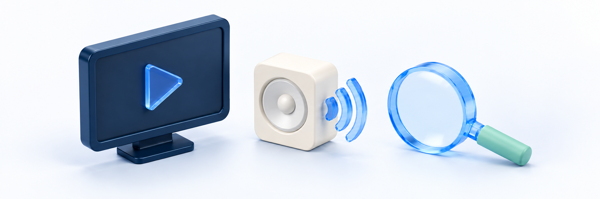

# 영상 재생·끊김 문제

<figure><figcaption></figcaption></figure>

**먼저 본인 계정·수업과 이용 제한을 확인하고, 화면에 표시된 증상에 맞게 점검합니다.** 새로고침·재생·다시 시도를 연속으로 누르거나, 재구매·보안 설정 해제로 해결하려 하지 않습니다.

## 먼저 현재 화면 확인하기 

| 확인할 것 | 확인 방법 |
| --- | --- |
| 학원 사이트·계정 | 구매하거나 수강권을 지급받은 사이트와 기존 계정인지 확인합니다. 확실하지 않으면 [로그인·계정 문제 해결 안내](login-and-account.md)를 먼저 봅니다 |
| 강좌·수업 | 열린 강좌와 수업 제목이 학원 안내와 같은지 확인합니다. 강좌 자체가 없다면 [구매한 강의·자료 확인 안내](missing-purchased-content.md)로 이동합니다 |
| 영상 종류 | 일반 업로드 영상인지 YouTube/Vimeo 외부 영상인지 화면과 안내로 구분합니다 |
| 현재 증상 | 강의실 진입 불가, 로딩/오류, 재생 시작 안 됨, 무음, 끊김, 이어보기/진도 중 어느 문제인지 정리합니다 |
| 화면 상태 | 목차 패널이 영상을 가린 상태인지, 영상 전체화면/기기 전용 재생 화면인지 확인합니다 |

PC의 **커리큘럼**, 모바일의 **목차**는 수업 목록 패널입니다. 모바일에서 패널이 화면을 덮었다면 **패널 닫기**로 영상 영역을 확인합니다. 패널 열기/닫기와 영상 재생·일시정지는 다른 조작입니다. 정상 조작은 [PC·모바일에서 영상 보기](../learning/watch-on-desktop-and-mobile.md)를 참고합니다.

> **화면 예시 준비 중** · 본인 계정과 수업·현재 영상/패널 화면을 먼저 확인합니다.

## 1. 로그인과 이용 제한부터 구분하기 

| 표시·상황 | 먼저 할 일 | 하지 않을 일 |
| --- | --- | --- |
| 로그인 화면으로 이동했어요 | 같은 학원 사이트의 기존 계정으로 로그인하고 내 학습에서 수업을 다시 찾습니다 | 로그인만으로 이전 수업/위치가 자동 복원된다고 기대하지 않음 |
| 수강 등록/상태·권한 안내가 나와요 | 본인 계정·강좌·학원 지급/구매 안내와 현재 문구를 확인합니다 | 다른 계정·직접 영상 주소·미리보기 경로로 우회하지 않음 |
| 수강 기간이 만료되었다고 나와요 | 목록의 종료일과 학원 안내를 확인하고 기간/권리 상태를 문의합니다 | 완료/진도 표시를 무제한 이용으로 보거나 재구매로 복구를 시험하지 않음 |
| 월 영상 시청시간 한도 안내가 나와요 | 표시 문구와 강좌/수업을 학원 운영자에게 전달합니다 | 학생이 클킷 플랜/추가 팩을 구매하거나 새로고침으로 제한을 풀려 하지 않음 |
| 취소/환불 신청 뒤 이용이 안 돼요 | 원 주문(해당 상품을 구매한 주문)·신청 대상과 현재 이용 제한을 함께 확인합니다 | 취소·환불을 신청했다고 환불이 끝난 것으로 판단하지 않습니다. 결제완료 표시만으로 현재 재생할 수 있다고 판단하지도 않습니다. |

제한 안내가 있으면 아래 기기/네트워크 비교를 반복하지 않습니다. [수강 기간과 학습 현황](../learning/access-period-and-progress.md)·[취소·반품·교환 처리 상태](../cancellations/request-status.md)를 참고해 학원에 확인합니다. 날짜나 오류 문구만으로 제한 원인·자동 해제 시각을 확정하지 않습니다.

> **화면 예시 준비 중** · 이용 제한 안내는 재생 조작 문제와 구분해 학원에 확인합니다.

## 2. 로딩과 재생 오류 문구 확인하기 

| 현재 보이는 화면·문구 | 확인할 것 | 다음 행동 |
| --- | --- | --- |
| 로딩 표시가 계속 보여요 | 강의실 전체인지 영상 영역인지, 언제부터인지 | 화면이 준비되는 동안 반복 조작하지 않습니다. 계속되면 시각·수업명을 기록해 문의합니다 |
| **영상 준비 중입니다.** | 같은 수업에서 계속 보이는지, 별도 권한/오류 안내가 있는지 | 영상 변환 중이라는 확정 안내가 아닙니다. 변환 완료 시각을 추측하거나 재진입을 반복하지 않습니다 |
| **이 영상 파일을 재생할 수 없습니다.** | 일반 영상인지, 발생 시각·기기/브라우저·수업명 | 주소를 새로 받으면 해결된다고 보장할 수 없습니다. 문구를 학원에 전달합니다 |
| **영상을 불러오지 못했습니다.** | 현재 수업과 연결 상태, 제한 안내 유무 | 화면의 다시 시도가 필요하면 아래 기준을 따릅니다. 같은 오류가 계속되면 중단하고 문의합니다 |
| **영상 주소를 새로 받지 못했습니다.** | 재시도 뒤 현재 문구와 발생 시각 | 영상 주소를 복사/수정하거나 재발급을 연속 요청하지 않습니다 |
| 외부 재생기에 오류나 빈 화면이 보여요 | YouTube/Vimeo 구분·보이는 문구 | 아래 외부 영상 점검으로 이동합니다. 일반 영상과 같은 오류창이 뜬다고 가정하지 않습니다 |

**다시 시도**가 표시되고 이용 제한 안내가 없다면 필요한 경우 한 번 눌러 결과를 확인합니다. 이는 재생 정보를 다시 요청하는 동작이지 파일 복구·기간 연장·권한 해제가 아닙니다. 같은 오류가 계속되거나 제한/요청 횟수 안내로 바뀌면 반복하지 않습니다.

영상 영역의 오류만으로 기기 문제·원본 파일 문제·학원 설정·서버 문제 중 하나를 확정하지 않습니다. 재생 버튼을 눌렀는지와 실제 화면/소리가 시작되었는지도 나눠 기록합니다.

> **화면 예시 준비 중** · 현재 문구를 기록하고 같은 오류가 계속되면 반복 시도를 멈춥니다.

## 3. 재생 버튼과 소리 확인하기 

1. 제한 안내가 없는 올바른 수업인지 확인합니다. 목차 패널이 열려 있다면 닫고 영상 영역을 확인합니다.
2. 일반 영상은 브라우저 기본 재생기, 외부 영상은 해당 서비스 재생기에서 **재생**을 누릅니다. 강의실을 열었다고 영상이 자동으로 시작되는 것은 아닙니다.
3. 조작이 숨겨져 있으면 PC에서는 해당 재생기 영역에 포인터를 두고, 모바일에서는 영상 영역을 터치해 제공되는 조작을 확인합니다. 강의실의 목차/Q&A/노트 도구와 영상 내부 조작을 구분합니다.
4. 화면은 움직이는데 소리만 없다면 재생기의 **음소거 표시**, 기기의 **음량**과 **연결된 이어폰 등 실제 출력 대상**을 확인합니다.

| 증상 | 구분할 것 |
| --- | --- |
| 영상과 소리 모두 시작하지 않아요 | 일시정지/재생 전인지, 로딩·오류·제한 문구가 있는지 |
| 화면은 움직이는데 무음이에요 | 재생기의 음소거 상태, 기기 음량과 소리 출력 대상을 확인하고, 해당 수업의 문제인지도 구분합니다. |
| 음량 조절 막대가 없어요 | 모든 모바일 재생기에 같은 슬라이더가 있는 것은 아닙니다. 실제 제공되는 조작과 기기 음량을 확인합니다 |
| 전체화면에서 목차가 안 보여요 | 영상 전체화면/기기 재생 화면을 종료하고 강의실로 돌아와 확인합니다 |
| 배속·화질·자막 버튼이 없어요 | 영상 종류·기기별 제공 차이입니다. 클킷 공통 설정창이나 고정 버튼 위치를 전제로 하지 않습니다 |

기본 상태를 확인해도 무음이 계속되면 수업명과 발생 구간을 문의합니다. 소리를 확인하려고 같은 구간을 계속 재생하거나 별도 플레이어·확장 프로그램을 설치하지 않습니다. 전체화면·회전·배속·배경 재생도 모든 기기에서 동일하게 지원된다고 보장하지 않습니다.

> **화면 예시 준비 중** · 화면과 소리를 나눠 확인하고 제공되는 재생기 조작만 사용합니다.

> **동작 예시 준비 중** · 목차 패널을 닫고 영상 영역으로 돌아옵니다.

## 4. 영상이 멈추거나 끊길 때 

먼저 **수업 제목·발생 시각·영상의 어느 구간인지·보이는 문구**를 기록합니다. 한 수업의 같은 구간에서 반복되는지, 여러 수업에서 나타나는지도 알고 있는 범위에서 구분합니다. 기억나는 위치가 없으면 억지로 반복 재생해 재현할 필요는 없습니다.

이용 제한이 없고 학원이 안내한 지원 환경에서 확인할 수 있다면, 필요한 범위에서 한 가지 조건만 바꿔 짧게 비교합니다. 비교를 위해 로그인·수강권·보안 설정을 바꾸거나 여러 창에서 동시에 재생하지 않습니다. **진입·재생·일시정지·화면 이동도 진도/이용 기록과 시청량에 영향을 줄 수 있습니다.**

| 비교할 상황 | 기록할 내용 | 주의할 점 |
| --- | --- | --- |
| 같은 수업의 특정 구간만 멈춰요 | 대략적인 영상 위치와 화면/소리 중 무엇이 멈추는지 | 끝없이 앞뒤 이동해 재현하거나 파일 문제로 확정하지 않음 |
| 여러 수업에서 끊겨요 | 이미 확인한 수업·발생 시각·일반/외부 영상 구분 | 모든 영상을 열어 시험하거나 서버 문제로 확정하지 않음 |
| 네트워크를 바꾸면 달라요 | 동일 기기·수업에서 사용한 Wi-Fi/모바일 데이터 등과 결과 | 사용 가능한 환경에서만 확인하고 데이터 사용을 고려함. 차이가 원인 확정은 아님 |
| 기기/브라우저에 따라 달라요 | PC/휴대폰·브라우저 또는 앱 내 브라우저와 결과 | 학원이 확인한 지원 환경을 따름. 새 환경에서 성공해도 모든 기기 지원을 뜻하지 않음 |
| 화면 잠금/앱 전환 뒤 문제가 나요 | 전환 전후 상태와 돌아왔을 때의 수업/위치 | 배경/화면 잠금 재생을 지원한다고 전제하거나 반복 전환하지 않음 |

상태가 나아지지 않거나 권한·한도·요청 제한 안내가 나오면 비교를 멈추고 문의합니다. 최소 인터넷 속도·권장 화질·지원 브라우저/버전·동시 기기 수·정확한 대기 시간은 아직 확인이 필요합니다. 학원이 확인해 준 안내를 따르며 임의의 기준으로 지원 여부를 판단하지 않습니다.

> **화면 예시 준비 중** · 알고 있는 구간과 환경·비교 결과를 필요한 범위로 정리합니다.

## 5. YouTube와 Vimeo 외부 영상 확인하기 

외부 영상은 해당 서비스 재생기를 사용합니다. **임베드**는 YouTube·Vimeo 영상을 학원 사이트 안에 넣어 재생하는 방식입니다. 서비스 오류·영상 공개/임베드 조건과 클킷의 수강 권한은 별도로 확인해야 합니다. 화면에 보이는 문구와 외부 영상 종류를 학원에 전달합니다.

| 상황 | 할 일 |
| --- | --- |
| 외부 영상만 빈 화면이거나 오류가 나요 | 같은 수업의 YouTube/Vimeo 구분·문구·발생 시각·환경을 기록합니다 |
| 외부 사이트 재생 제한·도메인 관련 안내가 보여요 | 문구 그대로 학원에 확인합니다. 학생이 공개 설정·허용 도메인을 바꾸는 절차가 아닙니다 |
| 클킷 오류창이 따로 없어요 | 외부 재생기 내부 문구를 확인합니다. 별도 오류창이 없다고 정상이라고 보지 않습니다 |
| 시청 완료인데 이어보기가 안 돼요 | 외부 영상의 재생 여부 표시와 일반 영상 진도/이어보기 차이를 구분합니다 |

비공개 영상 주소·Vimeo 접근키를 받아 직접 열거나 다른 계정으로 제한을 우회하지 않습니다. 브라우저 보안/개인정보 보호 설정 해제·출처 불명 확장 프로그램·영상 다운로드를 공통 해결책으로 쓰지 않습니다. 외부 계정으로 로그인하거나 유료 결제를 해야 해결된다고 가정하지 않습니다.

> **화면 예시 준비 중** · 외부 재생기의 문구를 기록하고 공개/임베드 조건은 학원에 확인합니다.

## 6. 이어보기나 진도가 다를 때 

일반 영상에서는 아직 완료하지 않은 수업의 재생 위치가 저장돼 있으면 클킷이 그 위치로 돌아가기를 시도합니다. 다만 모든 기기에서 정확한 위치로 즉시 돌아간다고 보장하지 않습니다. YouTube/Vimeo 외부 영상은 클킷에서 일반 영상과 같은 진도율·이어보기를 저장/제공하지 않습니다.

재생 위치·시청 시작/완료·목차의 학습 완료·강좌 진도율은 서로 다른 정보입니다. 영상이 끊긴 문제와 기록 표시가 다른 문제를 구분하고, [수강 기간과 학습 현황](../learning/access-period-and-progress.md)을 참고합니다. 저장정보 삭제·진도 초기화·끝 구간 반복 이동·새 계정 가입으로 복구하려 하지 않습니다.

## 해결되지 않으면 학원에 문의하기 

로그인할 수 있다면 [사이트 1:1 문의](../communication/site-inquiries.md), 로그인할 수 없다면 학원이 별도로 안내한 연락처를 이용합니다. 실제 문의처·운영 시간은 아직 확인이 필요합니다. 학원이 안내한 문의 경로를 이용합니다. 강좌 지급·이용 기간, 사이트 시청 한도, 원본·외부 영상 설정은 학원에 확인을 요청합니다. 학생이 직접 클킷 운영자용 플랜·정산 설정을 바꾸거나 영상을 다시 업로드하려 하지 않습니다.

먼저 **문제 대상·화면 문구·발생 시각**을 알려 주세요. 아래 추가 정보는 알고 있거나 학원에서 확인을 요청한 경우에만 전달하면 됩니다.

| 알려 줄 내용 | 필요한 범위 |
| --- | --- |
| 강좌·수업과 증상 | 학원 이름과 정확한 강좌·수업 제목, 화면이 안 열리는지/소리가 안 나는지/끊기는지 |
| 화면 문구·발생 시각 | 오류 문구나 개인정보를 가린 캡처, 언제부터인지. 알고 있는 영상 위치만 적고 확인용 반복 재생은 하지 않습니다 |
| 추가 요청을 받았을 때 | PC/휴대폰·브라우저·접속 환경, 일반/YouTube/Vimeo 구분, 목차/전체화면 여부와 음소거·출력 대상 확인 결과. 확인하지 않은 것은 미확인으로 적습니다 |
| 사이트·본인 확인이 필요할 때 | 학원 첫 화면 주소와 본인 확인에 필요한 최소 정보만 비공개 경로로 전달합니다. 영상 주소나 주소창 전체는 보내지 않습니다 |

문의 예시:

> 기존 계정의 강좌 A, 수업 B에서 일반 영상이 약 12분 부근에 멈춥니다. 오늘 오후 휴대폰 브라우저와 Wi-Fi에서 발생했고, 화면과 소리가 함께 멈췄습니다. 만료/한도 안내는 없고 다른 환경은 확인하지 않았습니다. 반복 재시도 없이 문의합니다. 해당 수업과 이용 상태를 확인해 주세요.

> **화면 예시 준비 중** · 확인한 것과 미확인인 것을 구분해 학원에 문의합니다.

**비밀번호·인증번호·토큰/세션·영상/자료 URL·Vimeo 접근키·외부 계정 정보·다른 학생 정보는 보내지 않습니다.** 스크린샷은 필요한 오류 영역만 남기고 이름·전화번호 등 개인정보가 보이지 않게 가립니다. 문의 접수가 즉시 권리 복구·영상 교체·진도 복원을 보장하지 않습니다.

## 완료 후 확인 

- [ ] 학원 사이트·본인 계정과 강좌/수업 제목이 맞는지 확인했습니다.
- [ ] 로그인/권한·기간·시청 한도 안내와 재생 조작 문제를 구분했습니다.
- [ ] 로딩·영상 준비 중·파일 오류·불러오기 실패를 구분하고 문구를 기록했습니다.
- [ ] 필요한 재시도 뒤 같은 오류나 제한이 나오면 반복하지 않았습니다.
- [ ] 재생기 조작과 패널/전체화면을 구분하고 무음이면 음소거·기기 음량·출력 대상을 확인했습니다.
- [ ] 끊김 구간·환경과 이미 확인한 비교 결과를 정리하고 제한 시 점검을 멈췄습니다.
- [ ] 일반 영상과 YouTube/Vimeo의 오류·이어보기/기록 차이를 구분했습니다.
- [ ] 재구매·보안 해제·직접 주소 우회·저장정보 삭제·완료 조작으로 해결하려 하지 않았습니다.
- [ ] 해결되지 않으면 비밀정보 없이 필요한 내용만 학원에 문의할 준비를 했습니다.

## 관련 안내 

- [로그인이나 계정 확인이 안 돼요](login-and-account.md)
- [결제했는데 강의나 자료가 보이지 않아요](missing-purchased-content.md)
- [내 강의 찾고 수강 시작하기](../learning/find-course-and-start.md)
- [PC·모바일에서 영상 보기](../learning/watch-on-desktop-and-mobile.md)
- [수강 기간과 학습 현황 확인하기](../learning/access-period-and-progress.md)
- [사이트에 1:1 문의하기](../communication/site-inquiries.md)
- [가이드 홈](../README.md)
