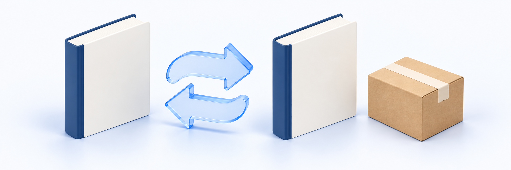

# 교재 교환 처리하기

> **검토용 가이드** · 실제 서비스 화면·동작 확인과 이미지 보완이 남아 있습니다. 본문의 실행 보류·주의사항을 먼저 확인하세요.

<figure><figcaption></figcaption></figure>

**업무 대상:** 취소·반품·교환 처리를 맡은 담당자용 안내입니다. 해당 처리 업무를 맡지 않은 강사·질답 조교는 환불을 확정하거나 승인하지 말고 학생의 요청을 처리 담당자에게 전달하세요. 실제 작업 가능 범위는 본인 계정의 권한을 확인하세요.

발송된 교재를 동일 교재로 교환할 때 사용합니다. 교재 구성품 하나와 신청 수량을 기준으로 회수·검수하고 수동 재배송 정보를 기록합니다. 다른 상품·판본·콘텐츠로 바꾸거나 차액을 환불하는 절차가 아닙니다. 반품 환불은 [교재 반품 처리하기](textbook-return.md)로 구분합니다.

**교환은 환불 승인이 아닙니다. 원 결제·원 배송·서비스 재고는 자동 변경하지 않으며, 수령 기록과 후속 동기화까지 확인해야 전체 교환 완료로 판단합니다.**

**확인 순서:** 교환 신청·원 배송 확인 → 수동 회수 준비·승인 기록 → 실제 회수·입고 기록 → 실물 검수·합격 기록 → 수동 재배송 준비·새 송장 등록 → 재배송 동기화 확인 → 실제 수령 확인·기록 → 수령 동기화·교환 완료 확인

아래는 클킷 서비스 정책을 확인하기 위한 기준입니다. 법정 교환 기준이나 실제 서비스 제공·법률 검토 완료를 뜻하지 않습니다. 최종 정책·화면·회수/재배송 담당자의 운영 책임을 확인한 뒤 공개 안내로 확정합니다.

## 시작 전 준비 

| 준비할 것 | 확인 기준 |
| --- | --- |
| 사이트·권한 | 해당 사이트의 신규 신청 조회와 회수·검수·재배송·수령 기록 권한 |
| 신청·대상 | 교환 유형·주문·구매자·교재 구성품 하나와 신청 수량 |
| 원 배송 | 유효한 원 배송 항목·잔여 수량·실제 발송 근거·원 송장 |
| 날짜·사유 | 원 신청 시각·구매자 입력 수령일·교환 사유와 실물 확인 근거 |
| 회수·재배송 담당 | 외부 회수 연락·수령 장소·실물 보관·동일 교재 재배송·수령 확인 담당 |
| 재배송 정보 | 동일 교재·수량·수령 정보·지원 택배사와 실제 새 송장 |
| 비용 안내 | 해당 주문의 교환 비용·귀책·부담 주체·외부 수동 처리 경로 |

실제 교재 확보·회수·택배 접수와 클킷 처리 기록은 다른 업무입니다. 촬영은 승인된 테스트 환경·신청·교재로 진행하고 학생 주소·연락처·송장·주문 정보를 보호합니다.

## 메뉴 위치 

**결제/정산관리 → 취소·반품·교환 내역 → 해당 교환 상세**에서 회수·입고·검수·재배송·수령 단계를 확인합니다. 원 배송의 일반 송장 입력으로 교환의 별도 재배송을 대신 처리하지 않습니다. 실제 운영 환경의 권한·교재 이동·후속 동기화 결과는 아직 확인되지 않았습니다.

회수 승인 창과 이후 상세 본문의 **처리 기록 → 처리 사유**를 구분합니다. 다음 단계로 진행하는 버튼은 본문에 입력한 현재 사유를 사용하며, 재배송 등록에는 재발송 택배사·새 송장 입력도 필요합니다. 모든 단계에서 별도의 입력창이나 추가 확인창이 열리는 것으로 생각하지 마세요. 화면 밖의 방식이나 원 배송 덮어쓰기로 우회하지 않습니다.

## 1. 동일 교재·신청 수량·원 배송 확인하기 

신청 유형이 교환인지 먼저 확인합니다. [신청 조회·상태 확인](request-review-approve-and-reject.md)을 따르되 취소·반품의 환불 승인으로 진행하지 않습니다.

| 확인 항목 | 판단 기준 |
| --- | --- |
| 대상 | 원 주문의 교재 구성품 하나. 이름만 같은 다른 교재·판본으로 대체하지 않음 |
| 수량 | 신청 수량과 원 배송의 남은 유효 수량을 대조. 운영자가 신청 수량을 임의 수정하지 않음 |
| 원 배송 근거 | 같은 사이트·구매자·주문·구성품·교재의 발송 배송이 하나로 확인되는지 대조 |
| 발송 상태·이력 | 현재 발송/수령 상태와 실제 발송 시각 근거 확인. 송장 존재만으로 확정하지 않음 |
| 원 신청일·수령일 | 구매자 입력 수령일·원 신청 시각·실제 수령 근거를 구분. 반품 입고일로 바꾸지 않음 |
| 사유·현재 결과 | 단순 변심·하자/오배송과 접수 제한·중복 진행·적용 대기를 구분 |

일반 사유·기간·신청 가능 조건은 [교재 발송 후 조건](component-cancellation-and-refund.md)을 따릅니다. 하자·오배송을 단순 변심 기한만으로 일괄 거절하지 않습니다. 단순 변심과 실제 훼손·하자·배송 사실을 검수하며 불명확한 날짜·수량을 추정하지 않습니다.

원 발송 근거가 없거나 배송을 하나로 확인할 수 없으면 담당자에게 전달합니다. 임의 원 배송 선택·상태 보정·새 일반 출고 생성으로 교환 근거를 만들지 않습니다. 다른 상품 교환·차액 처리가 필요하면 이 가이드의 동일 교재 교환 범위와 구분합니다.

> **화면 예시 준비 중** · 동일 교재·신청 수량·원 배송을 대조합니다. 반품 환불과는 다릅니다.

## 2. 수동 회수 준비·승인과 실물 입고 기록하기 

1. 최신 신청·상태·담당 권한과 해당 신청의 제한 적용 결과를 확인합니다.
2. 회수 담당·외부 연락 경로·실물 수령 장소·회수할 교재와 수량을 정합니다.
3. 담당자와 확인한 교환 신청 화면에서 회수 승인과 구체적인 사유·회수 근거를 기록합니다.
4. 같은 신청의 회수 단계·기록 시각·이력을 재조회합니다.
5. 외부 수단으로 실제 회수 업무를 진행합니다. 물건이 실제 도착하면 대상·수량을 대조한 뒤 입고를 기록합니다.
6. 같은 신청의 입고·검수 단계와 처리 이력을 다시 확인합니다.

**회수 승인 기록은 자동 택배 회수 접수가 아닙니다.** 회수 요청·이동 중을 실물 입고로 기록하지 않습니다. 도착 교재·수량이 다르거나 분실·회수 지연이 있으면 담당자에게 확인하고 신청 수량을 바꿔 진행하지 않습니다.

처리 사유는 비워둘 수 없습니다. 학생 개인정보·인증정보를 불필요하게 넣지 않으며 별도 회수 송장 입력·첨부 업로드·독립 메모 기능이 있다고 가정하지 않습니다. 처리 기록 시각을 학생의 원 수령일이나 택배사 실제 회수 시각으로 사용하지 않습니다.

## 3. 실물 검수와 합격·불합격 구분하기 

입고한 교재가 원 신청의 교재·수량과 일치하는지 확인하고 교환 사유·상태·하자/오배송 근거를 검수합니다. 동일 교재 재배송의 가능 여부와 실물 보관 책임도 확인합니다.

| 결과 | 처리 기준 |
| --- | --- |
| 검수 합격 | 입고 이후 구체적인 사유·검수 근거와 함께 합격 기록. 최신 단계·사유·이력 재조회 |
| 검수 불합격 | 재배송 송장 등록 전, 거절 가능한 상태에서 [사유와 함께 거절하기](request-review-approve-and-reject.md) 사용 |
| 정보·실물 근거 부족 | 불합격과 구분하고 담당자에게 확인. 추정값·단계 건너뛰기로 합격하지 않음 |

**교환 검수 합격은 재배송이나 전체 교환 완료가 아닙니다.** 교환 기록은 단계·처리 사유를 중심으로 합니다. [반품 검수](textbook-return.md)의 확인 수령일·귀책·확정 반품비·재입고 수량 입력을 교환의 필수 입력으로 복사하지 않습니다. 실제 화면에서 입력할 수 있는 항목은 아직 확인이 필요하므로 처리 전에 담당자에게 확인합니다.

이 절차에서는 합격 기록을 반복 수정하거나 이전 단계로 되돌릴 수 없습니다. 잘못된 사유·단계를 발견하면 최신 신청·원 근거·이력을 담당자에게 전달하고 가능한 후속 처리를 확인합니다.

> **화면 예시 준비 중** · 실제 회수·입고·검수 근거와 처리 기록을 확인합니다. 합격만으로 재배송되지는 않습니다.

## 4. 수동 재배송 준비와 새 송장 등록하기 

검수 합격 이후 동일 교재·신청 수량의 재배송을 준비합니다. 실제 교재 확보·배송지 확인·외부 택배 접수는 정해진 운영 경로로 진행하고, 교환 신청의 새 재배송 정보를 기록합니다. 자동 택배 접수·자동 출고 목록 생성을 기대하지 않습니다.

| 기록 항목 | 확인 기준 |
| --- | --- |
| 신청·단계 | 같은 교환 신청·검수 합격·최신 상태. 이미 재배송 등록했는지 재확인 |
| 택배사 | 이 가이드에서 다루는 택배사는 CJ대한통운 또는 한진택배. 실제 선택 항목과 사용 가능 여부는 화면·담당자에게 확인 |
| 새 송장 | 숫자 8~30자리. 실제 재배송 송장과 대조하고 원 송장을 덮어쓰지 않음 |
| 처리 사유 | 수동 재배송 근거를 구체적으로 기록 |
| 조회 주소 | 택배사·송장번호를 기준으로 생성한 공식 배송 조회 연결. 임의 URL을 입력하지 않음 |

이 절차에서는 택배사·송장을 재배송 등록 단계에만 입력합니다. 회수·입고·검수·수령 확인에 새 송장을 반복 입력하지 않습니다. 잘못된 택배사·송장·상태 제한을 무시하지 않습니다.

**재배송 등록 의도를 저장한 뒤에는 거절·다른 송장 재등록이 허용되지 않습니다.** 동기화 대기나 화면 응답 불명확도 등록되지 않았다는 뜻이 아닙니다. 등록 전에 교재·수량·택배사·송장을 확인하고, 실수를 발견하면 같은 신청의 저장된 새 송장·상태·이력을 담당자에게 전달합니다. 원 배송 송장을 수정하거나 신청을 새로 만들어 해결하지 않습니다.

> **화면 예시 준비 중** · 새 택배사·송장을 등록 전에 확인합니다. 저장 이후에는 거절·다른 송장 재등록이 제한됩니다.

### 등록 후 같은 신청 재조회 

새 재배송은 원 배송과 별도 기록입니다. 원 배송의 교재·상태·송장과 교환 신청의 새 송장·조회 연결을 각각 확인합니다. 새 재배송 식별자를 일반 배송 상세의 식별자로 사용하거나 원 배송을 다시 출고 처리하지 않습니다.

재배송 기록의 동기화가 대기이면 같은 신청의 최신 결과를 확인합니다. 적용 확인 후에도 재배송 중이지 수령·전체 교환 완료는 아닙니다. 실제 택배 인계·이동·수령 사실은 외부 근거로 별도 대조합니다.

> **화면 예시 준비 중** · 원 배송은 유지하고 같은 교환 신청의 새 송장·동기화 결과를 확인합니다.

> **동작 예시 준비 중** · 재배송 등록 후 같은 신청의 새 송장·동기화 결과를 다시 확인합니다.

## 5. 실제 수령 확인 후 기록·동기화·완료 대조하기 

재배송 동기화가 적용됐고 교재를 실제 받았다는 근거가 확인되면, 같은 신청에서 사유와 함께 수령 확인을 기록합니다. 송장 등록이나 이동 중 상태만으로 수령을 확정하지 않습니다. 반품 입고·원 교재 수령과 교환 재배송 수령도 구분합니다.

단계 처리 시각은 클킷에 기록한 시각입니다. 실제 택배사 수령 시각이나 학생의 수령 확인을 자동으로 증명하지는 않습니다. 정해진 외부 근거와 담당자의 확인을 거치고, 후속 동기화가 대기일 때 수령 확인을 반복하지 않습니다.

| 최신 결과 | 의미와 후속 확인 |
| --- | --- |
| 검수 합격 | 재배송 준비·새 송장 등록 전. 수령·교환 완료 아님 |
| 재배송 기록·동기화 대기 | 내부 등록 의도는 저장됐을 수 있음. 중복 등록 없이 같은 신청 재조회 |
| 재배송 기록·동기화 적용 | 새 재배송 정보 적용. 실제 인계·수령 별도 확인, 전체 완료 아님 |
| 수령 기록·동기화 대기 | 수령 기록과 후속 적용/제한 해제 확인 대기. 수령 단계만 보고 전체 완료로 안내하지 않음 |
| 전체 교환 완료 | 새 재배송 수령 기록·동기화 적용·해제 후속 확인이 끝난 교환. PG 환불 완료와 다름 |
| 거절 | 등록 전 거절 사유·이력과 해당 신청 제한 해제를 확인. 재배송·환불 성공이 아님 |

**교환의 예상 취소액 0은 0원 환불 거래가 아닙니다.** 교환 완료 후에도 원 결제 잔액은 유지하며 확정 취소액은 없습니다. 교환 완료 수량을 환불·취소 완료 수량이나 최초 배송비 환불 누계에 더하지 않습니다. 주문 상품을 취소 완료로 바꾸지 않습니다.

원 배송·원 결제·서비스 재고는 이 교환 흐름에서 자동 수정하지 않습니다. 실물 회수·대체 교재 확보의 재고 운영 책임은 별도로 확인하고 촬영이나 상태 보정을 위해 임의로 재고를 조정하지 않습니다. 해당 신청의 제한 해제와 남은 교재·다른 구성품의 결과도 대조합니다.

> **화면 예시 준비 중** · 수령 기록과 후속 동기화가 끝난 교환 완료를 확인합니다. PG 환불 완료는 아닙니다.

## 6. 교환 비용과 결과 불명확 대응하기 

교환 비용은 [배송 설정](../orders-and-shipping/shipping-settings.md)의 반품비와 별도 안내 비용입니다. 무료배송 여부로 다른 교환비를 만들거나 최초 배송비·반품비를 임의로 더하지 않습니다. 해당 주문 당시 안내·귀책·부담 주체·외부 수동 처리 경로를 확인하고 과거 주문 비용을 현재 설정으로 덮어쓰지 않습니다.

이 교환 처리의 비용 안내는 자동 결제·환불 공제·입금 확인 기능이 아닙니다. 송장 등록·교환 완료만으로 비용을 받았다고 표시하거나 PG 결제/취소를 대신 실행하지 않습니다. 데이터·운영 경로가 없으면 금액을 추정하지 않고 담당자에게 확인합니다.

처리 결과가 불명확하거나 상태 변경·동기화 지연 안내가 나오면 같은 신청의 단계·새 송장·이력을 다시 조회합니다. 재등록·수령 확인 반복·원 송장 수정·새 신청·중복 배송으로 해결하지 않습니다. 계속 확인할 수 없으면 신청 식별정보·원/새 배송·최신 단계·처리 사유·이력을 정해진 문의 경로로 전달합니다. 확인되지 않은 재처리 기능을 찾거나 처리 데이터를 직접 수정해 해결하지 않습니다.

## 완료 후 확인 

- [ ] 교환 유형·원 주문·구매자·교재 구성품 하나·신청/유효 수량을 확인했습니다.
- [ ] 원 배송 상태·실제 발송 근거와 원 신청일·입력 수령일을 대조했습니다.
- [ ] 동일 교재 교환과 반품 환불·다른 상품 교체를 구분했습니다.
- [ ] 외부 회수·실물 입고와 회수/입고/검수 기록을 구분했습니다.
- [ ] 검수 사유·합격/불합격과 송장 등록 전 거절 제한을 확인했습니다.
- [ ] 새 택배사·실제 송장·사유를 등록 전에 확인하고 원 배송을 덮어쓰지 않았습니다.
- [ ] 새 재배송 정보·조회 연결·동기화 대기/적용을 같은 신청에서 확인했습니다.
- [ ] 실제 수령 근거·수령 기록·동기화/제한 해제와 전체 완료를 구분했습니다.
- [ ] 교환 비용 안내/외부 처리와 자동 결제·PG 환불을 구분했습니다.
- [ ] 원 결제·원 배송·재고·남은 구성품을 보존하고 중복 재등록/재배송을 하지 않았습니다.

## 자주 막히는 상황 

| 상황 | 확인할 것 |
| --- | --- |
| 기존 환불/배송 화면에 교환 입력이 없음 | 새 신청 화면 제공 여부 확인. 기존 환불 승인·원 배송 수정으로 대신 처리하지 않음 |
| 원 배송·잔여 수량을 확인할 수 없음 | 같은 사이트·구매자·주문·구성품·실제 발송 근거 확인. 임의 배송 선택 금지 |
| 회수 승인했지만 교재가 오지 않음 | 외부 회수 접수·담당자·실물 도착 확인. 클킷의 회수 승인만으로 입고를 확정하지 않음 |
| 검수 합격했지만 새 송장이 없음 | 동일 교재 수동 재배송 준비와 별도 등록 필요. 자동 출고·환불 아님 |
| 택배사·송장·처리 단계가 제한됨 | 지원 택배사·숫자 길이·합격 이후 등록·최신 상태 확인. 단계 우회 금지 |
| 등록 후 거절/다른 송장 등록이 막힘 | 저장된 의도·새 송장·이력 확인 후 담당자에게 전달. 원 배송 변경·새 신청 금지 |
| 새 송장을 일반 배송 상세에서 찾지 못함 | 원 배송과 별도 교환 재배송 구분. 확인된 신청 상세의 새 정보 사용 |
| 수령 단계인데 전체 완료가 아님 | 동기화·해제 후속 결과 확인. 수령 기록을 반복하지 않음 |
| 교환 완료인데 환불·재고 변경이 없음 | 원 결제·원 배송·자동 재고 변경 없는 동일 교재 교환인지 확인 |
| 금액·상태 충돌/처리 결과 불명확/동기화 지연 | 같은 신청 최신 상세·새 송장·이력 조회 후 담당자에게 전달. 중복 배송 금지 |
