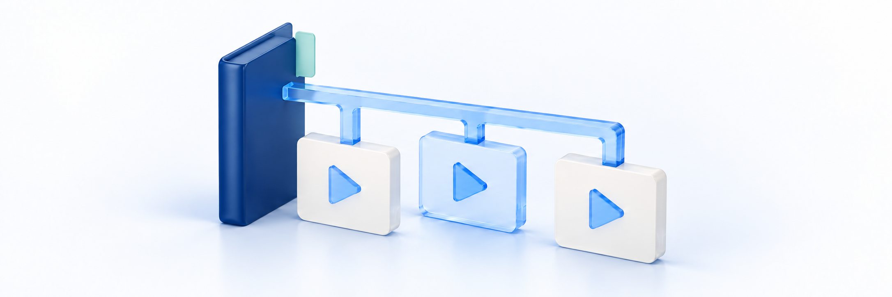

# 커리큘럼 구성하기

<figure><figcaption></figcaption></figure>

섹션과 수업을 만들고, 수강생이 학습할 순서와 공개 범위를 정합니다. 영상 업로드 방법은 [강의 영상 업로드하기](video-upload.md)에서 따로 안내합니다.

**작업 순서:** 섹션 만들기 → 수업 추가 → 순서 정리 → 공개·미리보기 설정 → 저장·발행 확인

## 시작 전 준비 

| 준비할 것 | 확인 기준 |
| --- | --- |
| 강좌 | 기본 정보를 저장한 강좌 |
| 수업 목록 | 수업 제목과 각 수업에 제공할 영상·자료 |
| 섹션 구성 | 오리엔테이션·핵심 개념·문제 풀이처럼 수업을 묶을 기준 |
| 공개 범위 | 수강생에게 제공할 수업과 구매 전 미리보기 수업 |

## 메뉴 위치 

강좌 생성·수정 화면의 **영상 업로드 및 섹션 구성**으로 들어갑니다. **섹션 및 수업 관리**에서 커리큘럼을 구성합니다.

| 구분 | 의미 | 예시 |
| --- | --- | --- |
| 강좌 | 학습 콘텐츠 전체 | 중등 수학 1학기 개념 완성 |
| 섹션 | 수업을 묶는 단위 | 일차방정식 |
| 수업 | 영상·설명·자료를 제공하는 학습 단위 | 일차방정식 기본 개념 |

> **화면 예시 준비 중** · 섹션 안에 학습할 수업을 구성합니다.

## 1. 섹션 만들기 

섹션 추가 버튼을 누르고 제목을 입력합니다. 처음에는 다음처럼 큰 학습 흐름으로 나눠도 됩니다.

| 섹션 | 넣을 수업 |
| --- | --- |
| 오리엔테이션 | 강좌 소개와 학습 방법 |
| 핵심 개념 | 개념 설명과 기본 예제 |
| 문제 풀이 | 대표 유형과 자주 틀리는 문제 |

섹션 제목을 바꿀 때는 해당 섹션의 편집 기능을 사용하고 저장 결과를 확인합니다.

## 2. 수업 추가하기 

1. 수업을 넣을 섹션에서 **수업 추가**를 누릅니다.
2. 무엇을 배우는지 드러나는 수업 제목을 입력합니다.
3. 수업을 열어 **영상 관리**와 **수업 내용**을 확인합니다.
4. 필요한 영상·설명·자료를 등록하고 저장합니다.

`1강`보다는 `일차방정식 기본 개념`, `대표 유형 1번 풀이`처럼 구분하기 쉬운 제목을 사용하세요. 파일 업로드 완료 여부와 수업에 연결된 결과는 따로 확인합니다.

### 수업에 첨부자료 등록하기 

이곳에는 해당 수업에서 나눠 줄 자료를 등록합니다. 별도 상품으로 판매하거나 직접 지급할 파일은 [디지털 자료·파일 관리하기](digital-resource-and-files.md)에서 다룹니다. 강의 첨부자료를 등록했다고 별도 **내 자료** 목록에도 지급되는 것은 아닙니다.

> **화면·제공 결과 확인 필요**
> 아래 경로·버튼의 실제 제공 여부와 이용 권한, 허용 파일 형식·용량, 교체 후 수강생에게 제공되는 결과는 아직 확인이 필요합니다. 수업 편집 화면의 안내 문구는 **최대 2GB, 파일 1개**입니다. 영상의 5GB 기준이나 별도 디지털 자료의 허용 형식을 이 첨부자료에 그대로 적용하지 않습니다. 안내와 실제 동작이 다르면 등록·교체를 멈추고 운영자에게 확인합니다.

1. 자료를 넣을 수업을 열고 **수업 내용 → 수업 자료 업로드**를 찾습니다. 강좌·섹션·수업 제목과 준비한 파일이 맞는지 확인합니다.
2. 파일 선택 영역을 눌러 파일 하나를 선택하거나 그 영역에 파일 하나를 끌어다 놓습니다. 업로드 중에는 진행률과 오류 안내를 확인하고 같은 파일을 반복 선택하지 않습니다.
3. 업로드·연결 완료 안내와 표시된 파일명을 확인합니다. **새로 업로드됨** 표시만 보고 내용까지 확인됐다고 판단하지 말고, 수업을 다시 열어 연결된 자료가 맞는지 확인합니다.
4. 자료를 바꾸려면 **자료 교체**에서 새 파일을 선택합니다. 원본과 이전 파일을 따로 보관하고, 교체 후 파일명·연결 결과를 다시 확인합니다. 기존 학생의 제공 파일이 언제 바뀌는지 확인하기 전에는 교체 완료로 안내하지 않습니다.
5. 제목·수업 노트 등 편집 내용은 **변경사항 저장**으로 저장하고 다시 조회합니다. 강좌의 발행은 별도이므로 [저장·발행 단계](#step-5)를 이어서 확인합니다. 발행 권한이 없다면 운영자에게 확인을 요청합니다.

**첨부자료 업로드·연결은 수업 편집 내용을 저장하기 전에 진행될 수 있습니다.** 팝업의 **취소**로 이미 업로드·연결·교체한 파일까지 원래대로 돌아간다고 생각하지 마세요. 오류가 나면 파일 저장과 수업 연결 결과부터 다시 확인하고 중복 업로드를 피합니다.

**자료 삭제는 단순 연결 해제가 아닙니다.** 삭제 확인창은 연결된 파일도 함께 삭제되며 복구할 수 없다고 안내합니다. 원본 보관과 학생에게 미칠 영향을 확인하기 전에는 실행하지 않으며, 이미 실행한 삭제를 팝업 취소로 되돌릴 수 있다고 판단하지 않습니다.

학생은 강의실의 PC **커리큘럼**, 모바일 **목차**에서 해당 수업의 **자료**를 이용합니다. 확인 방법은 수강생 가이드의 [강의 첨부 자료 받기](https://klekit.gitbook.io/learner-guide/resources/lecture-materials)를 참고합니다. 실제 제공 결과는 승인된 확인용 계정과 범위에서 확인합니다. 다운로드 주소 발급이 이용 이력에 남을 수 있으므로 환불 가능 여부를 시험하려고 누르거나 학생 비밀번호를 받아 대신 로그인하지 않습니다. 주소 발급과 실제 파일 저장·열기 결과도 구분합니다.

## 3. 학습 순서 바꾸기 

순서 변경용 이동 손잡이로 섹션·수업을 원하는 위치로 옮깁니다. 수업을 다른 섹션으로 옮겼다면 도착한 섹션과 앞뒤 수업을 다시 확인합니다.

> **동작 예시 준비 중** · 수업을 추가하고 순서가 저장됐는지 확인합니다.

순서를 바꾼 뒤 저장 안내를 확인하고 같은 강좌를 다시 엽니다. 섹션·수업 순서가 그대로 유지되는지 확인합니다.

## 4. 공개 범위와 미리보기 정하기 

수업의 공개·비공개 설정과 미리보기 설정을 확인합니다. 섹션의 공개 범위도 함께 확인하세요.

| 설정 | 확인할 점 |
| --- | --- |
| 공개·비공개 | 수강생에게 제공하려는 수업과 숨기려는 수업을 구분했는지 |
| 미리보기 | 구매 전 보여줄 수업만 선택했는지 |
| 실제 수강 접근 | 로그인·수강 권한별로 의도한 영상만 재생되는지 |

**공개 설정이 모든 방문자의 무료 시청을 뜻하는 것은 아닙니다.** 미리보기와 유료 수강 권한을 구분하고, 관리자 미리보기만으로 접근 제한을 확인했다고 판단하지 않습니다.

> **화면 예시 준비 중** · 공개 범위와 구매 전 미리보기를 구분해 설정합니다.

## 5. 저장하고 반영 결과 확인하기 

강좌 생성·수정 화면에서 커리큘럼을 계속 작업하려면 **임시 저장**, 내용을 발행하려면 **최종 완료**를 사용합니다. 저장 오류가 표시되면 해당 수업·섹션을 먼저 보완합니다.

커리큘럼 단계의 저장·완료에는 섹션이 1개 이상 필요하고, 모든 섹션에 수업이 1개 이상 있어야 합니다. 아직 비어 있는 섹션은 수업을 채우거나 불필요한 섹션인지 검토합니다.

강좌 상세의 **수업 추가**로 수업을 넣었다면 강좌 생성·수정 화면과 완료 후 처리가 다를 수 있습니다. 임시저장본에 추가됐다는 안내가 나오면 수강생에게 반영됐다고 안내하기 전에 발행 여부를 확인합니다.

## 완료 후 확인 

- [ ] 모든 섹션에 필요한 수업이 들어 있습니다.
- [ ] 섹션·수업 순서가 의도한 학습 순서이며 다시 조회해도 유지됩니다.
- [ ] 수업 제목과 연결된 영상·자료가 일치합니다.
- [ ] 공개·비공개와 미리보기 대상이 의도대로 설정되어 있습니다.
- [ ] 저장·발행 결과와 권한별 수강생 화면을 확인했습니다.

## 자주 막히는 부분 

| 상황 | 확인할 것 |
| --- | --- |
| 섹션을 만들었는데 임시 저장이 안 돼요 | 섹션만 만들고 수업을 넣지 않은 곳이 있는지 확인합니다 |
| 수업 순서가 다시 바뀌어요 | 저장 안내와 다시 조회한 결과를 확인합니다. 오류가 있었다면 변경을 완료로 보지 않습니다 |
| 미리보기 수업이 재생되지 않아요 | 섹션·수업 공개 설정, 연결 영상·변환 상태, 발행 결과를 함께 확인합니다 |
| 수업·파일을 삭제하고 싶어요 | 확인창의 영향을 먼저 읽습니다. 연결 파일 삭제는 수강생 재생에 영향을 줄 수 있습니다 |

## 다음 단계 

[강의 영상 업로드하기](video-upload.md)에서 각 수업의 영상을 연결합니다. 강좌 제목·소개 수정은 [강좌 등록·수정하기](course-create-and-edit.md)를 확인합니다.
