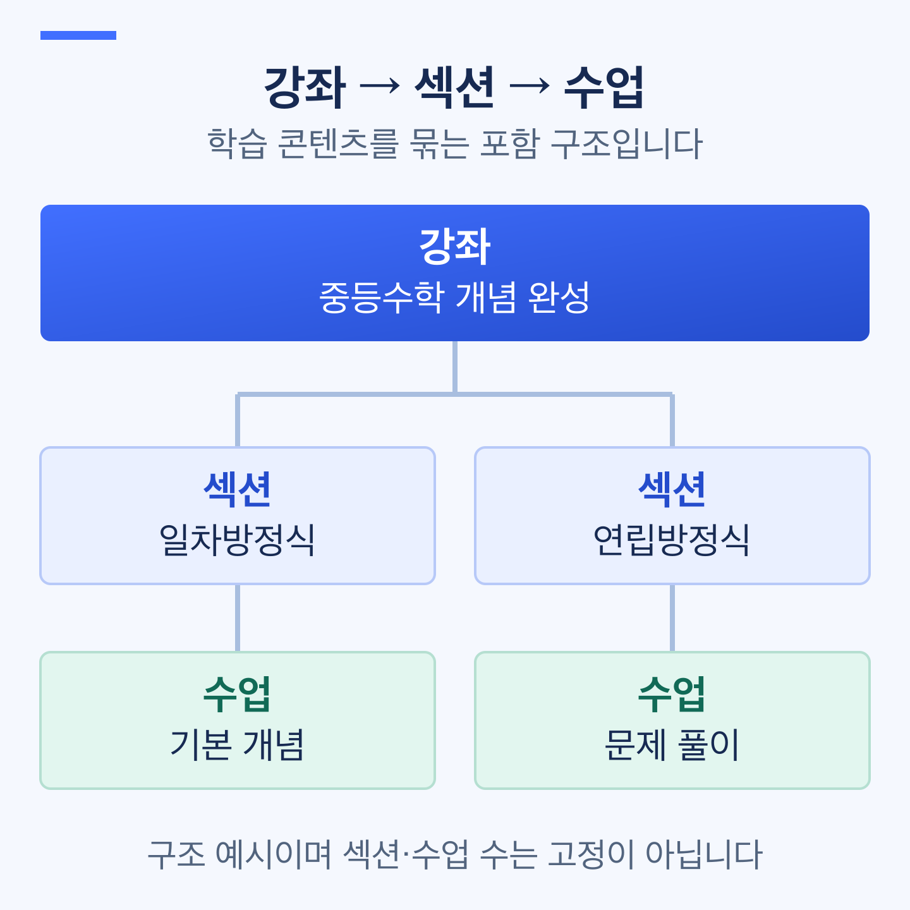

# 커리큘럼 구성하기

> **검토용 가이드** · 실제 서비스 화면·동작 확인과 이미지 보완이 남아 있습니다. 본문의 실행 보류·주의사항을 먼저 확인하세요.

섹션과 수업을 만들고, 수강생이 학습할 순서와 공개 범위를 정합니다. 영상 업로드 방법은 [강의 영상 업로드하기](video-upload.md)에서 따로 안내합니다.

**작업 순서:** 섹션 만들기 → 수업 추가 → 순서 정리 → 공개·미리보기 설정 → 저장·발행 확인

## 시작 전 준비 

| 준비할 것 | 확인 기준 |
| --- | --- |
| 강좌 | 기본 정보를 저장한 강좌 |
| 수업 목록 | 수업 제목과 각 수업에 제공할 영상·자료 |
| 섹션 구성 | 오리엔테이션·핵심 개념·문제 풀이처럼 수업을 묶을 기준 |
| 공개 범위 | 수강생에게 제공할 수업과 구매 전 미리보기 수업 |

## 메뉴 위치 

강좌 생성·수정 화면의 **영상 업로드 및 섹션 구성**으로 들어갑니다. **섹션 및 수업 관리**에서 커리큘럼을 구성합니다.

| 구분 | 의미 | 예시 |
| --- | --- | --- |
| 강좌 | 학습 콘텐츠 전체 | 중등 수학 1학기 개념 완성 |
| 섹션 | 수업을 묶는 단위 | 일차방정식 |
| 수업 | 영상·설명·자료를 제공하는 학습 단위 | 일차방정식 기본 개념 |

> **화면 예시 준비 중** · 섹션 안에 학습할 수업을 구성합니다.

## 1. 섹션 만들기 

섹션 추가 버튼을 누르고 제목을 입력합니다. 처음에는 다음처럼 큰 학습 흐름으로 나눠도 됩니다.

| 섹션 | 넣을 수업 |
| --- | --- |
| 오리엔테이션 | 강좌 소개와 학습 방법 |
| 핵심 개념 | 개념 설명과 기본 예제 |
| 문제 풀이 | 대표 유형과 자주 틀리는 문제 |

섹션 제목을 바꿀 때는 해당 섹션의 편집 기능을 사용하고 저장 결과를 확인합니다.

## 2. 수업 추가하기 

1. 수업을 넣을 섹션에서 **수업 추가**를 누릅니다.
2. 무엇을 배우는지 드러나는 수업 제목을 입력합니다.
3. 수업을 열어 **영상 관리**와 **수업 내용**을 확인합니다.
4. 필요한 영상·설명·자료를 등록하고 저장합니다.

`1강`보다는 `일차방정식 기본 개념`, `대표 유형 1번 풀이`처럼 구분하기 쉬운 제목을 사용하세요. 파일 업로드 완료 여부와 수업에 연결된 결과는 따로 확인합니다.

## 3. 학습 순서 바꾸기 

순서 변경 핸들을 이용해 섹션·수업을 원하는 위치로 이동합니다. 다른 섹션으로 옮겼다면 이동한 섹션과 앞뒤 수업을 다시 확인합니다.

> **동작 예시 준비 중** · 수업을 추가하고 순서가 저장됐는지 확인합니다.

순서를 바꾼 뒤 화면에서만 맞게 보이는지 확인하는 데 그치지 않고, 저장 안내와 다시 조회한 결과를 확인합니다.

## 4. 공개 범위와 미리보기 정하기 

수업의 공개·비공개 설정과 미리보기 설정을 확인합니다. 섹션의 공개 범위도 함께 확인하세요.

| 설정 | 확인할 점 |
| --- | --- |
| 공개·비공개 | 수강생에게 제공하려는 수업과 숨기려는 수업을 구분했는지 |
| 미리보기 | 구매 전 보여줄 수업만 선택했는지 |
| 실제 수강 접근 | 로그인·수강 권한별로 의도한 영상만 재생되는지 |

**공개 설정이 모든 방문자의 무료 시청을 뜻하는 것은 아닙니다.** 미리보기와 유료 수강 권한을 구분하고, 관리자 미리보기만으로 접근 제한을 확인했다고 판단하지 않습니다.

> **화면 예시 준비 중** · 공개 범위와 구매 전 미리보기를 구분해 설정합니다.

## 5. 저장하고 반영 결과 확인하기 

커리큘럼을 계속 작업하려면 **임시 저장**, 일반 생성·수정 내용을 발행하려면 **최종 완료**를 사용합니다. 저장 오류가 표시되면 해당 수업·섹션을 먼저 보완합니다.

커리큘럼 단계의 저장·완료에는 섹션이 1개 이상 필요하고, 모든 섹션에 수업이 1개 이상 있어야 합니다. 아직 비어 있는 섹션은 수업을 채우거나 불필요한 섹션인지 검토합니다.

강좌 상세에서 **수업 추가**로 진입했다면 일반 수정과 완료 동작이 다를 수 있습니다. 임시저장본에 추가됐다는 안내가 나오면 수강생 반영 전에 발행 여부를 확인합니다.

## 완료 후 확인 

- [ ] 모든 섹션에 필요한 수업이 들어 있습니다.
- [ ] 섹션·수업 순서가 의도한 학습 순서이며 다시 조회해도 유지됩니다.
- [ ] 수업 제목과 연결된 영상·자료가 일치합니다.
- [ ] 공개·비공개와 미리보기 대상이 의도대로 설정되어 있습니다.
- [ ] 저장·발행 결과와 권한별 수강생 화면을 확인했습니다.

## 자주 막히는 부분 

| 상황 | 확인할 것 |
| --- | --- |
| 섹션을 만들었는데 임시 저장이 안 돼요 | 섹션만 만들고 수업을 넣지 않은 곳이 있는지 확인합니다 |
| 수업 순서가 다시 바뀌어요 | 저장 안내와 다시 조회한 결과를 확인합니다. 오류가 있었다면 변경을 완료로 보지 않습니다 |
| 미리보기 수업이 재생되지 않아요 | 섹션·수업 공개 설정, 연결 영상·변환 상태, 발행 결과를 함께 확인합니다 |
| 수업·파일을 삭제하고 싶어요 | 확인창의 영향을 먼저 읽습니다. 연결 파일 삭제는 수강생 재생에 영향을 줄 수 있습니다 |

## 다음 단계 

[강의 영상 업로드하기](video-upload.md)에서 각 수업의 영상을 연결합니다. 강좌 제목·소개 수정은 [강좌 등록·수정하기](course-create-and-edit.md)를 확인합니다.
