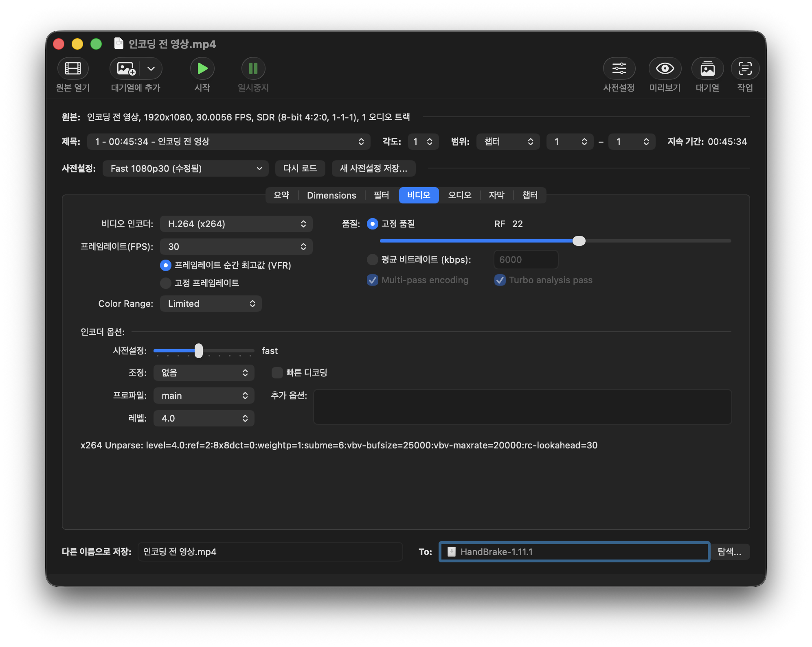
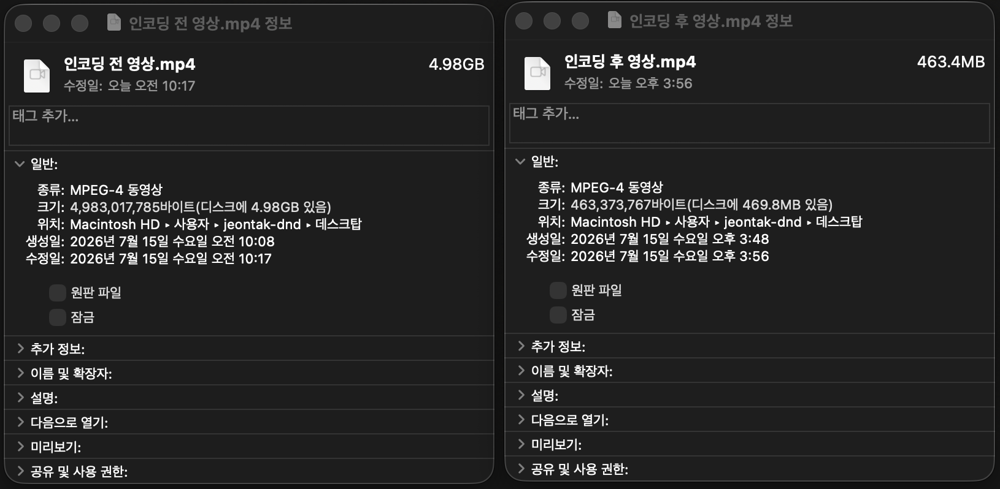

# 영상 용량 줄이기

> **검토용 가이드** · 실제 서비스 화면·동작 확인과 이미지 보완이 남아 있습니다. 본문의 실행 보류·주의사항을 먼저 확인하세요.

휴대폰으로 촬영한 영상이 크거나 업로드에 오래 걸린다면 화질과 소리를 확인하며 별도 변환본을 만듭니다. 목표는 가장 작은 파일이 아니라 **수강생이 칠판 글씨와 강사 목소리를 충분히 확인할 수 있는 영상**입니다.

**작업 순서:** 원본 보관 → 변환 설정 → 짧은 구간 테스트 → 전체 변환 → 글씨·소리·용량 확인

## 언제 용량을 줄이면 좋을까요 

| 상황 | 먼저 할 일 |
| --- | --- |
| 파일이 업로드 한도를 넘습니다 | 변환하거나 수업 단위로 나눕니다. 한도는 [영상 업로드하기](video-upload.md)를 기준으로 확인합니다 |
| 4K·60fps로 촬영했습니다 | 1080p·30fps 기준 변환본을 시험합니다 |
| mov 파일이 크거나 변환에 실패합니다 | 확장자 이름을 바꾸지 말고 MP4·H.264로 다시 내보냅니다 |
| 이미 용량이 작고 글씨·소리가 좋습니다 | 추가 압축을 반복하기보다 그대로 업로드할 수 있는지 확인합니다 |

해상도·프레임·품질 값은 아래 작업의 시작값입니다. 서비스의 필수 업로드 규격이나 모든 영상에 최적인 설정은 아닙니다. 칠판·문서의 작은 글씨가 흐려지면 용량보다 가독성을 우선합니다.

## 시작 전 준비 

촬영 원본을 PC에 옮기고 원본과 변환본을 별도 파일로 보관합니다. PC의 남은 저장 공간과 전원을 확인한 뒤, [HandBrake 공식 사이트](https://handbrake.fr/)에서 프로그램을 준비합니다.

| 파일 | 이름 예시 |
| --- | --- |
| 촬영 원본 | `01-일차방정식-원본.mov` |
| 업로드용 변환본 | `01-일차방정식-업로드.mp4` |

HandBrake에서는 **원본 열기 → 사전설정 선택 → 설정 확인 → 저장 위치 지정 → 시작** 순서로 진행합니다. 운영체제·언어·버전에 따라 메뉴 위치와 이름은 조금 다를 수 있습니다.

## 1. 원본 열고 사전설정 선택하기 

HandBrake에서 **원본 열기**로 촬영 파일을 엽니다. 영상 길이와 원본 크기를 확인하고, 사전설정에서 **Fast 1080p30**을 선택합니다. 이 사전설정은 MP4·H.264·AAC를 사용하는 출발점입니다. [공식 사전설정 설명](https://handbrake.fr/docs/en/latest/technical/official-presets.html)

## 2. 영상과 오디오 설정 확인하기 

| 항목 | 시작값·확인 방법 |
| --- | --- |
| 형식 | 요약 탭에서 MP4 확인 |
| 비디오 인코더 | H.264 (x264) |
| 해상도 | 1080p 기준. 원본 비율 유지, 저해상도 영상을 억지로 확대하지 않기 |
| 프레임 | 사전설정의 30fps 기준 유지. 원본보다 프레임을 늘릴 필요는 없음 |
| 품질 | 고정 품질 RF 22부터 시험하고 글씨·용량으로 조정 |
| 오디오 | AAC 설정과 오디오 트랙 확인. 변환 후 말소리 재생 확인 |

**화면 잘림을 확인하세요.** Dimensions의 크기·자르기 설정에서 칠판 끝이나 자료의 가장자리가 잘리지 않는지 확인합니다. 세로 촬영 영상을 16:9로 억지로 늘리거나 잘라 맞추지 않습니다.

> **화면 예시 준비 중** · 영상 형식과 화면 잘림·오디오 트랙을 확인합니다.

*제공된 비디오 설정 예시입니다. 이 화면만으로 MP4 형식·자르기·오디오 설정까지 확인한 것은 아닙니다.*

**캡처의 핵심 설정**

| 확인 항목 | 화면에 표시된 값 |
| --- | --- |
| 비디오 인코더 | `H.264 (x264)` |
| 프레임레이트 | `30fps` |
| 고정 품질 | `RF 22` |

RF는 x264에서 숫자가 낮을수록 화질과 용량이 높아지고, 높을수록 화질과 용량이 낮아지는 방향입니다. RF 22는 이 안내의 시험 시작값입니다. 글씨가 흐리면 21·20처럼 낮춰 비교하고, 용량을 더 줄일 때는 작은 폭으로 올려 다시 확인합니다. HandBrake 공식 문서는 x264의 1080p 권장 범위를 RF 20~24로 제시합니다. [공식 품질 설정 설명](https://handbrake.fr/docs/en/latest/workflow/adjust-quality.html)

## 3. 짧은 구간으로 먼저 확인하기 

전체 변환 전에 미리보기 또는 짧은 구간을 변환해 확인합니다. 칠판에 작은 글씨가 있는 장면, 화면이 바뀌는 장면, 강사가 설명하는 장면을 포함하세요.

| 점검 | 통과 기준 |
| --- | --- |
| 글씨 | 작은 수식·문제 번호·칠판 끝의 글씨를 읽을 수 있음 |
| 소리 | 말소리가 또렷하고 소리와 입 모양이 어긋나지 않음 |
| 화면 | 방향·비율이 맞고 중요한 내용이 잘리지 않음 |
| 움직임 | 필기·화면 전환을 따라갈 수 있음 |

> **화면 예시 준비 중** · 원본과 변환본의 칠판 글씨 가독성을 비교합니다.

## 4. 전체 변환하고 다른 이름으로 저장하기 

시험 결과가 괜찮다면 원본 전체 구간을 대상으로 설정을 확인합니다. **다른 이름으로 저장**에서 새 파일명·저장 위치를 지정하고 **시작**을 누릅니다. 원본 파일에 덮어쓰지 않습니다.

변환 중에는 완료 상태를 확인할 수 있도록 PC의 전원·저장 공간을 유지합니다. 처리 시간이나 최종 파일 크기는 원본과 설정에 따라 달라집니다.

## 5. 용량과 재생 결과 확인하기 

파일 정보에서 원본과 변환본의 용량을 비교하고, 전체 길이가 의도대로 유지됐는지 확인합니다. 시작·중간·끝 구간을 다시 재생한 뒤 [강의 영상 업로드하기](video-upload.md)에 따라 업로드합니다.

*제공된 예시의 용량은 4.98GB에서 463.4MB로 줄었습니다. 이 수치가 모든 영상의 압축률·화질 유지·업로드 성공을 보장하지는 않습니다.*

**캡처의 용량 비교**

| 파일 | 표시 용량 |
| --- | --- |
| 촬영 원본 | `4.98GB` |
| 인코딩 후 파일 | `463.4MB` |

## 완료 후 확인 

- [ ] 원본과 변환본을 별도 파일로 보관했습니다.
- [ ] 영상 전체 길이와 시작·중간·끝 구간을 확인했습니다.
- [ ] 칠판·자료 글씨가 읽히고 목소리가 또렷합니다.
- [ ] 화면 방향·비율·자르기와 소리 싱크가 정상입니다.
- [ ] 변환본이 업로드 용량 기준에 맞으며 서비스에서도 재생을 확인했습니다.

변환한 파일의 지원 확장자·용량 확인과 클킷의 변환/재생 성공은 별도입니다. 업로드 결과가 불명확하면 새 변환/재업로드를 반복하기 전에 원 파일 목록·수업 연결·오류를 [영상 업로드](video-upload.md)에서 확인합니다. 1080p·30fps 등 권장 설정을 모든 원본의 성공 조건이나 서비스 필수 규격으로 해석하지 않습니다.

## 자주 막히는 부분 

| 상황 | 확인할 것 |
| --- | --- |
| mp4로 바꿨는데 용량이 그대로예요 | 확장자 변경만으로 압축되지는 않습니다. 실제 변환 설정과 출력 파일을 확인합니다 |
| 오히려 용량이 커졌어요 | 원본이 이미 효율적으로 압축됐을 수 있습니다. 더 낮은 RF를 사용했는지 확인하고 짧은 구간으로 비교합니다 |
| 칠판 글씨가 흐려요 | RF를 낮추거나 원본 해상도 유지가 필요한지 비교합니다. 가독성을 잃으면서 용량만 줄이지 않습니다 |
| 소리가 없어요 | 원본과 오디오 트랙을 확인한 뒤 다시 변환합니다 |
| 변환본도 너무 커요 | RF를 조금 조정해 시험하거나 수업 단위로 나눕니다. 반복 변환은 원본에서 시작합니다 |
| 서비스에서 재생되지 않아요 | MP4·H.264·AAC 설정과 전체 변환 완료 여부를 확인하고, 업로드·변환 오류를 따로 확인합니다 |

다음 촬영에서는 가로 방향·1080p·30fps를 출발점으로 짧게 시험하고 글씨·소리를 확인해 보세요. 촬영 후 압축만으로 원본에 없는 선명도를 되살릴 수는 없습니다.
