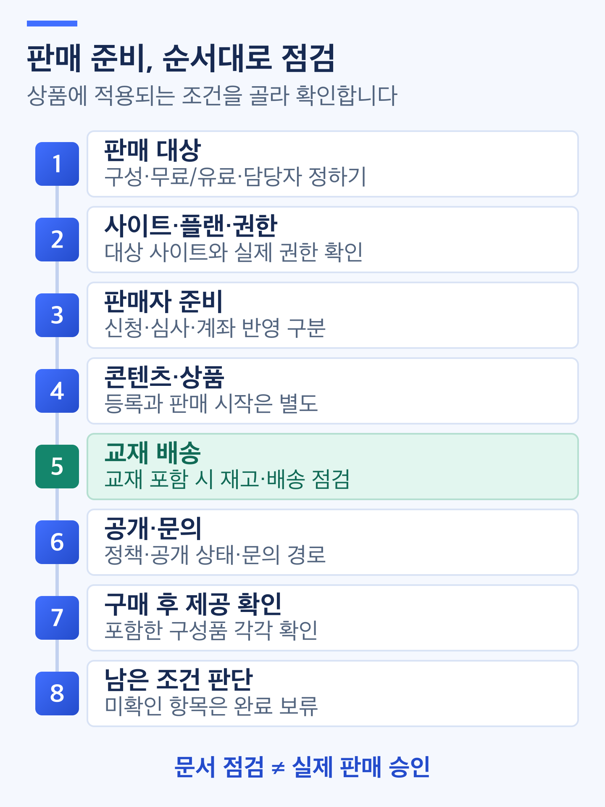

# 판매 준비 체크리스트

> **검토용 가이드** · 실제 서비스 화면·동작 확인과 이미지 보완이 남아 있습니다. 본문의 실행 보류·주의사항을 먼저 확인하세요.

<figure><figcaption></figcaption></figure>

처음 판매할 상품을 정하고, 같은 사이트의 설정과 운영 준비를 점검합니다. **사이트 개설, 판매자 승인, 콘텐츠 등록, 상품 판매 시작, 구매 후 제공은 서로 다른 단계**입니다. 자세한 입력 방법은 각 항목의 관련 가이드에서 확인합니다.

**점검 순서:** 판매 대상 정하기 → 사이트·플랜·권한 → 판매자 준비 → 콘텐츠·상품 → 교재 배송 → 공개·문의 → 구매 후 제공 확인 → 남은 조건 판단

## 체크리스트 사용하는 방법 

상품별로 사이트 이름, 상품 이름, 구성, 무료/유료 여부, 확인 날짜와 담당자를 기록합니다. 아래 상태는 **이 문서에서 사용할 점검 표시**이며 서비스에 같은 이름의 일괄 점검 화면이 있다는 뜻은 아닙니다.

| 표시 | 기록할 때의 기준 |
| --- | --- |
| 확인 완료 | 해당 상품·환경에서 확인한 결과와 날짜를 적을 수 있습니다. 설정 알림만으로 구매·제공까지 완료 처리하지 않습니다 |
| 보완·확인 대기 | 미입력, 오류, 권한/제공 여부 불명확 또는 실제 결과 확인 전입니다. 남은 조건과 확인할 담당자를 적습니다 |
| 해당 없음 | 상품에 그 구성이나 운영 방식이 없으며 적용하지 않는 이유가 명확합니다. 확인하지 못한 항목을 대신 제외하지 않습니다 |

**적용 항목에 보완·확인 대기가 남아 있으면 판매 준비 완료로 판정하지 않습니다.** 아래 표를 작성하는 것만으로 운영 사이트가 공개되거나 상품 판매가 시작되는 것은 아닙니다.

> **화면 예시 준비 중** · 적용 항목의 미확인은 판매 준비 완료로 처리하지 않습니다.

## 1. 무엇을 판매할지 정하기 

| 상품 구성 | 추가로 점검할 준비 | 해당 없음으로 둘 수 있는 항목 |
| --- | --- | --- |
| 강좌 | 강좌·커리큘럼·수업/영상·수강 기간·수강 권한 | 교재와 별도 자료가 없다면 그 구성의 배송·자료 권한 |
| 교재 | 교재 정보·표지·실제 재고·배송 기준·출고 담당 | 강좌와 자료가 없다면 그 구성의 수강·자료 권한 |
| 디지털 자료 | 최종 파일·판본·자료 권한·실제 파일 수신 | 강좌와 교재가 없다면 그 구성의 수강·배송 |
| 패키지 | 포함한 강좌·교재·자료 각각의 조건과 제공 결과 | 실제로 포함하지 않은 구성의 항목만 제외 |

상품 유형은 **강좌·교재·디지털 자료·패키지**로 구분합니다. 강좌와 교재가 섞였다고 새로운 다섯 번째 유형으로 안내하지 않습니다. 패키지는 대표 구성 하나만 정상이어도 전체 준비 완료가 아닙니다.

무료 상품과 할인·쿠폰 적용 후 결제할 금액이 0원인 유료 상품도 구분합니다. **0원이라는 결과만으로 플랜·판매자·주문 생성·제공 조건이 같다고 판단하지 않습니다.** 쿠폰은 사용할 때만 점검하며 판매 시작의 공통 필수 조건으로 두지 않습니다.

> **화면 예시 준비 중** · 포함한 구성품마다 필요한 준비와 제공 결과를 확인합니다.

## 2. 사이트·플랜·담당 권한 확인하기 

| 점검 항목 | 확인할 결과 | 관련 가이드 |
| --- | --- | --- |
| 대상 사이트 | 사용할 사이트의 이름·주소와 생성/설정 상태를 확인했습니다. 기존 사이트가 있으면 중복 생성하지 않습니다 | [계정과 사이트 만들기](account-and-site-create.md) |
| 현재 플랜·체험 | 현재 플랜·체험 여부·기간·판매 제한을 확인했습니다. 기본 Free 시작과 상위 플랜 14일 체험을 구분합니다 | [플랜·무료체험과 구독 시작하기](../subscription-and-usage/plan-trial-and-subscription-start.md) |
| 사용량·한도 | 예정한 영상·파일과 시청 운영에 필요한 저장/시청 한도를 확인했습니다. 조회 오류를 남은 용량 0이나 무제한으로 해석하지 않습니다 | [사용량 확인·추가 팩 관리하기](../subscription-and-usage/usage-and-additional-packs.md) |
| 담당자·변경 권한 | 상품·콘텐츠·주문·사이트 업무의 담당자와 실제 권한을 구분했습니다. 판매자 신청·계좌 작업은 소유자가 담당합니다 | [운영자 지정·역할 관리하기](../members-and-operations/operator-assignment-and-roles.md) |

**상위 플랜 무료체험 중 유료 판매·정산 실행·추가 팩 신규 구매에는 제한이 있습니다.** 정확한 적용 범위는 실제 환경에서 확인하며, 체험 표시나 유료 플랜 이름만으로 모든 판매 기능이 준비됐다고 판단하지 않습니다. 플랜/팩 견적 생성·카드 등록·최종 변경은 별도 작업입니다. 점검용으로 체험 1회를 사용하거나 결제를 진행하지 않습니다.

## 3. 판매자·정산 준비 구분하기 

| 점검 항목 | 확인할 결과 | 관련 가이드 |
| --- | --- | --- |
| 사업자 정보 | 해당 판매에 필요한 사업자 정보·연락처·주소와 저장/인증 결과를 확인했습니다 | [판매자 등록·심사 확인하기](../sellers-and-settlements/seller-registration-and-review.md) |
| 신청·심사 | 계좌 인증, 신청 제출, 심사/보완 결과를 구분했습니다. 유료 판매에 필요한 승인·제한 상태를 확인했습니다 | [판매자 등록·심사 확인하기](../sellers-and-settlements/seller-registration-and-review.md) |
| 정산 계좌 | 소유자가 사용할 계좌의 인증과 실제 반영 상태를 구분했습니다. 지급 중 변경/보류가 있으면 담당자에게 확인했습니다 | [정산 계좌 등록·변경하기](../sellers-and-settlements/settlement-bank-account.md) |

**신청 제출 성공은 심사 승인이 아니며, 계좌 인증은 외부 계좌 반영·실제 정산금 지급 완료가 아닙니다.** 판매 준비 단계에서 아직 발생하지 않은 정산금의 지급 완료를 요구하지 않습니다. 반대로 지급 조건과 판매 제한 조건을 같은 것으로 처리하지 않습니다.

사업자등록증·통장 사본은 클킷에서 선택 제출하는 증빙입니다. 추가 보완 요청과 현재 화면의 저장 조건 차이는 각 가이드에 따라 확인하고, 항목을 완료로 표시하려고 불필요한 서류를 올리지 않습니다. 무료 상품이나 쿠폰 후 0원 주문의 판매자 조건이 불명확하면 `해당 없음`으로 넘기지 말고 적용 여부를 확인합니다. 법적 자격·신고 의무는 이 문서만으로 판단하지 않습니다.

> **화면 예시 준비 중** · 플랜, 판매자 승인, 계좌 인증과 지급은 서로 다른 확인입니다.

## 4. 콘텐츠와 판매 상품 준비하기 

### 포함 콘텐츠 점검 

| 포함 콘텐츠 | 준비 기준 | 관련 가이드 |
| --- | --- | --- |
| 강좌 | 제목·소개·썸네일, 커리큘럼의 제목/순서·공개 범위와 발행 결과를 확인합니다 | [강좌](../content-management/course-create-and-edit.md) · [커리큘럼](../content-management/curriculum.md) |
| 업로드 영상 | 수업에 맞는 파일 연결·업로드·변환 상태를 구분합니다. 확장자 허용만으로 변환·재생 성공을 판단하지 않습니다 | [영상 업로드](../content-management/video-upload.md) · [용량 줄이기](../content-management/video-optimization.md) |
| 외부 영상 | 사용할 권리·연결 방식·공개/접근 조건을 확인합니다. 업로드 영상과 같은 재생·진도 동작을 보장하지 않습니다 | [외부 영상](../content-management/external-video.md) |
| 교재 | 교재명·표지·확인된 교재 정보·게시 상태와 실제 보유 재고를 확인합니다 | [교재](../content-management/textbook-create-and-edit.md) |
| 디지털 자료 | 배포할 최종 파일·판본과 업로드 후 저장/현재 파일 연결을 확인합니다. 주문 생성 시 기록된 파일 버전과 이후 교체본을 구분합니다 | [디지털 자료](../content-management/digital-resource-and-files.md) |

영상의 5GB 안내를 디지털 자료의 확정 업로드 한도로 사용하지 않습니다. 파일 기준·실제 운영 제한은 해당 가이드와 현재 안내를 확인합니다. 콘텐츠의 임시 저장·게시 완료·발행은 **판매 상품 생성이나 판매 시작을 대신하지 않습니다.**

### 판매 상품 점검 

| 점검 항목 | 확인할 결과 | 관련 가이드 |
| --- | --- | --- |
| 상품 구성 | 상품 유형·제목·대표 이미지와 포함 콘텐츠가 계획과 같습니다. 현재 확인한 상품 생성 화면의 제공 수량은 각 콘텐츠 1이며, 편집 기능이 있다고 가정하지 않습니다 | [상품 생성·콘텐츠 연결](../products-and-coupons/create-products-and-connect-content.md) |
| 가격·할인 | 콘텐츠 정가, 상품 구성 금액, 할인 후 가격과 주문 최종액을 구분했습니다. 무료 상품은 구성 금액도 모두 0원인지 확인합니다 | [가격·할인·수강 기간](../products-and-coupons/price-discount-and-valid-days.md) |
| 강좌 수강 기간 | 유료 강좌 포함 시 공통 수강 일수 1~365일을 확인했습니다. 무료 강좌의 기간 차이는 별도 확인하고 빈 값을 무제한 지원으로 안내하지 않습니다 | [가격·할인·수강 기간](../products-and-coupons/price-discount-and-valid-days.md) |
| 과세·면세 | 포함 콘텐츠별 확인된 판단과 설정을 대조했습니다. ISBN·콘텐츠 종류만으로 면세를 확정하지 않습니다 | [과세·면세 정보](../products-and-coupons/tax-settings.md) |
| 저장·판매 상태 | 상품 저장, 판매 준비 조건, 판매 중 표시와 실제 구매 가능을 따로 확인할 계획입니다. 비공개로 저장은 상품을 판매 중지 상태로 생성하는 동작입니다 | [재고·판매 상태](../products-and-coupons/stock-and-sales-status.md) |
| 쿠폰을 사용하는 경우 | 적용할 상품·기간·할인/제한 조건을 확인했습니다. 쿠폰 발급·등록·적용과 실제 결제 금액을 구분합니다 | [쿠폰](../products-and-coupons/create-and-issue-coupons.md) |

수강 기간의 달력은 일수를 입력하는 방식이며 모든 구매자의 고정 종료일을 설정하는 기능으로 안내하지 않습니다. 강좌가 없는 교재·자료 상품에는 강좌 수강 기간을 일괄 적용하지 않습니다. 가격·기간·파일을 바꿨다고 기존 주문·이미 지급된 권리도 자동 변경되는 것은 아닙니다.

> **화면 예시 준비 중** · 콘텐츠 등록과 상품 설정·판매 시작을 구분합니다.

## 5. 교재가 포함되면 재고·배송 준비하기 

교재 단독뿐 아니라 **교재가 하나라도 포함된 패키지**에 적용합니다. 강좌·디지털 자료만 제공한다면 이 절은 해당 없음 사유를 기록할 수 있습니다.

| 점검 항목 | 확인할 결과 | 관련 가이드 |
| --- | --- | --- |
| 실제 재고·예약 | 교재별 실제 보유량과 판매 가능한 재고를 확인했습니다. 같은 교재를 연결한 상품은 재고를 공유하며 예약량도 구분합니다 | [재고·판매 상태](../products-and-coupons/stock-and-sales-status.md) |
| 출고·회수 준비 | 실제 사용할 택배사·담당자·출고지·반품지와 연락처를 준비했습니다. 학생 배송지/주소록과 구분합니다 | [배송 설정](../orders-and-shipping/shipping-settings.md) |
| 배송비 기준 | 기본 배송비·조건부 무료배송·반품비·교환비를 구분했습니다. 무료배송은 상품 할인 후·쿠폰 적용 전 교재 금액 기준입니다 | [배송 설정](../orders-and-shipping/shipping-settings.md) |
| 설정 반영 경로 | 실제 환경의 배송 설정 제공 여부·권한·저장/재조회 결과를 확인할 담당자와 범위를 정했습니다 | [배송 설정](../orders-and-shipping/shipping-settings.md) |
| 주문 후 처리 | 배송 대상 생성, 송장 등록, 실제 발송/수령과 정정 문의를 구분할 담당 절차를 준비했습니다 | [출고·송장](../orders-and-shipping/dispatch-and-tracking.md) · [배송지 정정](../orders-and-shipping/change-shipping-address.md) |

**검토한 화면에는 배송 설정/관리·학생 주문 배송/주소·배송 정보 확인 후 주문 생성이 연결돼 있습니다.** 실제 사용할 사이트의 기능 제공 여부·권한·주소·비용·물류 결과가 확인되지 않았다면 준비 완료를 보류합니다. CSV 내보내기는 송장 업로드나 출고가 아니며, 클킷의 배송 화면이 있다고 자동 회수·교환품 재배송까지 진행되는 것은 아닙니다.

배송비 정책 비활성화나 최초 배송비 0원은 배송 업무가 없다는 뜻이 아닙니다. 부족한 재고를 통과시키려고 가상의 입고를 기록하거나 예약량을 임의로 빼지 않습니다. 재고·콘텐츠를 보완했다고 중지된 상품이 자동으로 판매 재개된다고 안내하지 않습니다.

> **화면 예시 준비 중** · 교재가 포함된 패키지도 재고와 배송 준비를 확인합니다.

## 6. 공개 화면·약관·문의 경로 준비하기 

| 점검 항목 | 확인할 결과 | 관련 가이드 |
| --- | --- | --- |
| 사이트 기본 정보 | 사이트 이름·로고·파비콘과 방문자 결과를 구분했습니다. 검색/공유 미리보기만으로 공개·검색 반영을 확정하지 않습니다 | [사이트 기본 정보](../site-and-communication/site-basic-information.md) |
| 약관·정책 | 담당자가 승인한 이용약관·개인정보처리방침·환불 정책 등의 내용·버전과 실제 연결 위치를 확인할 계획입니다 | [사이트 기본 정보](../site-and-communication/site-basic-information.md) |
| 페이지·메뉴 | 제공할 페이지의 발행본·공개 상태와 PC/모바일 메뉴 연결·직접 주소 결과를 각각 확인할 계획입니다 | [페이지·메뉴](../site-and-communication/pages-and-menus.md) |
| 공지 | 필요한 운영/학습 안내와 공개 범위를 정했습니다. 비공개 공지 보호가 미확인인 상태에서 학생 명단·인증정보·유료 자료를 넣지 않습니다 | [게시판·공지](../site-and-communication/boards-and-notices.md) |
| 문의 담당·경로 | 학습 Q&A와 주문/사이트 문의를 구분하고 실제 제공되는 문의 경로·담당자·안내 기준을 준비했습니다 | [Q&A 답변](../site-and-communication/qna-answer.md) · 수강생 가이드의 **1:1 문의** |
| 선택 상담 채널·폼 | 사용할 경우에만 플랜·노출·실제 연결/접수 결과를 점검합니다. 둘 다 판매 공통 필수 기능으로 두지 않습니다 | [폼](../site-and-communication/site-form-create-and-responses.md) · [상담 채널](../site-and-communication/connect-inquiry-channel.md) |

메뉴 숨김이나 검색 로봇 차단은 페이지·회원 전용 자료의 접근 보호를 대신하지 않습니다. **커스텀 빌더의 대상 연결 문제는 수정·검수 전 실행 중단**을 유지합니다. 새 사이트의 템플릿 자동 발행 가능성도 [계정과 사이트 만들기](account-and-site-create.md)과 함께 확인하며, 판매 준비 중이라는 이유로 사이트가 비공개라고 가정하지 않습니다.

약관의 **임시 저장**은 안전한 초안 보관으로 사용하지 않습니다. 현재 확인한 구현에서는 변경 등록 요청이므로 검토 문구는 서비스 밖에서 작성합니다. 버전 변경·기존 회원 동의 영향과 실제 방문자 반영은 별도로 확인하며, 이 문서는 법률 판단이나 정책 승인을 대신하지 않습니다.

> **화면 예시 준비 중** · 공개 상태, 접근 보호와 문의 경로는 각각 확인합니다.

## 7. 구매 후 무엇이 제공되는지 확인 계획 세우기 

주문·이용 결과를 실제로 확인하기 전에는 **테스트 환경·가상 계정·상품·허용 금액·동작·결과 확인 범위**를 별도로 확정합니다. 운영자 미리보기로 대신 확인하거나 학생의 비밀번호를 받아 대신 접속하지 않습니다.

| 대상 | 같은 주문에서 대조할 결과 | 관련 가이드 |
| --- | --- | --- |
| 공통 | 상품 구성·수량·할인/쿠폰·배송비·최종액과 해당 주문의 결제 상태. 0원 주문도 원 주문과 실제 제공 결과를 확인 | [주문·결제](../orders-and-shipping/order-and-payment-status.md) · 수강생 가이드의 **결제·무료 신청** |
| 강좌 | 이번 주문과 연결된 수강 권한·기간, 구매자 계정의 실제 학습 접근과 별도 승인한 재생 결과 | [지급 확인](../orders-and-shipping/content-fulfillment-check.md) · 수강생 가이드의 **내 강의** |
| 디지털 자료 | 이번 주문의 파일 버전·이용 권한, 주소 발급과 별도 승인한 실제 파일 수신/열기 결과 | [지급 확인](../orders-and-shipping/content-fulfillment-check.md) · 수강생 가이드의 **내 자료** |
| 교재 | 이번 주문의 교재·수량·배송 대상/주소·확정 배송비와 담당 출고 경로. 생성·송장·발송·수령을 구분 | [지급 확인](../orders-and-shipping/content-fulfillment-check.md) · [출고·송장](../orders-and-shipping/dispatch-and-tracking.md) |
| 패키지 | 위 구성품 각각의 결과와 누락 여부. 기존 수강권·자료 권한의 존재만으로 이번 주문의 지급 성공을 확정하지 않음 | [지급 확인](../orders-and-shipping/content-fulfillment-check.md) |

**결제 완료는 제공 완료가 아니며, 내 자료의 받음/주소 발급은 파일 전송·저장 완료가 아닙니다.** 주문서 진입·무료 신청도 주문/권리 생성으로 이어질 수 있고, 강의실 진입·재생은 이용 기록, 다운로드 주소 발급은 취소 판단에 영향을 줄 수 있습니다. 점검·촬영만을 이유로 실제 학생 주문에서 실행하지 않습니다.

결과가 불명확하면 같은 주문·권리부터 확인합니다. 재결제·재신청·임의 재지급·취소/환불로 다시 맞추지 않습니다. 운영자 계정의 미리보기 성공과 구매자의 이용 성공을 구분하고, 실제 이용 확인은 승인된 테스트 범위에서 진행합니다.

## 8. 남은 조건 정리하고 다음 단계 정하기 

| 현재 단계 | 기록할 내용 | 판정 |
| --- | --- | --- |
| 문서·자료 준비 | 상품 구성·가격/기간·정책·담당자와 적용 항목을 정리 | 입력 계획 준비. 저장·판매·실제 제공 완료 아님 |
| 설정 확인 | 승인된 작업으로 저장된 콘텐츠·상품·판매자/플랜·필요한 배송/공개 조건의 결과를 확인 | 설정 점검 결과. 실제 구매·이용 결과 확인과 별도 |
| 실제 구매·이용 확인 | 승인된 테스트에서 구매자별 원 주문·구성별 제공 결과와 PC/모바일 경로를 확인 | 남은 조건·차이를 확인. 운영 판매 승인은 별도 |
| 판매 준비 판정 | 적용 항목의 확인 결과와 미해결 여부를 책임 담당자가 검토 | 적용 조건에 보완·확인 대기가 남으면 완료 보류 |

확인 기록에는 **대상 사이트·상품, 환경/버전, 확인 날짜, 담당자, 결과와 남은 조건**을 적습니다. 해당 없음 항목에는 이유를 남깁니다. 상품 구성·가격·기간·파일·재고·배송 정책·플랜·권한·공개 설정이 바뀌면 영향을 받는 항목을 다시 확인합니다. 예전 캡처나 다른 상품의 완료 표시를 그대로 재사용하지 않습니다.

> **화면 예시 준비 중** · 준비 자료 작성과 실제 검수·판매 승인은 다릅니다.

> **동작 예시 준비 중** · 문서에서 적용 항목과 남은 조건을 정리하는 예시입니다.

## 완료 후 확인 

- [ ] 대상 사이트·상품·구성과 무료/유료 여부를 구분했습니다.
- [ ] 플랜·체험·사용량과 담당자별 권한을 확인했습니다.
- [ ] 판매자 신청/승인·계좌 인증/반영·실제 지급을 구분했습니다.
- [ ] 포함 콘텐츠·상품 구성·가격·수강 기간·과세 조건을 확인했습니다.
- [ ] 교재 포함 여부에 따라 공유 재고·배송 기준·담당 경로를 점검했습니다.
- [ ] 공개/접근 보호·약관·문의 경로의 준비와 확인 대기를 구분했습니다.
- [ ] 구매 후 제공 검수의 대상·허용 동작·결과 확인 범위를 별도로 정했습니다.
- [ ] 미해결 적용 조건과 해당 없음 사유를 기록하고, 실제 판매 시작 승인과 구분했습니다.

## 다음 단계 

판매할 유형에 맞춰 [첫 강좌 판매하기](first-course-sale.md)·[첫 교재 판매하기](first-textbook-sale.md)·[첫 디지털 자료 판매하기](first-digital-resource-sale.md)에서 상품 등록부터 구매 후 제공까지의 진행 방법을 확인합니다. 세 편 모두 실제 구매·제공 결과의 추가 확인이 남아 있습니다. 배송 연결 확인과 실제 물류 처리를 구분하고, 자료 이용 권한과 실제 파일 수신도 따로 확인합니다. 상세 입력은 각 콘텐츠·상품 가이드를 따릅니다.
