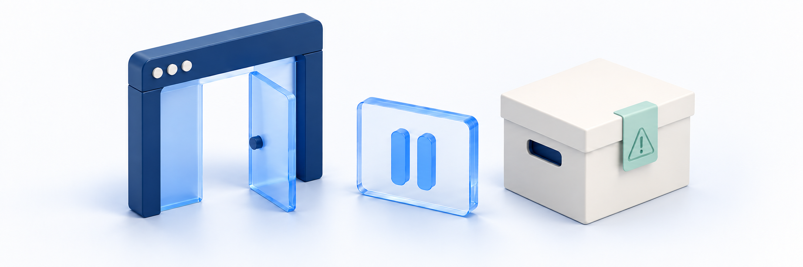

# 사이트 중지·삭제하기

<figure><figcaption></figcaption></figure>

**업무 대상:** 사이트 운영 중지·삭제를 검토하는 소유자·담당자용 안내입니다. 강의나 로그인이 안 된다는 이유로 이 작업을 실행하지 말고 먼저 학원 운영자에게 문의하세요. 아래 실행 보류·복구 불가 경고를 반드시 확인합니다.

**운영 → 운영 설정**에서 사이트의 현재 상태와 중지·재개·삭제 관련 안내를 확인합니다. **사이트 운영 상태, 페이지 공개, 상품 판매 상태, 서비스 구독은 서로 다른 설정**입니다. 잠시 운영을 멈추려는 목적을 사이트 삭제로 처리하지 않습니다.

**먼저 확인하세요:** 대상 사이트·현재 상태·권한·진행 중 거래와 보존할 자료를 확인하고, 해결되지 않은 조건이 있으면 실행을 중단합니다. 확인 창을 열었다가 취소한 것은 운영 중지나 삭제 완료가 아닙니다.

회원의 이용 권리는 [수강권·이용 기간 관리하기](enrollment-and-access-period.md), 운영자 권한은 [운영자 지정·역할 관리하기](operator-assignment-and-roles.md), 페이지 공개는 [페이지·메뉴 구성하기](../site-and-communication/pages-and-menus.md), 상품 판매는 [재고·판매 상태 관리하기](../products-and-coupons/stock-and-sales-status.md)와 구분합니다. 중지·삭제가 구독·청구에 미치는 영향은 아직 확인되지 않았으므로 [플랜·무료체험과 구독 시작하기](../subscription-and-usage/plan-trial-and-subscription-start.md)의 주의사항도 확인하세요.

## 시작 전 준비 

| 준비할 것 | 확인 기준 |
| --- | --- |
| 대상 사이트·목적 | 사이트 이름·주소와 중지/재개/서비스 종료 중 필요한 업무를 확인합니다. 다른 사이트를 변경하지 않습니다 |
| 현재 상태 | 최신 조회 결과를 확인합니다. 운영중·운영 중지 두 표시만으로 제재·삭제·가입 설정 중 상태까지 판단하지 않습니다 |
| 작업 권한 | 상태 변경은 소유자와 사이트 설정 변경 권한, 삭제는 소유자와 사이트 삭제 권한을 확인합니다. 메뉴·버튼 노출은 최종 허용 증거가 아닙니다 |
| 학생·주문·환불 | 남은 수강 기간·이용 약속·진행 중 주문/배송·취소/환불/반품/교환을 확인합니다. 삭제 조건을 맞추려고 수강권을 회수하거나 거래를 강제로 종료하지 않습니다 |
| 구독·정산 | 사이트 구독의 청구/변경/갱신 작업·미정산·지급 예정·증빙을 확인합니다. 중지나 삭제가 자동 환불·정산 완료를 뜻하지 않습니다 |
| 자료 보존·안내 | 보존할 자료·권한 있는 보관 위치·인수인계·학생 안내와 책임자를 확인합니다. 전체 백업/복원 기능이 제공된다고 가정하지 않습니다 |
| 업무 승인·실행 보류 | 사이트 소유자와 필요한 업무를 확인합니다. 아래 중지·재개·삭제의 안전성이 확인되기 전에는 실제 변경을 하지 않으며 비밀번호 입력·동의·최종 삭제도 진행하지 않습니다 |

## 먼저 상태 구분하기 

| 구분 | 의미·확인 위치 | 같은 것으로 보지 않을 것 |
| --- | --- | --- |
| 운영중 / 운영 중지 | 운영 설정의 사이트 상태. 일반적인 상태 변경은 운영중과 운영 중지 사이에서만 가능합니다 | 운영중 표시만으로 모든 페이지 발행·상품 판매·구독 정상 결제 보장 |
| 페이지 공개·메뉴 노출 | 페이지/메뉴별 공개·발행·연결 상태 | 메뉴 숨김이 사이트 중지·직접 URL 접근 차단을 뜻함 |
| 상품 판매 중지 | 상품별 새 판매 상태 | 기존 구매 권리 종료·전체 사이트 중지·구독 해지 |
| 구독 만료·종료 예약 | 클킷 서비스의 플랜·청구 상태 | 사이트 삭제·운영 중지와 같은 상태, 만료 즉시 전체 데이터 삭제 |
| 제재·삭제 상태 | 일반 중지/재개와 다른 상태 및 처리 조건 | 운영중 선택으로 제재 해제·삭제 취소·데이터 복원 |

**대상과 목적 확인 → 최신 상태/권한 확인 → 거래·구독·보존 영향 확인 → 미해결이면 실행 보류 → 담당자에게 안전한 처리 방법 확인** 순서로 진행합니다.

## 1. 현재 운영 상태 확인하기 

1. **운영 → 운영 설정**을 엽니다.
2. **현재 운영 상태**에서 사이트 이름·주소·상태 배지를 확인합니다. 아직 로딩 중이거나 조회 실패·다른 상태가 의심되면 다음 변경 단계로 넘어가지 않습니다.
3. **운영 상태 변경**에서 선택한 항목과 현재 상태 배지를 구분합니다. 운영 상태 항목을 선택한 것만으로는 상태가 저장되지 않습니다.
4. 작업 목적이 페이지 숨김·상품 판매 중지·구독 종료인지 다시 확인합니다. 필요한 경우 해당 가이드로 이동하고 사이트 상태를 대신 변경하지 않습니다.

현재 화면은 상태 조회가 끝나지 않았거나 실제 상태가 운영 중지가 아닌 경우에도 **운영중**으로 표시될 수 있습니다. 배지 하나만으로 서비스에 저장된 실제 상태를 확정하지 말고, 최신 상태를 확인할 수 없으면 담당자에게 확인합니다. 같은 화면의 **학부모 회원가입 허용 → 변경 저장**은 별도 설정이며 이 문서의 중지/재개 버튼이 아닙니다.

> **화면 예시 준비 중** · 현재 상태와 선택값을 구분합니다. 로딩/다른 상태의 기본 표시만으로 실제 상태를 확정하지 않습니다.

## 2. 운영 중지 안내 확인하기 

> **실행 보류:** 중지 선택 항목과 확인 창의 구독 안내가 서로 다르며, 실제 구독·접근 차단 결과는 아직 확인되지 않았습니다. **중지하면 비공개·신규 판매 차단·기존 구매자 이용 보호가 완료되는 것으로 판단하지 마세요.** 운영 사이트에서 최종 **확인**을 누르지 말고 담당자에게 안전한 처리 방법을 확인합니다.

아래는 확인 창에서 구분해야 할 내용입니다. 실제 변경 절차가 아니며, 확인하려고 운영 사이트에서 상태 변경을 시험하지 않습니다.

1. 현재 상태가 실제 **운영중**인지 확인합니다. 조회 결과가 불명확하면 선택하지 않습니다.
2. **운영 상태 변경 → 운영 중지**를 선택합니다. 선택 항목의 **비공개** 배지와 설명은 실제 차단 결과가 아닌 안내 문구입니다.
3. **변경 적용**을 누르면 **운영 중지** 확인 창이 열립니다. 이 단계는 확인 창 진입이며 최종 상태 변경 완료가 아닙니다.
4. 비공개·판매 중단·기존 구매 회원 이용·구독 유지 안내를 읽고, 선택 항목과 다른 구독 설명을 확인합니다.
5. 최종 **확인**은 누르지 않고 **취소**로 닫습니다. 취소 후에도 운영 중지 선택이 남을 수 있으므로 선택값을 실제 저장된 상태로 오해하지 않습니다. 필요하면 화면에 다시 진입해 최신 상태를 확인합니다.

중지 성공 안내가 있더라도 사이트 상태 반영과 방문자·학생의 이용 결과는 별개입니다. 비로그인 방문자·기존 구매자의 이용과 신규 구매 가능 여부를 각각 확인하고, 직접 URL·모바일 접근과 구독·청구 결과도 별도로 확인해야 합니다. 이 안내는 그 결과를 확정하지 않습니다.

> **화면 예시 준비 중** · 구독 안내가 서로 달라 최종 변경을 보류합니다. 취소한 상태는 중지 완료가 아닙니다.

## 3. 운영 재개 안내 확인하기 

1. 서비스에 저장된 현재 상태가 **운영 중지**인지 확인합니다. 제재·삭제 상태나 초기 설정 중인 상태를 운영 재개 대상으로 해석하지 않습니다.
2. **운영 상태 변경 → 운영중 → 변경 적용**은 **운영 재개** 확인 창으로 이어집니다. 실제 재개 결과는 아직 확인되지 않았으므로 상태 변경을 시험하지 않습니다.
3. **사이트 운영을 재개하시겠습니까?** 안내를 확인하고 최종 **확인**을 누르지 않은 채 **취소**합니다. 취소 후 남은 선택값은 저장 상태가 아닙니다.

중지·재개 시 접근 범위와 구독 조건은 아직 확인되지 않았으므로 **실제 재개 실행은 보류**하고 담당자에게 확인합니다. 일반 전환은 운영중과 운영 중지 사이에서만 가능하므로, 제재 해제·삭제 복구·구독 재시작을 대신하지 않습니다. 재개 성공 메시지만으로 페이지 발행·상품 판매·학생 수강권·청구가 함께 정상화됐다고 안내하지 않습니다.

> **화면 예시 준비 중** · 운영 재개 안내를 읽고 취소합니다. 제재 해제·삭제 복구·재구독과 다릅니다.

## 4. 삭제 전에 확인할 조건 

> **삭제 실행 보류:** 삭제는 되돌릴 수 없는 작업으로 취급합니다. **활성 수강권·처리 중 환불·구독 작업·자료 보존·학생 안내**를 확인하지 못했다면 진행하지 않습니다. 화면에 표시되는 조건만으로는 전체 삭제 가능 여부를 판단할 수 없고 삭제 절차의 안전성도 아직 확인되지 않았으므로, 실제 비밀번호 입력·동의·최종 확인은 보류합니다.

| 확인 항목 | 확인할 내용 | 판단하면 안 되는 것 |
| --- | --- | --- |
| 소유자·삭제 권한 | 같은 사이트 소유자와 전용 삭제 권한. 페이지/콘텐츠 삭제 권한과 구분 | 버튼이 있으므로 매니저·디자이너도 삭제 가능 |
| 사이트 상태 | 클킷의 삭제 가능 상태와 최신 상태를 확인 | 운영중이면 무조건 불가, 중지/만료이면 무조건 가능 |
| 실제 활성 수강권 | 남은 유효 권리와 학생 이용을 확인. 관리자 관리용 접근만 있는 경우와 구분 | 회원 목록 수나 유료 구매 건수만으로 삭제 가능 판정 |
| 처리 중 환불·거래 | 클킷에서 확인하는 환불 대상 외에도 신규 취소/반품/교환·배송 등 진행 업무 확인 | 삭제 가능 조회가 모든 거래/학생 보호를 검증함 |
| 진행 중 구독 작업 | 플랜 변경·갱신·결제 결과 미확인 등 진행 작업과 충돌 여부 확인 | 구독 상태/종료일만으로 진행 작업 없음 판정 |
| 미정산·보존·고객 안내 | 정산·증빙·개인정보/콘텐츠 보존·인수인계와 이용자 안내를 별도로 승인 | 미정산 차단이 보이지 않으므로 삭제해도 안전 |

클킷은 활성 구독 **상태 자체**를 독립적인 삭제 차단 조건으로 사용하지 않지만, 진행 중인 구독 변경·갱신 작업 등은 별도로 확인합니다. 구독 해지·환불·수강권 회수로 조건을 억지로 맞추지 않습니다. 최종 청구·환불·정산 영향은 별도 확인이며 이 문서에서 확정하지 않습니다.

현재 화면의 구독 차단 여부는 **전체 삭제 가능 판정이 아닙니다.** 전체 삭제 조건을 확인하는 별도 기능은 현재 화면에 연결되어 있지 않습니다. **삭제 계속하기**로 비밀번호 창이 열렸다는 이유만으로 모든 조건을 통과했다고 판단하지 않습니다. 조회 당시 조건도 최종 실행 시 달라질 수 있습니다.

[회원 상세](member-information-and-history.md)의 수강완료는 학습 상태이며, [수강권 회수](enrollment-and-access-period.md) 후에도 구매 등 남은 권리가 있을 수 있습니다. 해당 표의 배지·행 수로 클킷의 실제 활성 수강 집계를 대신하거나 삭제 차단 해제를 확정하지 않습니다.

> **화면 예시 준비 중** · 삭제 창 진입이 전체 조건 통과를 뜻하지 않습니다. 거래·구독 작업·보존과 안내를 별도 확인합니다.

## 5. 웹사이트 삭제 창 읽기 

**삭제 절차의 안전성이 확인되기 전에는 비밀번호 입력·동의·최종 삭제를 진행하지 않습니다.** 비밀번호나 요청 내용을 캡처해 공유하지 말고, 사이트 이름·시도 시각·화면 문구만 담당자에게 전달합니다.

1. **Danger Zone → 사이트 삭제**에는 **삭제 후 복구가 불가능합니다. 삭제 전 반드시 데이터를 백업하세요.** 경고가 있습니다. 전체 백업 메뉴나 복원 서비스가 제공된다는 뜻은 아닙니다. 경고를 확인하려고 운영 사이트에서 삭제 절차를 시험하지 않습니다.
2. 화면 설명을 확인해야 할 때만 **삭제 계속하기**를 엽니다. **웹사이트 삭제** 창의 차단 안내 또는 비밀번호 확인 영역을 구분합니다.
3. 차단 안내가 보이면 **닫기**로 나옵니다. **구독을 먼저 해지**하라는 문구만 보고 구독 해지를 실행하지 않습니다. 담당자에게 현재 적용되는 삭제 조건부터 확인합니다.
4. 비밀번호 확인 창이 보이면 데이터/디자인/콘텐츠 복구 불가 경고, **비밀번호 확인**, **위 웹사이트 삭제 정책에 동의합니다.**, **취소/확인** 위치만 읽고 **취소**합니다. 비밀번호는 입력하지 않고 동의도 선택하지 않습니다.

창의 최종 **확인**은 삭제 요청을 보내는 버튼입니다. 버튼이 활성화되는지 시험하려고 비밀번호를 입력하거나, 동의를 선택하거나, Enter를 누르지 않습니다. 화면에 없는 삭제 사유나 **DELETE** 입력란을 찾거나 임의로 입력하지 않습니다.

클킷에서 삭제 요청을 수락했다는 것은 사이트가 삭제 상태로 바뀌고 요청 시각이 기록됐다는 근거입니다. 화면에서 플랫폼으로 이동했거나 사이트가 보이지 않는다는 이유만으로 모든 데이터의 즉시 물리 삭제·법정 보존 완료·전 기기 즉시 로그아웃·자동 환불을 확정하지 않습니다. 복구 가능 기간이나 재가입 시 데이터 복원도 약속하지 않습니다.

> **화면 예시 준비 중** · 현재는 삭제 요청을 보류합니다. 비밀번호를 입력하지 않고 창을 취소합니다.

## 6. 오류·결과가 불명확할 때 

| 상황 | 확인할 것과 중단 기준 |
| --- | --- |
| 운영중 배지가 보이지만 실제 상태가 의심됨 | 최신 조회와 로딩/실패·제재/삭제 여부를 확인합니다. 배지를 근거로 최종 변경하지 않습니다 |
| 변경 적용이 없거나 변경이 거절됨 | 소유자·작업 권한·현재/목표 상태·구독 조건을 확인합니다. 다른 계정으로 우회하지 않습니다 |
| 구독 취소/유지 문구가 서로 다름 | 현재 미해결입니다. 중지·재개를 실행하거나 청구 중단을 약속하지 않습니다 |
| 중지됐다는 안내 후 사이트가 계속 열림 | 상태 변경과 방문자 차단은 다릅니다. 개인정보 보호·판매 차단 완료로 안내하지 않고 담당자에게 전달합니다 |
| 삭제 창이 열렸거나 구독으로 인한 삭제 차단이 표시되지 않음 | 전체 삭제 조건 통과가 아닙니다. 수강권·환불·구독 작업·자료 보존과 고객 안내를 별도로 확인합니다 |
| 비밀번호 불일치 또는 인증 정보 확인 오류 | 두 오류를 구분합니다. 인증 정보 없음은 반복 입력으로 해결된다고 가정하지 않습니다. 현재는 삭제 절차의 안전성이 확인되지 않아 요청 자체를 보류합니다 |
| 활성 수강생·환불·구독 작업 관련 거절 | 해당 대상과 진행 상태를 확인합니다. 삭제를 위해 임의 회수·환불·구독 해지를 하지 않습니다 |
| 확인을 누른 뒤 연결이 끊겼거나 이동만 발생 | 실패/성공을 단정해 반복 요청하지 않습니다. 시도 시각·사이트·오류와 서비스의 최신 상태·처리 결과를 담당자와 확인합니다 |

결과를 전달할 때는 사이트 식별 정보·시도 시각·선택한 업무·보이는 오류와 최신 상태만 정리합니다. 비밀번호·토큰·삭제 요청 원문은 전달하지 않습니다. 실제 상태를 변경하고 결과를 확인하는 작업은 별도 승인을 받고 안전한 환경을 준비한 뒤 진행합니다.

> **화면 예시 준비 중** · 오류·결과가 불명확하면 반복 실행하지 말고 최신 상태와 처리 결과를 담당자에게 확인합니다.

> **동작 예시 준비 중** · 확인 창을 읽고 취소하는 예시입니다. 남은 선택값을 저장된 상태로 판단하지 않습니다.

## 확인할 것 

- [ ] 대상 사이트·현재 상태·필요한 업무와 소유자/작업 권한을 확인했습니다.
- [ ] 선택값·현재 상태 배지·실제 저장 상태를 구분하고 조회 불명확 시 중단했습니다.
- [ ] 사이트 중지·페이지 공개·상품 판매·구독 종료·제재/삭제를 구분했습니다.
- [ ] 중지 문구가 서로 다르고 방문자·학생 접근 차단 결과도 아직 확인되지 않아 최종 실행을 보류했습니다.
- [ ] 활성 수강권·진행 거래/환불·구독 작업·미정산·학생 안내와 보존 계획을 확인했습니다.
- [ ] 삭제 창 진입·화면의 구독 차단 여부와 전체 삭제 조건 확인 결과가 다름을 확인했습니다.
- [ ] 삭제 절차의 안전성이 확인되기 전 입력·삭제 요청·민감정보 캡처/공유를 보류했습니다.
- [ ] 삭제 수락·이동과 물리 삭제/복구·세션·환불·정산 완료를 동일시하지 않았습니다.
- [ ] 실제 변경/삭제 없이 확인·취소 범위로 검토하고 미해결 사항을 담당자에게 전달했습니다.
