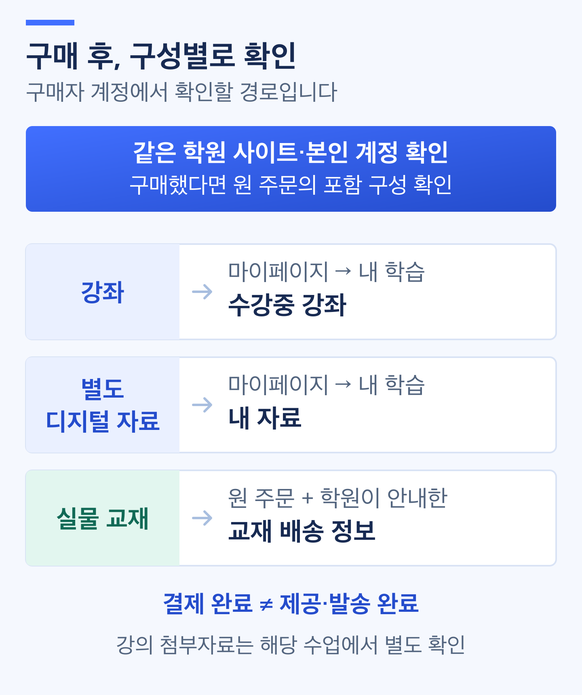

# 구매 후 콘텐츠 지급 확인하기

> **검토용 가이드** · 실제 서비스 화면·동작 확인과 이미지 보완이 남아 있습니다. 본문의 실행 보류·주의사항을 먼저 확인하세요.

구매한 강좌를 이용할 수 있는지, 디지털 자료를 받을 권한이 있는지, 교재의 배송 대상이 생성됐는지 확인합니다. 결제 후 이용 문의가 들어왔거나 판매 흐름을 검수할 때 사용합니다.

**결제 완료와 콘텐츠 지급 완료는 다릅니다.** 강좌는 수강 권한, 자료는 구매 당시 파일의 이용 권한, 교재는 배송 대상 생성으로 각각 확인합니다. 교재 배송 대상 생성은 실제 발송·수령 완료가 아닙니다.

**작업 순서:** 주문 대조 → 유효한 구성 확인 → 강좌·자료·교재별 결과 확인 → 확인되지 않은 항목 정리 → 담당자 확인

## 시작 전 준비 

| 준비할 것 | 확인 기준 |
| --- | --- |
| 대상 주문 | 주문번호·구매자·결제 상태·금액·시점. [주문 조회 가이드](order-and-payment-status.md) 참고 |
| 구매 당시 구성 | 포함 강좌·자료·교재와 수량. 현재 상품 구성이 아니라 해당 주문의 구성 |
| 취소 여부 | 부분 취소·환불 등으로 제외된 항목과 아직 유효한 항목 |
| 이용 확인 계정 | 구매자 본인의 확인 또는 승인된 테스트 구매자 계정 |
| 확인 범위 | 목록 표시·이용 권한·파일 수신·배송 생성 중 무엇을 확인하는지 |

운영자·강사 계정의 미리보기 성공을 구매자의 지급 성공으로 사용하지 않습니다. 학생의 비밀번호나 인증번호를 받아 대신 로그인하지 마세요. 운영 검수용 재생·다운로드는 승인된 테스트 주문과 계정으로 진행합니다.

## 메뉴 위치 

| 목적 | 현재 확인한 위치 | 한계 |
| --- | --- | --- |
| 운영자의 주문 대조 | 관리자 **결제/정산관리 → 결제 내역 → 상세 보기** | 결제 상세는 구성품별 지급 결과 화면이 아님 |
| 구매자의 강좌 확인 | 수강생 **마이페이지 → 내 학습 → 수강중 강좌** | 목록에 보이는 것만으로 이번 주문의 지급 성공을 확정할 수 없음 |
| 구매자의 자료 확인 | 수강생 **마이페이지 → 내 학습 → 내 자료** | 자료 이용 권한과 실제 파일 수신을 구분 |
| 주문별 지급·배송 결과 | 학생 **구매 내역 → 결제 → 해당 주문**의 구성품 제공/배송 정보·신청 영역 | 관리자 수강 내역과 학생 원 주문의 제공 결과를 구분. 실제 배포/권한별 결과는 검수 대기 |

아래 구매자 화면 확인은 운영자가 문의를 정리하거나 테스트할 때의 기준입니다. 실제 운영 환경의 메뉴 노출·권한을 먼저 확인하세요.

## 1. 주문과 유효한 구성 확인하기 

1. 결제 내역에서 대상 주문의 상세를 엽니다.
2. 주문번호·구매자·금액·시점을 대조합니다.
3. 결제 상태와 취소·환불 진행 여부를 확인합니다.
4. 해당 주문에 포함된 강좌·자료·교재와 유효한 수량을 확인합니다.

입금 대기나 결제 결과가 불명확한 주문을 지급 완료 대상으로 처리하지 않습니다. 반대로 **0원 주문에 외부 영수증이 없다는 이유로 지급 확인을 생략하지 않습니다.**

현재 관리자 상세에는 혼합 구성·수량 표시 차이가 있습니다. 구성이나 수량이 불명확하면 담당자가 구매 당시 주문 기록을 대조해야 합니다. 현재 상품을 다시 열어 과거 구성을 추정하거나 화면의 항목 수를 교재 수량으로 사용하지 않습니다.

> **화면 예시 준비 중** · 이번 주문의 구매 당시 구성과 현재 유효한 항목을 먼저 확인합니다.

## 2. 강좌 수강 권한 확인하기 

구매자 본인 또는 승인된 테스트 구매자 계정에서 다음을 확인합니다.

1. **내 학습 → 수강중 강좌**를 엽니다.
2. 상태 조건을 **전체**로 두고 대상 강좌와 페이지를 확인합니다.
3. 강좌명과 표시된 수강 기간·만료일을 확인합니다.
4. 입장 가능한 강좌의 **썸네일**을 눌러 학습 화면으로 이동할 수 있는지 확인합니다.
5. 재생 검수가 필요한 경우 승인된 테스트 계정으로 공개된 수업의 영상 재생을 확인합니다.

**강좌 소개 페이지가 열리는 것, 학습 화면에 들어가는 것, 영상이 재생되는 것은 서로 다른 확인입니다.** 강좌명 링크만 열어 보고 수강 권한이 정상이라고 판단하지 않습니다. 접근은 되지만 특정 영상만 재생되지 않으면 해당 수업의 공개·영상 연결·처리 상태도 별도로 확인합니다.

이미 같은 강좌의 수강권이 있었다면 목록 표시·접근 성공만으로 **이번 주문의 권한이 지급됐다고 확정할 수 없습니다.** 주문에 연결된 권한과 실제 적용 기간은 담당자가 대조해야 합니다. 현재 상품의 수강 일수만으로 구매자의 만료일을 다시 계산하지 않습니다.

> **화면 예시 준비 중** · 구매자에게 강좌가 보이고 학습할 수 있는지 확인합니다. 이번 주문의 권한은 별도로 대조합니다.

## 3. 디지털 자료 이용 권한 확인하기 

1. 구매자 화면의 **내 학습 → 내 자료**를 엽니다.
2. **전체**에서 대상 자료의 제목·파일명·지급일을 확인합니다.
3. **상세 보기**를 눌러 자료 정보와 이용 상태를 확인합니다.
4. **이용불가**이거나 자료가 없으면 주문·계정·취소 여부와 실제 권한을 담당자에게 확인합니다.

**권한이 지급되었는지와 파일을 실제로 받았는지는 별개입니다.** `미받음`이라고 표시되어도 권한 지급 실패를 뜻하지 않습니다. `받음`·`최초 다운로드` 표시는 다운로드 주소가 발급된 기록 기준이므로 파일 전송·저장·열람 완료를 보장하지 않습니다.

### 파일을 직접 확인해야 한다면 

**다운로드 주소 발급은 자료의 단순 취소 판단에 영향을 줄 수 있습니다.** 문의 확인이나 촬영만을 위해 실제 학생 주문의 다운로드를 실행하지 않습니다. 운영 검수는 승인된 테스트 자료·계정으로 진행하세요.

1. 자료 상세의 **자료 다운로드**를 누릅니다.
2. 확인창의 안내를 읽고, 실제 다운로드가 필요한 경우에만 **다운로드**를 누릅니다.
3. 파일이 실제로 저장됐는지, 열리는지, 내용이 해당 구매 자료와 일치하는지 확인합니다.

다운로드 주소·구매자 파일을 다른 학생에게 공유하지 않습니다. 주소가 만료되거나 발급이 실패하면 현재 권한과 오류 안내를 확인합니다. URL 발급 실패를 곧바로 미지급으로 판단하거나 새 구매를 안내하지 않습니다.

### 새 파일로 바꿨는데 이전 파일을 받는다면 

자료의 권한은 **구매 당시 파일 버전**에 연결됩니다. 관리자가 [자료 파일을 교체](../content-management/digital-resource-and-files.md)해도 기존 구매자의 권한이 최신 파일로 자동 변경된다고 안내하지 않습니다.

기존 구매자에게 이전 파일이 제공되면 원 주문에 연결된 버전부터 확인합니다. 파일명만으로 버전을 확정하거나, 확인되지 않은 버전 선택·재지급 버튼을 찾도록 안내하지 않습니다.

> **화면 예시 준비 중** · 자료 권한과 URL 발급 기록, 실제 파일 수신을 구분합니다.

> **동작 예시 준비 중** · 안내를 확인하고 테스트 파일의 실제 저장·열기 결과를 확인합니다.

## 4. 교재 배송 대상 생성 확인하기 

교재는 다운로드 권한이 아니라 **출고할 배송 대상**이 생성됐는지 확인합니다. 현재 학생 주문 상세에는 배송 정보/생성 대기와 배송 목록이 연결돼 있고 운영자는 **배송 관리 → 배송 관리**에서 원 주문을 찾습니다. 생성 대기 안내를 실제 자동 처리/발송이나 고정 시간 내 완료로 보지 않습니다.

택배사·출고지·반품지·배송비 기준은 [배송 설정하기](shipping-settings.md)를 참고합니다. 사이트 설정을 바꾸는 작업과 이미 생성된 주문·배송 건을 확인하는 작업은 다릅니다.

| 확인 항목 | 확인할 결과 |
| --- | --- |
| 주문 연결 | 대상 주문과 배송 대상이 일치함 |
| 교재·수량 | 구매 당시 구성과 취소 반영 후 실제 유효한 출고 대상이 일치함 |
| 수령 정보 | 해당 배송 건의 수령인·배송지와 필요한 연락처 확인 |
| 생성 결과 | 배송 대상이 생성됐는지, 아직 준비 중인지 구분 |
| 후속 상태 | 배송 준비·송장·발송 결과는 배송 생성과 별도 확인 |

배송비가 0원이어도 교재의 배송 대상 확인은 필요합니다. 배송이 아직 생성되지 않았다는 이유만으로 같은 주문을 다시 만들거나 배송을 수동 중복 생성하지 않습니다.

**배송 대상 생성은 발송 완료가 아닙니다.** 송장 저장·실제 발송·택배사의 이동·수령 완료도 각각 구분합니다. 이미 생성된 배송 정보와 주소록 변경의 관계도 별도 확인해야 합니다.

> **화면 예시 준비 중** · 교재 배송 대상 생성과 실제 발송·수령은 별도로 확인합니다.

## 5. 일부만 확인되거나 결과가 불명확할 때 

혼합 주문은 **현재 유효한 구성품마다** 확인합니다. 강좌 하나가 열렸다고 자료·교재까지 모두 처리됐다고 판단하지 않습니다. 취소로 처리 대상에서 제외된 항목은 지급 누락과 구분합니다.

아래는 업무 판단 기준입니다. 현재 학생 주문 상세의 처리 안내·구성품별 제공·배송/신청 영역과 각각 대조하되 관리자 화면에도 같은 배지가 있다고 가정하지 않습니다. 실제 처리 결과를 확인할 수 없는 항목은 완료 대신 확인 대기로 남깁니다.

| 상황 | 다음 확인 | 피할 행동 |
| --- | --- | --- |
| 결제 결과 확인 중 | 동일 주문의 최신 결제 결과·안내 | 새 주문·재결제 반복 |
| 결제 완료, 일부 이용 불가 | 구성품별 권한·파일·배송 생성과 오류 | 전체 성공 또는 전체 실패로 단정 |
| 후속 처리 지연·오류 | 자동 처리 여부와 담당자 확인 필요 여부 | 수동 중복 지급·배송 생성 |
| 부분 취소·환불 발생 | 실제 제외 범위·남은 권한·출고 대상 | 취소 항목을 다시 지급 |
| 과거 주문의 처리 기록 부족 | 기존 권한·배송·원 주문을 대조 | 기록 부재를 성공이나 실패로 자동 판정 |
| 처리 종료 확인을 받음 | 유효한 항목의 실제 결과와 제외 항목 | 모든 구성품이 지급됐다고 추정 |

**같은 주문 조회는 상태 확인이며 재지급 요청이 아닙니다.** 현재 확인한 관리자 화면에는 구성품 재처리 콘솔이 없습니다. 확인되지 않은 재시도 버튼이나 수동 수강권 부여를 기본 해결책으로 안내하지 않습니다. 처리 지연의 완료 시각도 임의로 약속하지 않습니다.

과거 주문에는 승인된 내부 지급 복구와 복구 보류가 적용될 수 있습니다. 내부 상태를 사용자 복구 버튼·무조건 재지급/기존 권리 복원 완료로 안내하지 않습니다. 원 주문/권리·현재 이용 제한을 정리하고 담당자에게 확인합니다.

## 6. 담당자에게 전달할 정보 정리하기 

| 전달할 것 | 정리 방식 |
| --- | --- |
| 주문·계정 | 주문번호와 구매자 식별 정보. 권한 있는 문의 경로로만 전달 |
| 구성·증상 | 어떤 강좌·자료·교재에서 무엇이 안 되는지 |
| 확인한 결과 | 목록 표시·기간·이용 상태·파일 수신·배송 생성의 확인/미확인 구분 |
| 발생 시각·환경 | 확인 시각, PC/모바일, 브라우저, 오류 문구 |
| 취소·변경 | 부분 취소·환불 진행, 기존 수강권·자료 파일 교체 여부 |

공개 문의·가이드 캡처의 학생 정보는 가립니다. 비밀번호·인증번호·결제 키·자료 다운로드 URL·전체 배송지를 일반 문의에 첨부하지 않습니다.

## 완료 후 확인 

- [ ] 해당 주문·구매자·구매 당시 구성과 유효한 항목을 대조했습니다.
- [ ] 강좌 접근과 이번 주문의 권한·적용 기간을 구분했습니다.
- [ ] 자료 권한·구매 당시 파일·URL 발급과 실제 파일 수신을 구분했습니다.
- [ ] 교재의 배송 생성과 준비·발송·수령을 구분했습니다.
- [ ] 혼합·0원·부분 취소 주문도 항목별로 확인했습니다.
- [ ] 미확인 결과를 완료로 처리하지 않고 필요한 정보를 담당자에게 전달했습니다.

## 자주 막히는 부분 

| 상황 | 확인할 것 |
| --- | --- |
| 결제 완료인데 강좌가 없어요 | 구매자 계정·전체 조건·주문 구성·권한 결과를 확인합니다. 재결제를 먼저 안내하지 않습니다 |
| 강좌는 보이는데 학습이 안 돼요 | 소개 페이지와 학습 진입을 구분하고 기간·권한·수업 공개·영상 상태를 확인합니다 |
| 같은 강좌가 원래 있었어요 | 이번 주문의 권한과 합산된 실제 기간을 대조합니다. 목록 존재만으로 이번 지급 완료를 확정하지 않습니다 |
| 자료가 미받음으로 보여요 | 권한 지급과 다운로드 주소 발급은 별도입니다. 미받음 자체는 지급 실패가 아닙니다 |
| 받음인데 파일을 못 받았어요 | 주소 발급 기록과 실제 전송·저장을 구분하고 권한·오류 안내를 확인합니다 |
| 새 파일로 교체했는데 이전 파일이에요 | 원 주문의 구매 당시 버전을 먼저 대조합니다. 자동 최신 버전 지급을 가정하지 않습니다 |
| 교재 배송 정보가 없어요 | 배송 생성 여부와 지연·오류를 담당자에게 확인합니다. 중복 주문·배송 생성을 피합니다 |
| 강좌는 열리는데 자료·교재는 안 보여요 | 혼합 주문의 유효한 구성품을 각각 확인합니다 |
| 재처리 버튼이 없어요 | 현재 확인한 화면에 관리자 구성품 재처리 동선은 없습니다. 담당자에게 결과 확인을 요청합니다 |

교재 배송 대상이 확인되면 [출고 준비·송장 등록하기](dispatch-and-tracking.md)의 품목·수량·수령 정보 확인 기준을 이어서 검토합니다. 배송 생성만으로 실제 발송이 끝났다고 판단하지 않습니다.
