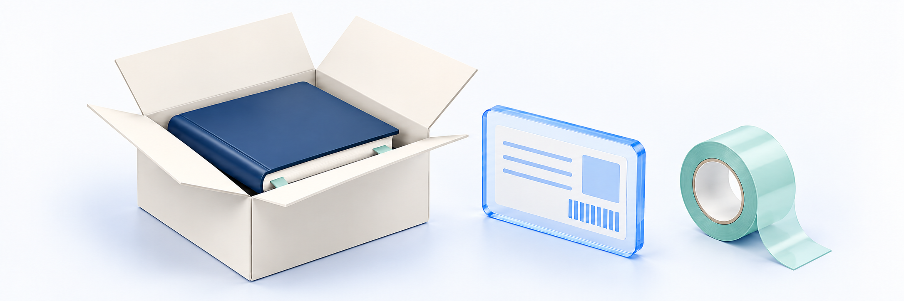

# 출고 준비·송장 등록하기

<figure><figcaption></figcaption></figure>

**업무 대상:** 주문 확인·콘텐츠 제공·교재 배송을 맡은 담당자용 안내입니다. 강사는 학생이 알려 준 문제와 대상을 정리해 해당 운영자에게 전달하세요. 실제 작업 가능 범위는 본인 계정의 권한을 확인하세요.

교재가 포함된 주문의 배송 대상과 수량·수령 정보를 확인하고, 실제 택배사·송장번호와 발송 결과를 기록합니다. 강좌·디지털 자료의 지급은 [구매 후 콘텐츠 지급 확인하기](content-fulfillment-check.md)에서 따로 확인합니다.

**송장 저장과 발송 완료는 다릅니다.** **송장 저장**은 송장 정보만 저장하고 **저장 후 발송 완료**는 저장 후 별도 발송 처리를 이어갑니다. 두 결과를 각각 확인하며 실제 택배 인계와도 구분합니다.

**업무 순서:** 배송 대상 확인 → 교재·수량·수령 정보 대조 → 출고 가능 여부 확인 → 송장 등록·저장 결과 확인 → 실제 인계 확인·발송 처리 → 상태·송장·이력 재확인

## 시작 전 준비 

| 준비할 것 | 확인 기준 |
| --- | --- |
| 담당 계정 | 배송 조회 권한과 변경 권한이 있는 운영자 계정. 조회 가능과 처리 가능은 다름 |
| 대상 주문 | 주문번호, 교재 배송 대상 생성 여부, 결제·취소 처리 결과 |
| 출고 품목 | 해당 배송의 교재명·현재 유효 수량·취소 표시 |
| 수령 정보 | 수령인·연락처·우편번호·기본/상세 주소·배송 요청사항 |
| 실제 송장 | 사용할 지원 택배사와 택배사에서 발급받은 송장번호 |
| 출고 기준 | [배송 설정하기](shipping-settings.md)의 택배사·출고지와 실제 포장·인계 담당자 |

송장 등록은 실제 택배 업무에서 확인한 정보를 클킷에 기록하는 작업입니다. 택배 계약·집하 접수·송장 발급·라벨 출력 기능은 포함하지 않습니다.

## 메뉴 위치 

**배송 관리 → 배송 관리**에서 주문번호·구매자·상품으로 검색합니다. 주문 기간·상태와 페이지당 표시 개수를 확인한 뒤 대상 배송의 상세를 엽니다. 상세에서는 **송장 저장**, **저장 후 발송 완료**, 주소 수정·변경 이력의 결과를 각각 확인합니다.

처음 처리하기 전 담당자에게 사용 가능한 메뉴와 처리 범위를 확인하고, 승인된 대상과 권한으로만 진행하세요. 결제 목록이나 재고 조정으로 송장 처리를 대신하거나 화면 밖의 방식으로 우회하지 않습니다. 예상한 버튼·확인창이 없으면 중단하고 담당자에게 확인합니다.

## 1. 배송 대상을 찾고 상태 구분하기 

배송 관리에서 원 주문과 해당 배송 상세를 대조합니다. 주문·결제 완료는 배송 대상 생성/실제 발송 완료가 아니며 0원 주문도 배송 대상과 출고 결과를 확인합니다.

| 관리자 배송 상태 | 확인 의미 | 다음 확인 |
| --- | --- | --- |
| 배송 대기 | 배송 대상이 생성된 준비 단계 | 교재·유효 수량·수령 정보 확인 |
| 배송 준비 | 포장·출고를 준비하는 단계 | 송장과 실제 인계 준비 확인 |
| 발송 완료 | 클킷에 발송 처리가 기록된 상태 | 저장된 택배사·송장·발송 기록 확인. 구매자 수령 완료와는 다름 |
| 배송 취소 | 주문·품목 취소 결과에 따라 배송 대상이 취소된 상태 | 일반 상태 변경으로 복원하거나 출고하지 않음 |

구매자에게 안내할 때는 배송 대기와 배송 준비를 모두 **상품 준비 중**으로 표현합니다. 실제 구매자 화면의 표시와 배송 조회 연결은 아직 확인되지 않았으므로, 안내 전에 담당자와 확인하세요. 택배 이동을 추정해 클킷의 상태를 배송 중·수령 완료로 바꾸지 않습니다.

배송 대상을 찾지 못했다면 주문 식별·조회 조건·권한·배송 생성 결과부터 확인합니다. 생성 지연이나 조회 실패를 배송 취소로 처리하거나 같은 주문을 다시 만들지 않습니다.

기간 검색과 최신순 정렬의 기준은 **주문 생성 시각**이며 배송 생성일·발송일이 아닙니다. 다만 실제 화면의 날짜 입력 방식·시간대와 검색 조건·건수 표시는 아직 확인되지 않았습니다. 기간으로 검색한 뒤에는 대상 주문의 생성 시각과 결과를 대조하고, 맞지 않으면 조건을 임의로 해석하지 말고 담당자에게 확인하세요.

> **화면 예시 준비 중** · 주문번호와 배송 상태를 대조해 출고 대상을 확인합니다.

## 2. 교재·수량·수령 정보 대조하기 

<figure><figcaption></figcaption></figure>

| 확인할 것 | 대조 기준 |
| --- | --- |
| 주문과 배송 | 같은 주문번호의 배송 건인지 확인 |
| 교재 | 해당 주문·배송에 기록된 교재명과 실제 포장할 교재 대조 |
| 수량 | 취소가 반영된 현재 유효 수량 확인. 취소 품목은 포장하지 않음 |
| 배송지 | 수령인·전화·우편번호·주소·상세 주소 확인 |
| 요청사항 | 해당 배송에 저장된 배송 요청사항 확인 |
| 혼합 주문 | 강좌·자료와 교재를 구분. 교재 취소를 주문 전체 취소로 해석하지 않음 |

상품의 현재 구성이나 교재 썸네일만으로 구매 당시 품목·수량을 다시 만들지 않습니다. 부분 취소가 반영된 수량에서 취소 수량을 다시 빼지 않으며, 누락·불일치가 있으면 출고를 보류하고 담당자에게 확인합니다.

현재 기준은 **주문 단위 합포장·단건 처리**입니다. 남은 교재 일부만 먼저 발송하거나 같은 주문에 임의로 여러 배송 건·송장을 만들어 처리하지 않습니다. 송장 CSV 업로드·일괄 발송·부분 출고는 이 가이드 범위가 아닙니다.

주소가 잘못됐거나 변경 요청이 있으면 [배송지 변경하기](change-shipping-address.md)의 실제 발송 이력·역할별 변경 조건부터 확인합니다. 주소록이나 사이트 출고지를 바꾸는 것으로 해당 주문의 수령 주소를 정정했다고 판단하지 않습니다. 실제 변경 화면의 확인이 남아 있으므로 담당자에게 처리 방법을 확인한 뒤 진행하세요.

> **화면 예시 준비 중** · 실제 포장할 교재·수량과 해당 배송의 수령 정보를 대조합니다.

## 3. 출고 가능 여부 확인하기 

포장·발송 전에 최신 주문·배송·취소 결과를 다시 확인합니다. 화면에 발송 가능으로 보여도 저장할 때 권한이나 주문 상태에 따라 처리가 제한될 수 있습니다. 거절 안내가 나오면 최신 상세와 사유를 확인합니다.

| 상황 | 처리 기준 |
| --- | --- |
| 결제·배송 결과가 확정되지 않음 | 발송하지 않고 결과 확인 |
| 취소·환불 확인 또는 결과 복구 중 | 발송 보류. 실패 표시만 보고 차단이 풀렸다고 판단하지 않음 |
| 일부 교재만 취소 확정 | 취소 결과가 반영된 나머지 유효 교재·수량과 출고 가능 여부 재확인 |
| 배송이 취소됐거나 유효 교재가 없음 | 발송하지 않음 |
| 이미 발송 완료 | 재발송 처리 대신 해당 건의 송장·이력 확인 |
| 다른 담당자가 변경함 | 최신 상세를 다시 조회하고 변경 내용 비교 |

출고가 막혔다고 상태를 되돌리거나 송장을 바꿔 차단을 우회하지 않습니다. 관련 주문의 취소·환불·결제 확인을 담당자에게 요청합니다. 결제 정보 조회에 별도 권한이 필요한 경우에도 임의로 권한을 넓히지 않습니다.

## 4. 택배사·송장번호 등록하기 

### 입력할 정보 

| 항목 | 확인 기준 |
| --- | --- |
| 택배사 | 실제 발송할 지원 택배사. 이 가이드에서 다루는 목록은 CJ대한통운·한진택배이며, 실제 사용 가능 여부는 운영 화면과 담당자에게 확인 |
| 송장번호 | 택배사에서 발급받은 숫자 8~30자리. 공백·하이픈·배송 조회 URL을 넣지 않음 |
| 대상 배송 | 포장한 교재·수령인과 송장이 같은 배송인지 확인 |

기본 택배사가 있다고 해당 배송의 택배사·송장이 올바르게 저장됐다고 가정하지 않습니다. 지원 목록에 없는 택배사를 다른 이름으로 선택하지 않고, 길이 검증 통과만으로 택배사가 실제 발급한 송장이라고 판단하지 않습니다.

### 송장·발송 저장 결과 확인 

1. 최신 배송 상세에서 대상 주문과 배송 상태를 확인합니다.
2. 실제 택배사·송장번호를 확인된 입력 방식으로 등록합니다.
3. 저장 뒤 상세를 다시 조회해 택배사와 송장번호가 유지되는지 확인합니다.
4. 송장만 저장한 경우 상태와 실제 발송 기록이 그대로인지 확인합니다.

**송장 저장**은 송장 정보만 저장합니다. **저장 후 발송 완료**는 송장을 저장한 뒤 최신 상태에서 발송할 수 있는지 확인하고 발송 처리를 이어갑니다. 송장 저장만 성공하고 발송 처리는 실패할 수 있으므로, 송장·상태·이력을 따로 확인하고 전체 작업을 반복하지 않습니다.

> **화면 예시 준비 중** · 실제 택배사·송장을 확인하고 저장 결과를 다시 조회합니다.

## 5. 실제 인계 확인·발송 결과 재확인하기 

실제 포장·택배 인계 사실을 확인한 뒤, 담당자와 확인한 화면·순서에 따라 발송 처리합니다. 송장 발급만으로 물건이 택배사에 인계됐다고 판단하지 않습니다.

발송 처리에는 지원 택배사·유효 형식의 송장과 주문·취소 조건 확인이 필요합니다. 저장된 송장을 사용하는 절차라면 송장 저장 후 최신 상세를 기준으로 진행합니다.

| 처리 후 확인 | 완료 판단 |
| --- | --- |
| 배송 상태 | 다시 조회한 결과가 발송 완료인지 확인 |
| 택배사·송장 | 실제 인계한 배송의 정보와 일치 |
| 발송 기록 | 발송 시각·변경 이력 확인 |
| 교재·수량 | 발송한 교재와 현재 유효 배송 품목 일치 |
| 구매자 안내 | 최종 구매자 화면의 발송 상태·송장·조회 연결을 별도 확인 |

성공 알림 이후 재조회가 실패하거나 결과가 불명확하면 같은 작업을 반복하지 않습니다. 주문번호·배송 건·처리 시각·기대 결과를 정리해 확인하고, 실제로 발송한 상품을 중복 출고하지 않습니다.

발송 뒤 결제대행사(PG)의 배송 정보 반영과 에스크로 등 후속 처리는 별도입니다. 클킷에서 발송 완료로 보여도 결제대행사에 배송 정보가 전달됐거나 구매확정·정산이 끝났다는 뜻은 아닙니다. 후속 처리에 오류가 있으면 담당자에게 문의하고, 해결하려고 발송 상태를 되돌리거나 다시 발송 처리하지 않습니다.

> **동작 예시 준비 중** · 송장 저장과 발송 처리를 구분하고 최신 상태·이력을 확인합니다.

## 6. 공식 조회·정정·변경 이력 확인하기 

### 배송 조회 

상세에 **배송 조회**가 있으면 저장된 택배사·송장번호를 기준으로 공식 조회 페이지를 엽니다. 링크가 있어도 택배 접수나 조회 성공을 뜻하지는 않습니다. 외부 조회와 송장 복사의 기기별 동작은 아직 확인되지 않았습니다. 열리지 않으면 임의 주소·다른 택배사 링크로 우회하지 말고 담당자에게 확인하세요.

공식 조회 URL이 생성됐다는 사실과 택배사 조회 성공은 다릅니다. 조회 결과가 없거나 내용이 다르면 택배사·송장·실제 인계 사실을 확인합니다. 그 결과만으로 배송 취소·수령 완료·중복 발송을 처리하지 않습니다.

### 송장 정정과 상태 보정 

| 필요한 작업 | 주의할 점 |
| --- | --- |
| 잘못된 택배사·송장 정정 | 실제 발송 정보와 대조 후 최신 상세로 수정. 송장 정정만으로 상태·발송 사실은 바뀌지 않음 |
| 배송 대기·준비·발송 상태 보정 | 운영 오류의 확인된 사실만 반영. 같은 상태를 반복 저장하거나 취소 상태를 일반 선택하지 않음 |
| 발송 완료를 준비 단계로 되돌림 | 활성 택배사·송장·현재 발송 시각은 해제되지만 최초 발송 사실과 변경 이력은 남음 |
| 출고 전 취소 요청 | 주문 취소·환불 결과를 확인. 배송 상태를 임의 취소로 변경하지 않음 |

**발송 상태를 되돌려도 주소 변경이나 출고 전 취소 자격이 복원되지 않습니다.** 실제 발송 이력을 없애는 작업이나 재출고 수단으로 보정 기능을 사용하지 않습니다. 배송 취소는 일반 복원이 불가능합니다.

변경 뒤 처리자·시각·변경 전후 상태·송장을 이력에서 대조합니다. 사유 메모는 선택 항목으로 안내하고 있으나 실제 화면의 입력 방식은 아직 확인되지 않았습니다. 필요한 기록 방법은 담당자에게 확인하세요. 과거 이력이 없으면 현재 상태로 가짜 이력을 만들거나 정확한 발송 시각을 추정하지 않습니다.

> **화면 예시 준비 중** · 발송 상태·송장·변경 이력을 확인합니다. 수령 완료와는 다릅니다.

### 출고 CSV는 내보내기입니다 

목록의 **출고 CSV 다운로드**는 현재 검색·상태·주문 기간 조건에 해당하는 여러 페이지의 배송 내역을 파일로 내보냅니다. 송장 CSV 업로드·송장 등록·일괄 발송 기능이 아닙니다. 화면에 보이는 한 페이지만 내보내는 것으로 생각하지 말고, 다운로드 권한과 검색 범위·파일에 담긴 대상·건수·저장 위치를 확인하세요. 수령인·연락처·주소가 포함될 수 있으므로 필요한 출고 업무가 아니라면 내려받지 말고, 개인정보가 담긴 원문을 오류 문의에 공유하지 않습니다.

## 완료 후 확인 

- [ ] 배송 관리 메뉴와 조회·변경 권한을 확인하고 한 건씩 처리했습니다.
- [ ] 주문·교재·현재 유효 수량·취소 결과·수령 정보가 실제 포장과 일치합니다.
- [ ] 최신 출고 가능 여부와 취소·환불 확인 상태를 다시 확인했습니다.
- [ ] 실제 택배사·송장번호와 저장 후 조회 결과를 대조했습니다.
- [ ] 송장 저장·발송 처리·실제 인계를 구분했습니다.
- [ ] 발송 처리 후 상태·송장·시각·이력을 다시 확인했습니다.
- [ ] 공식 배송 조회 결과와 구매자에게 표시되는 안내를 별도로 확인했습니다.
- [ ] 충돌·불명확 결과·보정으로 중복 출고나 제한 우회를 하지 않았습니다.

## 자주 막히는 부분 

| 상황 | 확인할 것 |
| --- | --- |
| 배송 관리 메뉴가 없어요 | 사이트의 배송 관리 제공 여부와 계정 권한·조회 결과를 담당자에게 확인합니다. 다른 계정이나 화면 밖의 방식으로 우회하지 않습니다 |
| 결제 완료인데 배송 건이 안 보여요 | 주문 식별·조회 조건·권한·배송 생성 결과를 확인합니다. 새 주문을 만들지 않습니다 |
| 송장을 저장했는데 배송 준비로 남아 있어요 | 송장 저장과 발송 처리는 별도입니다. 실제 인계와 확인된 발송 동선을 확인합니다 |
| 발송 처리가 거절됐어요 | 지원 택배사·송장 형식·취소/환불·유효 품목·최신 상태·권한을 확인합니다 |
| 다른 담당자가 변경했다는 안내가 나와요 | 최신 상세와 변경 내용을 확인합니다. 오래된 값으로 자동 덮어쓰지 않습니다 |
| 일부 교재를 취소했어요 | 취소 결과가 반영된 남은 교재와 수량을 확인합니다. 전체 배송 취소나 취소 수량 이중 차감으로 처리하지 않습니다 |
| 공식 조회에 결과가 없어요 | 실제 택배사·송장·인계 사실을 확인합니다. 클킷에서 배송 중·수령 완료를 임의 설정하지 않습니다 |
| 준비로 되돌렸는데 주소가 잠겨 있어요 | 최초 발송 이력은 남습니다. 상태 보정으로 변경 자격을 복원하지 않습니다 |
| 후속 처리 오류가 보여요 | 내부 발송과 외부 후속 결과를 분리해 담당자에게 확인합니다. 재발송·중복 출고로 해결하지 않습니다 |
