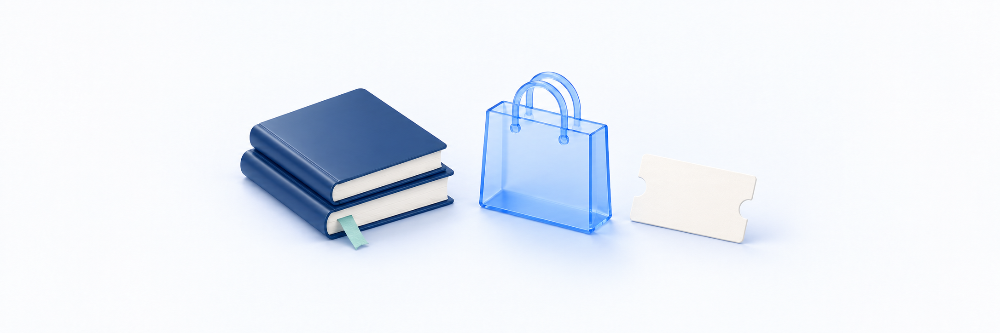

# 과세·면세 정보 설정하기

> **검토용 가이드** · 실제 서비스 화면·동작 확인과 이미지 보완이 남아 있습니다. 본문의 실행 보류·주의사항을 먼저 확인하세요.

<figure><figcaption></figcaption></figure>

상품에 포함된 **각 콘텐츠의 과세 유형**을 설정합니다. 이 문서는 클킷의 입력 절차를 안내하며 개별 상품이 법적으로 면세에 해당하는지를 판단하는 문서가 아닙니다. 판단이 불확실하면 판매자의 확인된 기준을 먼저 정리합니다.

**작업 순서:** 구성·금액 확인 → 콘텐츠별 과세/면세 선택 → 면세 책임 확인 → 저장 → 설정 재조회·주문 결과 확인

## 시작 전 준비 

| 준비할 것 | 확인 기준 |
| --- | --- |
| 상품과 구성 | [상품 생성·콘텐츠 연결](create-products-and-connect-content.md)의 포함 콘텐츠 확인 |
| 구성 금액 | [가격·할인 설정](price-discount-and-valid-days.md)에 따라 실제 상품에서 사용할 금액 확인 |
| 판매자 판단 | 콘텐츠별로 적용할 과세/면세와 확인된 판단 자료 |
| 수정 범위 | 기존 주문과 신규 판매 설정을 구분할 수 있는 변경 기록 |

강좌·교재·디지털 자료라는 종류만으로 과세 유형을 자동 확정하지 않습니다. **ISBN 입력·미입력도 면세 설정을 대신하지 않습니다.**

## 메뉴 위치 

상품 생성의 **정보 입력**, 또는 상품 상세의 **상품 설정**에서 **과세 설정**으로 이동합니다. 먼저 콘텐츠를 선택해야 구성품별 설정이 표시됩니다.

## 1. 콘텐츠별 과세 유형 선택하기 

1. 포함 콘텐츠의 이름과 수량을 확인합니다.
2. 각 콘텐츠 옆 **과세** 또는 **면세**를 선택합니다.
3. 패키지는 모든 항목을 확인합니다. 일부만 면세라면 해당 항목만 면세로 선택합니다.

여러 콘텐츠가 모두 같은 유형이면 **전체 적용**을 사용할 수 있습니다. 이 기능은 현재 선택한 모든 항목의 유형을 바꾸므로, 혼합 과세 구성을 만들 때는 적용 후 각 항목을 다시 확인합니다.

| 구성 예시 | 입력 방식 |
| --- | --- |
| 과세로 확인된 콘텐츠만 구성 | 각 항목 과세, 또는 전체 적용 후 확인 |
| 면세로 확인된 콘텐츠만 구성 | 각 항목 면세, 책임 확인 |
| 과세·면세가 함께 있는 패키지 | 각 콘텐츠를 개별 선택하고 책임 확인 |

위 표는 입력 방식의 예시이며 어떤 강좌·교재·자료가 면세인지 정하는 기준표가 아닙니다. 새 콘텐츠를 추가했으면 초기 선택값을 그대로 믿지 말고 다시 확인하세요.

> **화면 예시 준비 중** · 각 구성품의 과세 유형을 확인하고 필요하면 개별 설정합니다.

## 2. 면세 책임 확인하기 

면세 콘텐츠가 하나라도 있으면 아래 공통 체크박스가 표시됩니다.

> 선택한 콘텐츠의 과세·면세 판단과 입력 정보에 대한 판매자 책임을 확인합니다.

판단과 입력을 확인한 뒤 체크합니다. 구성품마다 체크박스를 따로 누르는 화면이 아니라, **공통 확인 하나를 선택한 면세 구성품들에 적용하는 방식**입니다.

콘텐츠를 추가·제거하거나 과세 유형을 바꾸면 확인이 해제될 수 있습니다. 수정된 전체 구성을 다시 확인한 뒤 체크하세요. 저장 버튼을 활성화하려고 검토 없이 책임 확인만 누르지 않습니다.

> **화면 예시 준비 중** · 면세 구성과 입력 정보에 대한 판매자 책임을 확인합니다.

### 면세 사유·증빙은 어디에 입력하나요? 

현재 확인한 화면에는 **필수 면세 사유·판단 근거 입력란이 없습니다.** 화면에 없는 입력란을 찾거나, 해당 입력을 완료했다고 판단하지 마세요.

증빙 첨부는 클킷에서 선택 사항이지만, **현재 화면에서 증빙 파일을 첨부하는 방법은 확인되지 않았습니다.** 별도 업로드 버튼이나 제출 완료를 가정하지 마세요. 자료가 필요하면 운영 담당자와 실제 보관·제출 방법을 확인합니다. 클킷에 첨부하지 않았다는 사실만으로 판매자의 판단 자료가 필요 없다는 뜻은 아닙니다.

## 3. 저장하고 설정 다시 확인하기 

생성은 **최종 완료**, 수정은 **수정 완료**를 누릅니다. 저장 후 **상품 설정**을 다시 열어 구성품별 과세 유형과 책임 확인 상태를 확인합니다.

과세 정보 오류로 저장이 거절되면 해당 구성의 유형·책임 확인·금액을 점검합니다. 다른 담당자가 먼저 수정했으면 최신 설정을 다시 조회하고 변경 내용을 비교합니다. 검증을 통과시키기 위해 실제 판단과 다른 유형으로 바꾸지 않습니다.

> **화면 예시 준비 중** · 저장된 구성품별 과세 유형과 책임 확인을 다시 확인합니다.

## 4. 주문 결과와 기존 주문 구분하기 

설정 변경과 구매 결과는 별도로 확인합니다. 승인된 테스트 주문에서는 상품 구성·할인·쿠폰·배송비와 함께 결제 금액 및 제공되는 과세/면세 표시를 확인합니다. 관리자 설정 화면이 맞더라도 결제대행사(PG)에 전달되는 정보·증빙·환불 계산까지 모두 확인된 것은 아닙니다.

**상품 과세 설정을 수정해도 기존 주문의 세금·금액을 자동으로 다시 계산했다고 안내하지 않습니다.** 과거 주문의 정정이 필요하면 해당 주문과 처리 근거를 확인하고 별도 절차를 따릅니다.

## 완료 후 확인 

- [ ] 모든 구성품의 과세 유형을 확인했습니다.
- [ ] 전체 적용을 사용했다면 혼합 구성 여부를 다시 확인했습니다.
- [ ] 면세 항목의 판매자 판단과 공통 책임 확인이 일치합니다.
- [ ] 저장 후 다시 연 설정에서 의도한 유형이 유지됩니다.
- [ ] 증빙 보관·제출과 기존 주문 정정을 화면 설정 변경과 구분했습니다.

## 자주 막히는 부분 

| 상황 | 확인할 것 |
| --- | --- |
| 과세 설정에 항목이 없어요 | 먼저 상품에 콘텐츠를 선택했는지 확인합니다 |
| 전체 적용 후 일부 항목이 잘못됐어요 | 전체 적용은 모든 현재 항목을 바꿉니다. 각 콘텐츠의 실제 유형을 다시 선택합니다 |
| 면세를 선택했는데 저장이 안 돼요 | 판매자 책임 확인과 구성 금액·화면 오류를 확인합니다 |
| 책임 확인이 풀렸어요 | 콘텐츠 구성이나 과세 유형 변경 후 다시 확인하는 상태인지 점검합니다 |
| 면세 사유·증빙 입력란이 없어요 | 현재 확인한 화면에는 면세 사유의 필수 입력란이 없으며, 증빙을 첨부하는 방법도 확인되지 않았습니다. 실제 제출 방법을 담당자에게 확인합니다 |
| ISBN을 넣었는데 과세로 보여요 | ISBN과 과세 설정은 별도입니다. 확인된 판매자 판단에 맞게 설정합니다 |
| 설정을 바꿨는데 기존 주문은 그대로예요 | 신규 상품 조건 변경과 과거 주문 정정은 다른 작업입니다 |
