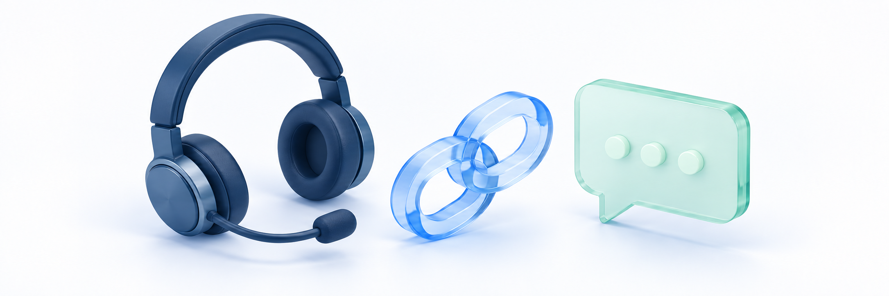

# 상담 채널 연결하기

> **이용 전 확인** · 실제 서비스 화면·동작이 아직 확인되지 않은 항목이 있습니다. 문서의 제한·주의사항을 따르고, **실행 보류**로 표시한 작업은 진행하지 마세요.

<figure><figcaption></figcaption></figure>

**업무 대상:** 외부 상담 채널 연결을 맡은 담당자용 안내입니다. 강사·질답 조교의 학습 질문 답변은 Q&A에서 진행하며, 사이트 공통 상담 설정은 담당 운영자에게 요청하세요.

**외부 서비스 연동 → 고객 상담 채널**에서 사이트에 표시할 상담 채널을 선택하고 연결 정보를 저장합니다. **채널톡 / 카카오톡 채널 / 사용 안 함** 중 하나를 선택하며 두 채널을 동시에 활성화하는 설정은 아닙니다.

**완료 기준:** 같은 설정 화면을 다시 열어 저장한 채널·연결 정보·노출 조건이 유지되고, 실제 사이트에서 의도한 대상과 기기에만 상담 버튼이 나타나며 올바른 상담 창/채널로 연결됩니다. 관리자 화면의 저장 안내만으로 외부 상담 연결까지 완료됐다고 판단하지 않습니다.

학생의 학습 질문에 답변하려면 [Q&A](qna-answer.md), 설문·신청 응답을 받으려면 [사이트 폼](site-form-create-and-responses.md)을 사용합니다. 이 페이지는 외부 상담 버튼 연결 안내이며 상담 내용이 클킷 Q&A나 폼 응답으로 자동 저장되는 기능 안내가 아닙니다.

## 시작 전 준비 

| 준비할 것 | 확인 기준 |
| --- | --- |
| 사이트·계정 | 해당 사이트의 연동 설정 조회·변경 권한이 있는지 확인합니다. 조회가 된다고 저장·연결 해제가 모두 가능한 것은 아닙니다 |
| 플랜·구독 | 상담 기능 제공 범위와 구독 상태를 확인합니다. 카카오톡에도 같은 이용 제한이 적용되므로 모든 플랜에서 가능하다고 가정하지 않습니다 |
| 채널톡 연결 정보 | 담당자가 관리하는 채널의 웹 플러그인 **Plugin Key**를 준비합니다. API 인증 키 등 다른 키를 대신 넣지 않습니다 |
| 카카오톡 연결 정보 | 담당자가 확인한 카카오톡 채널의 공개 URL을 준비합니다. 개인 채팅방·오픈채팅·관리자센터 주소와 구분합니다 |
| 노출 계획 | 사용할 채널 하나, 채널톡의 회원/비회원 조건, 각 채널의 PC·모바일 노출을 정합니다 |
| 아이콘 | 필요한 경우 개인정보 없는 아이콘을 준비합니다 |

외부 서비스 가입·키 발급·채널 개설의 최신 메뉴와 요금은 이 가이드에서 다루지 않습니다. 화면의 **채널톡 바로가기 / 카카오톡 채널 바로가기**는 외부 서비스로 이동하는 버튼이며 클킷 연결 저장이나 외부 계정 생성 완료 버튼이 아닙니다.

## 채널 선택과 저장 구분하기 

**현재 연결 확인 → 채널 선택 → 연결/노출 설정 → 저장 → 재진입 대조 → 사이트 노출/연결 확인** 순서로 진행합니다. 이 화면은 수동 저장 방식이며 [폼 만들고 응답 확인하기](site-form-create-and-responses.md) 폼의 자동저장과 다릅니다.

| 선택·작업 | 저장 후 의미 | 주의할 점 |
| --- | --- | --- |
| 채널톡 | 조건에 맞는 사이트 방문자에게 채널톡을 사용하도록 설정 | Plugin Key·노출 대상·기기를 함께 확인합니다 |
| 카카오톡 채널 | 사이트 버튼에서 해당 카카오톡 채널 상담 주소로 이동하도록 설정 | 채널 URL·기기·실제 목적지를 확인합니다 |
| 사용 안 함 | 사이트 상담 버튼을 숨기고 저장된 두 채널의 연결 정보는 유지 | 선택만 하지 말고 저장합니다. 외부 채널 삭제·계약 해지가 아닙니다 |
| 연결 해제 | 대상 채널의 연결 정보를 지움. 활성 채널이면 사용 안 함으로 전환 | 다른 채널을 자동 활성화하지 않습니다. 단순 숨김과 다릅니다 |

> **화면 예시 준비 중** · 사용할 상담 채널 하나를 선택하고 연결 정보를 설정합니다.

## 1. 채널톡 연결하기 

1. **고객 상담 채널**에서 기존 연결과 노출 조건을 먼저 확인합니다. 현재 설정을 바꿔도 되는 사이트인지 확인한 뒤 **채널톡**을 선택합니다.
2. **채널톡 연동 설정 → Plugin Key**에 준비한 웹 플러그인 키를 입력합니다. 임의 문자열이 형식 검사를 통과하더라도 유효한 외부 채널이라는 뜻은 아닙니다.
3. **노출 설정 → 노출 대상 조건**에서 **전체 사용자 / 로그인 사용자만 / 비회원만**을 선택합니다.
4. **PC / 모바일 노출 여부**를 정합니다. 활성 채널은 PC·모바일 중 하나 이상을 켜야 합니다. 둘 다 끄는 대신 잠시 숨기려면 사용 안 함 절차를 사용합니다.
5. 아래 **저장**을 누르고 결과를 확인합니다. 저장/재진입과 실제 사이트 확인은 뒤의 공통 절차를 따릅니다.

로그인 사용자 조건은 클킷에서의 로그인 여부입니다. 특정 강좌 수강 여부나 채널톡 회원 상태와 같다고 안내하지 않습니다. 이 조건을 선택했다고 외부 상담 창에 학생 이름·학습 정보가 자동 연결되는 것도 보장하지 않습니다.

> **화면 예시 준비 중** · 채널톡 키와 로그인 조건·기기별 노출을 확인합니다.

## 2. 카카오톡 채널 연결하기 

1. **카카오톡 채널**을 선택하고 **카카오톡 채널 연결 설정 → 채널 URL**에 준비한 공개 URL을 입력합니다.
2. 기본 주소 형태는 `https://pf.kakao.com/_채널ID`입니다. `_채널ID`는 설명용 자리이며 실제 담당 채널 주소로 바꿔야 합니다. 주소를 직접 추측해 만들지 않습니다.
3. 채널 주소 뒤의 `/chat`은 허용되며 저장 시 기본 채널 주소로 정리됩니다. 추적 쿼리·해시·임의 포트가 붙은 주소나 다른 도메인의 링크는 넣지 않습니다.
4. **PC / 모바일 노출 여부**를 정합니다. 둘 중 하나 이상을 켜고 필요한 경우 아래 아이콘 설정을 진행합니다.
5. **저장** 후 같은 화면의 URL·기기 설정을 대조합니다. 실제 버튼은 해당 채널의 `/chat` 주소를 새 창으로 여는 구조이므로 외부 목적지를 별도로 확인합니다.

채널톡의 **노출 대상 조건** 선택란이 카카오톡에도 있다고 안내하지 않습니다. 현재 카카오톡 설정은 PC·모바일 구분이며 회원 전용 상담·본인인증을 보장하는 접근 제어가 아닙니다. URL 형식 검사도 외부 채널의 존재·상담 가능 상태 검사를 대신하지 않습니다.

> **화면 예시 준비 중** · 카카오톡 채널 공개 주소를 입력하고 표시할 기기를 정합니다.

## 3. 카카오톡 상담 버튼 아이콘 바꾸기 

| 항목 | 준비 기준 |
| --- | --- |
| 형식 | PNG, JPEG/JPG, WebP의 정적 이미지. GIF·SVG는 이 아이콘의 허용 목록에 없습니다 |
| 파일 크기 | 화면 안내 기준 **2MB 이하**입니다. 이 입력의 파일 크기 제한은 2,097,152바이트 기준이며 실제 업로드 결과도 확인합니다 |
| 모양·해상도 | 정사각형 256 × 256px을 권장합니다. 잘라내기 화면에서 원형 버튼 안의 잘림을 확인합니다 |
| 내용 | 작은 버튼에서도 구별되는 이미지를 사용합니다. 개인정보·연결 키·작은 안내 문구는 넣지 않습니다 |

1. **채널 아이콘 설정**의 이미지/카메라 버튼에서 파일을 선택합니다.
2. 잘라내기 화면에서 위치·크기를 맞추고 **확인**합니다. **취소**는 새 아이콘 적용을 마친 것이 아닙니다.
3. 설정 화면의 아이콘 미리보기를 확인하고 **저장**합니다. 잘라내기 확인·미리보기 표시는 설정 저장 완료와 다릅니다.
4. 같은 설정을 다시 열고 실제 사이트의 아이콘도 확인합니다. 업로드·연결 후 반영 처리가 별도로 진행될 수 있으므로 저장 직후 미리보기만으로 완료 처리하지 않습니다.

손상된 이미지·지원하지 않는 내용은 확장자가 맞아도 거절될 수 있습니다. 사용자 지정 아이콘을 불러오지 못하면 기본 카카오 아이콘으로 표시될 수 있으며, 기본 아이콘이 보이는 것을 새 이미지 반영 성공으로 판단하지 않습니다. 별도 아이콘 제거 버튼을 가정하거나 아이콘만 바꾸기 위해 연결 전체를 해제하지 않습니다.

> **화면 예시 준비 중** · 아이콘을 잘라 확인한 뒤 저장합니다. 실제 사이트의 이미지도 대조합니다.

## 4. 저장 후 같은 설정 다시 확인하기 

1. 사용할 채널·연결 정보·노출 조건을 확인하고 **저장**을 누릅니다. 채널 선택·입력·아이콘 미리보기만으로는 저장되지 않습니다.
2. **고객 상담 채널 설정이 저장되었습니다.** 안내를 확인한 뒤 같은 설정 화면을 다시 엽니다.
3. 선택 채널과 Plugin Key/URL·대상·PC/모바일·아이콘을 대조합니다. 저장 요청은 두 채널 설정을 함께 포함하므로 오류가 나면 선택하지 않은 채널의 입력 안내도 확인합니다.
4. 저장 실패·결과 불명확 시 최신 설정부터 확인합니다. 아이콘 업로드 성공이나 버튼 비활성만으로 저장 성공을 판단하거나 저장을 반복하지 않습니다.

**다른 관리자가 설정을 변경했습니다. 최신 설정을 확인해 주세요.** 안내가 나오면 자동 병합됐다고 생각하지 않습니다. 저장 충돌 후 화면에는 입력 중인 값이 남아 있을 수 있으므로 필요한 입력을 보존하고 최신 저장값과 비교한 뒤 변경안을 다시 정합니다. 재저장으로 다른 관리자의 변경을 덮지 않도록 담당자와 확인합니다.

조회 실패 화면의 **다시 시도**는 설정을 다시 불러오는 버튼이며 변경 내용을 저장하지 않습니다. 변경하지 않은 상태·저장 중·아이콘 업로드 중·구독 만료에는 저장이 비활성일 수 있습니다. 버튼이 보이더라도 권한·이용 플랜에 따라 저장이 거절될 수 있습니다.

> **화면 예시 준비 중** · 저장 후 같은 설정을 다시 확인합니다. 충돌하면 최신 설정과 비교합니다.

## 5. 사이트에서 실제 노출과 상담 목적지 확인하기 

관리자 설정 화면이 아닌 **실제 수강생 사이트**를 새로 열어 확인합니다. 이미 열린 다른 브라우저의 설정이 즉시 갱신된다고 가정하지 않습니다.

| 확인 위치·조건 | 확인할 결과 |
| --- | --- |
| 실제 PC·모바일 웹 | 켠 환경에 선택한 상담 버튼이 나타나고 끈 환경에는 나타나지 않는지 확인합니다. 창 너비만 바꾸지 말고 실제 모바일 기기에서도 확인합니다 |
| 채널톡 회원·비회원 | 로그인/로그아웃 후 노출 대상 조건과 일치하는지 확인합니다. 외부 상담자의 자동 식별·기존 대화 연결은 별도 결과입니다 |
| 카카오톡 버튼 | 학원의 올바른 상담 채널로 새 창이 열리는지 확인합니다. 앱 실행·로그인·상담 가능 상태도 실제 기기에서 확인합니다 |
| 로그인·회원가입·인증 페이지 | 사이트 상담 버튼을 사용하지 않는 별도 화면입니다. 이 위치만 보고 연결 실패로 판단하지 않습니다 |
| 강의 영상 학습 화면 | 패널을 닫은 상태에서는 버튼 숨김 규칙이 적용됩니다. 패널을 열었을 때와 다른 일반 페이지를 함께 확인합니다 |
| 관리자 화면 | 클킷 고객지원용 버튼은 별도 연결입니다. 이 버튼을 우리 사이트 상담 채널의 성공 증거로 사용하지 않습니다 |

채널톡은 실제 상담 창이 열리고 의도한 채널로 연결되는지 확인합니다. 카카오톡은 새 창 이동과 상담 가능 여부를 구분합니다. 메시지 송수신까지 확인해야 한다면 상담 담당자와 먼저 협의하세요. 버튼 클릭·창 열림만으로 상담이 접수되거나 답변이 완료된 것은 아닙니다.

> **화면 예시 준비 중** · 사이트에서 대상·기기별 버튼과 실제 상담 목적지를 확인합니다.

> **동작 예시 준비 중** · 수동 저장한 노출 설정을 다시 열어 확인하고 사이트 표시와 대조합니다.

## 6. 채널 전환하거나 잠시 숨기기 

**다른 채널로 전환:** 사용할 채널 선택 → 그 채널의 연결/노출 설정 확인 → 저장 → 재진입 → 사이트 결과 확인 순서입니다. 활성 채널은 하나지만 이전 채널의 저장된 정보까지 자동 삭제되는 것은 아닙니다. 다른 관리자가 작업 중이면 먼저 확인합니다.

**잠시 숨기기:** **사용 안 함 → 저장 → 재진입·사이트에서 버튼 숨김 확인** 순서로 진행합니다. 두 채널의 연결 정보는 유지되므로 나중에 다시 선택할 때도 키/URL·노출 조건을 확인하고 저장합니다.

사용 안 함은 외부 서비스의 채널 삭제·상담 이력 삭제·유료 계약 해지가 아닙니다. 구독 만료 등으로 변경이 막히면 외부 상담도 자동 종료됐다고 판단하지 말고 담당자에게 확인합니다.

## 7. 연결 정보 지우기 

1. 현재 저장된 채널과 연결 해제할 대상을 확인합니다. 연결 정보가 있는 해당 설정 영역의 **연결 해제**를 사용합니다.
2. 미저장 변경이 있으면 화면의 안내에 따라 먼저 처리합니다. 오류·임시 입력을 무조건 저장해 해제를 진행하지 말고 변경안을 보존한 뒤 최신 설정과 비교합니다.
3. **연결 정보를 삭제할까요?** 확인 창에서 대상 채널을 다시 확인하고 승인된 경우에만 확정합니다. 취소는 해제 완료가 아닙니다.
4. 같은 설정을 다시 열어 대상 연결 정보가 정리됐는지 확인합니다. 활성 채널을 해제했다면 **사용 안 함** 전환과 실제 사이트 버튼 숨김도 확인합니다.

카카오톡 연결 해제는 해당 URL·기기 설정·아이콘 연결도 초기화하는 작업입니다. 채널톡 역시 키·노출 설정이 초기화됩니다. 다른 채널이 자동 연결되거나 외부 계정·기존 상담 이력이 삭제되는 작업은 아닙니다.

사용 안 함 상태에서는 연결 설정 영역이 숨겨집니다. 남아 있는 비활성 채널 정보를 정리하려고 운영 채널을 임의로 다시 활성화하지 않습니다. 해당 채널의 연결 정보만 안전하게 지우는 방법을 담당자에게 확인합니다. 실패·충돌 시 최신 결과를 먼저 확인하고 해제 버튼을 반복하지 않습니다.

> **화면 예시 준비 중** · 잠시 숨기는 설정과 연결 정보를 지우는 작업은 다릅니다.

## 완료 후 확인 

- [ ] 해당 사이트의 조회/변경 권한·플랜/구독 제공 범위를 확인했습니다.
- [ ] 활성 채널 하나를 선택했고 선택·입력·저장을 구분했습니다.
- [ ] 올바른 Plugin Key/채널 URL과 대상·PC/모바일 조건을 확인했습니다.
- [ ] 아이콘의 형식·크기·자르기·저장과 실제 반영/기본 아이콘 대체를 구분했습니다.
- [ ] 저장 성공 후 같은 설정을 다시 대조했고 실패·충돌 때 최신 값과 입력안을 확인했습니다.
- [ ] 실제 PC/모바일·회원/비회원과 로그인/학습 화면의 버튼 노출을 확인했습니다.
- [ ] 우리 상담 채널의 실제 목적지를 확인했고 클킷 지원 버튼·외부 회원 식별·메시지 수신과 구분했습니다.
- [ ] 사용 안 함·채널 전환·연결 해제의 정보 보존/삭제와 결과를 각각 확인했습니다.

## 자주 막히는 부분 

| 상황 | 확인할 것 |
| --- | --- |
| 상담 메뉴나 저장/연결 해제가 안 보여요 | 해당 사이트·조회/변경 권한과 구독·플랜을 확인합니다. 메뉴 조회와 변경 가능 여부는 다릅니다 |
| 저장 버튼이 비활성이에요 | 변경 여부·저장/아이콘 업로드 진행·구독 만료를 확인합니다. 자동저장이 끝났다고 가정하지 않습니다 |
| Plugin Key나 URL이 거절돼요 | 키 종류·채널 공개 주소·공백/추가 파라미터와 오류가 붙은 채널을 확인합니다. 형식 검사와 외부 유효성을 구분합니다 |
| PC·모바일을 둘 다 끄면 저장이 안 돼요 | 활성 채널은 하나 이상의 기기가 필요합니다. 잠시 숨기려면 사용 안 함을 선택하고 저장합니다 |
| 저장했는데 버튼이 안 보여요 | 실제 사이트·선택 채널·대상/기기·페이지 숨김 규칙·새로 연 화면을 확인합니다. 관리자 지원 버튼으로 대신 확인하지 않습니다 |
| 카카오톡에 회원 전용 조건이 없어요 | 현재 카카오톡 설정에는 채널톡의 노출 대상 선택란이 없습니다. 회원 전용 접근 보호를 가정하지 않습니다 |
| 바꾼 아이콘 대신 기본 아이콘이 보여요 | 저장/재진입·이미지 반영·실제 URL 로딩을 확인합니다. 기본 아이콘 대체는 새 이미지 성공 증거가 아닙니다 |
| 다른 관리자가 변경했다는 안내가 나와요 | 입력안 보존·최신 저장값 비교·담당자 확인 후 변경합니다. 바로 재저장해 최신 설정을 덮지 않습니다 |
| 사용 안 함인데 연결 정보가 남아 있어요 | 숨김은 정보를 보존하는 설정입니다. 정보 삭제는 별도 해제이며 안전한 대상 동선을 먼저 확인합니다 |
| 연결 해제했는데 외부 서비스가 남아 있어요 | 클킷 연결 해제와 외부 채널/계약·상담 이력 삭제는 별도입니다. 외부 결과는 담당자에게 확인합니다 |
