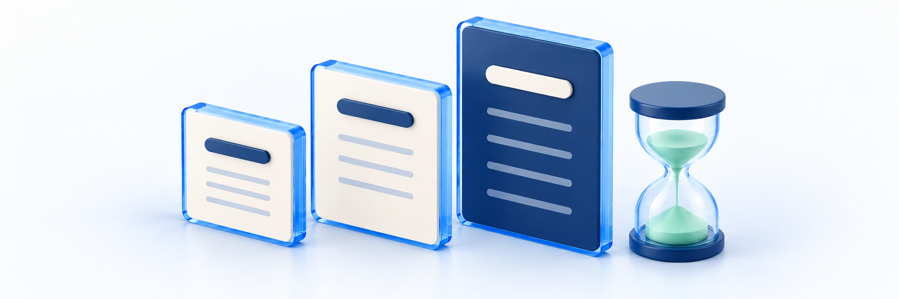

# 무료체험·구독 시작하기

<figure><figcaption></figcaption></figure>

**업무 대상:** 클킷 이용 비용과 사이트 한도를 관리하는 소유자·담당자용 안내입니다. 이 업무를 맡지 않은 강사는 영상 업로드·수강 문의 때문에 플랜이나 카드를 직접 변경하지 말고 학원 운영자에게 요청하세요. 실제 작업 가능 범위는 본인 계정의 권한을 확인하세요.

**구독 관리 → 플랜 관리**에서 현재 플랜과 이용 기간을 확인하고, 무료체험 또는 유료 구독 시작 흐름을 살펴봅니다. 이 문서의 구독은 **운영자가 클킷 서비스를 이용하기 위한 구독**입니다. 수강생이 구매하는 강좌·교재 상품과는 다릅니다.

**완료 기준:** 대상 사이트와 소유자 권한, 기준 플랜과 체험 혜택, 유료 시작 견적을 구분하고 신청했다면 실제 결과까지 확인합니다. 안내 창을 열거나 카드만 등록한 상태는 구독 시작 완료가 아닙니다.

기존 유료 플랜 변경·종료 예약은 [플랜 변경·구독 종료 예약하기](plan-change-and-subscription-end-schedule.md), 사용량·추가 팩은 [사용량 확인·추가 팩 관리하기](usage-and-additional-packs.md)를 봅니다. 카드 등록/선택·청구 상세는 [구독 결제수단·청구 내역 확인하기](billing-method-and-payment-history.md)를 봅니다.

## 시작 전 준비 

| 준비할 것 | 확인할 내용 |
| --- | --- |
| 대상 사이트 | 사이트 이름·주소와 현재 플랜을 확인합니다. 다른 사이트의 체험·청구 결과와 섞지 않습니다 |
| 소유자 계정 | 해당 사이트의 구독 결제자와 연결된 소유자 계정인지 확인합니다. 메뉴를 조회할 수 있어도 신청·결제 권한까지 있는 것은 아닙니다 |
| 현재 상태 | 플랜·기간/다음 결제일, 체험·예약·처리 중/실패 안내가 있는지 읽습니다. 조회 실패를 Free나 구독 없음으로 판단하지 않습니다 |
| 체험 이력·목적 | 체험은 플랫폼 계정 전체에서 한 번입니다. 비교할 상위 플랜과 필요한 기능을 먼저 정합니다 |
| 유료 시작 준비 | 현재 Free에서 변경 가능한 상태인지 확인하고, 결제할 카드와 견적의 금액·기간을 확인할 담당자를 정합니다 |
| 업무 승인 | 구독 담당자와 체험 1회 사용·카드·예산·신청 대상을 확인합니다. 아래 실행 보류 안내를 먼저 읽습니다 |

**플랜 선택으로 견적을 여는 동작도 견적을 생성·저장**합니다. 현재 플랜만 확인하려는 경우에는 누르지 않습니다. 신청·결제는 구독 담당자의 업무 승인과 아래 실행 보류 조건을 확인해야 합니다.

## 먼저 흐름 확인하기 

| 목적 | 흐름 | 완료로 판단할 근거 |
| --- | --- | --- |
| 현재 플랜 확인 | 플랜 관리 → 현재 구독·플랜 선택 목록 읽기 | 현재 플랜과 기간, 현재 선택 가능한 목록을 확인 |
| 무료체험 | 체험 가능한 상위 플랜 선택 → 정식 변경 견적 → 14일 체험하기 → 체험 안내 확인 | 신청했다면 체험 중 표시·정확한 종료 시각·기준 플랜/유효 한도를 재조회 |
| Free에서 유료 시작 | 유료 플랜 선택 → 견적 → 필요 시 카드 등록 → 최신 견적·동의 → 변경 요청 | 처리 결과와 실제 현재 플랜·구독 기간·같은 결제 건을 함께 확인 |
| 이미 유료 이용 중 | 현재 상태·변경 목적 확인 → [플랜 변경·구독 종료 예약하기](plan-change-and-subscription-end-schedule.md) 범위 확인 | 이 문서의 신규 시작 흐름으로 하향·종료 예약을 처리하지 않음 |

## 1. 현재 플랜과 선택 가능한 플랜 확인하기 

1. **구독 관리 → 플랜 관리**를 엽니다.
2. **현재 구독**에서 플랜 이름, **월 플랜 금액**, **다음 결제일**, **구독 기간**을 읽습니다. 값이 없거나 오류가 있으면 상태부터 확인합니다.
3. 체험 중 안내, 변경 예약이나 결제 실패 안내가 있다면 따로 확인합니다. 기준 플랜과 체험 플랜을 같은 값으로 보지 않습니다.
4. **플랜 선택** 목록에서 현재 플랜의 **이용 중**, 체험 가능한 플랜의 **14일 체험 가능**, 변경 불가 사유를 확인합니다.

플랜 이름·판매 가능 여부·가격·기능/한도는 당시 목록과 견적을 기준으로 합니다. 이전 가이드나 다른 계정의 가격표를 그대로 적용하지 않습니다. 목록이 비었거나 불러오기 오류가 났다면 모든 플랜이 판매 종료된 것으로 판단하지 않습니다.

> **화면 예시 준비 중** · 현재 플랜과 선택 가능한 플랜을 구분합니다. 가격·한도는 현재 목록을 확인합니다.

## 2. 무료체험 안내 열기 

1. 체험하려는 상위 플랜에 **14일 체험 가능** 표시가 있는지 확인합니다.
2. 승인된 범위에서 **플랜 선택**을 누르면 **플랜 변경 확인** 견적이 열립니다. 이 단계만으로 체험이나 유료 구독이 시작되지는 않습니다.
3. **14일 무료 체험 가능** 영역에서 정식 구독 금액과 체험 안내를 구분합니다.
4. **[선택한 플랜] 14일 체험하기**를 누르면 체험 확인 창이 열립니다. 정식 구독의 동의·변경 적용 버튼과 구분합니다.

견적의 **위 견적은 정식 구독으로 변경할 때의 금액입니다** 안내를 확인합니다. 이 금액을 체험 신청 비용으로 읽거나, 견적을 닫았다는 이유로 신청된 체험이 취소됐다고 판단하지 않습니다.

체험 버튼은 조건을 충족한 계정·플랜에서만 나타납니다. 체험 이력, 현재 구독/사이트 상태, 상위 플랜 여부, 변경 예약·진행 작업 등에 따라 신청이 제한될 수 있습니다. 버튼이 없을 때 새 사이트·다른 계정으로 체험 제한을 우회하지 않습니다.

> **화면 예시 준비 중** · 정식 구독 견적과 무료체험은 별개입니다. 견적을 열어도 체험·구독이 시작되지 않습니다.

## 3. 체험 기간과 제한 확인하기 

체험 확인 창에서 다음 내용을 확인합니다.

| 항목 | 안내 |
| --- | --- |
| 횟수 | 플랫폼 계정 전체에서 1회입니다. 사이트마다 한 번씩 제공하는 체험이 아닙니다 |
| 기간 | 체험 시작부터 14일, 즉 14×24시간입니다. 신청 결과의 정확한 종료 날짜와 시각을 확인합니다 |
| 카드·요금 | 체험 신청에는 카드 등록이 필요하지 않습니다. 체험 플랜으로 자동 유료 전환되지 않습니다 |
| 기준 플랜 | 원래 이용하던 기준 플랜은 유지되고 체험 혜택이 더해집니다 |
| 저장·시청 한도 | 저장공간 최소 20GiB·시청시간 최소 20시간입니다. 기존 유효 한도가 더 크면 유지되며, 선택한 유료 플랜의 모든 한도를 주는 방식은 아닙니다 |
| 관리자 수 | 체험 플랜이 아니라 기준 플랜의 관리자 수를 따릅니다 |
| 판매·정산·팩 | 체험 중 유료 판매·정산 실행·추가 팩 신규 구매가 제한됩니다. 각 화면에서 실제로 제한되는 범위는 아직 확인이 필요합니다 |
| 체험 플랜 변경 | 시작 후 체험 대상 플랜을 다시 바꾸는 절차는 제공하지 않습니다 |

**안내를 확인하고 체험 시작**은 실제 신청 버튼이며 계정의 체험 1회 기회를 사용합니다. 실제 신청 결과가 아직 확인되지 않았으므로 **체험 신청은 보류**하고 담당자에게 확인하세요. 안내만 읽었다면 **취소**로 닫습니다. 이미 신청했다면 버튼을 반복해서 누르지 말고 기존 결과부터 확인합니다.

> **화면 예시 준비 중** · 기간·한도·제한을 읽고 신청 여부를 결정합니다. 체험 대상은 시작 후 바꿀 수 없습니다.

## 4. 체험 시작·종료 결과 확인하기 

실제로 체험을 신청한 경우 다음을 함께 확인합니다.

1. **플랜 관리**를 다시 열어 **[플랜] 체험 중**과 **체험 종료**의 날짜·시각을 확인합니다. 시작 알림의 날짜만 기록하지 않습니다.
2. 체험 안내의 기준 플랜·관리자 수 유지 설명을 읽습니다. 기준 플랜 이름은 **현재 구독**, 관리자 한도는 해당 플랜의 제공 정보와 대조합니다.
3. **사용량 및 팩**에서 현재 유효 한도·사용량을 함께 읽습니다. 체험 한도는 사용량 초기화나 20시간 추가 구매와 다릅니다.
4. 체험 정보 조회 오류가 있으면 **다시 조회**로 확인합니다. 체험 표시가 없다는 사실만으로 체험 미사용·신청 실패를 단정하지 않습니다.

### 체험이 끝나면 

체험 혜택이 끝나고 **기준 플랜을 계속 이용**하는 정책입니다. 체험 플랜이 자동 결제되는 것은 아닙니다. 다만 **원래 유료 플랜을 이용 중이었다면 기준 플랜의 정기결제는 유지**되므로 모든 결제가 멈춘다고 생각하지 않습니다.

유료 플랜으로 전환이 성공하면 남은 체험 기간과 관계없이 체험이 종료되는 정책입니다. 전환 후 체험/현재 플랜·한도를 다시 확인합니다. 체험 종료를 사이트 삭제·파일 자동 삭제·수강생 주문 환불로 처리하지 않습니다.

체험 종료 시각에 기능·한도가 어떻게 돌아오는지, 기존 유료 플랜의 정기결제와 유료 전환 후 체험 종료가 안내대로 처리되는지는 아직 확인이 필요합니다. 한도 차이를 해결하려고 파일을 임의 삭제하거나 추가 결제를 반복하지 않습니다.

> **화면 예시 준비 중** · 체험 종료 시각과 기준 플랜을 확인합니다. 체험 플랜 자동 결제와 기존 유료 정기결제는 다릅니다.

## 5. Free에서 유료 구독 시작 준비하기 

이 절은 **현재 Free 플랜에서 유료로 변경할 수 있는 상태**를 기준으로 합니다. 구독이 없거나 결제 대기·기간 만료·오류 상태인 계정에 모두 같은 가입 버튼이 제공되는 것은 아닙니다. 그런 상태는 먼저 소유자와 현재 구독 결과를 확인합니다.

1. 원하는 유료 플랜의 기능·한도를 확인하고 승인된 범위에서 **플랜 선택**을 누릅니다.
2. **플랜 변경 확인**의 현재 플랜·변경 플랜과 기능/한도 변화를 확인합니다.
3. **결제 확인**에서 아래 값을 읽습니다.

| 확인할 값 | 확인할 내용 |
| --- | --- |
| 최종 결제 금액 | 이번 변경에서 결제할 금액입니다. 월 플랜 금액이나 다음 주기 금액과 같다고 가정하지 않습니다 |
| 공급가액·부가세 | 견적에 표시된 구분과 최종 합계를 확인합니다. 세금을 다시 더해 계산하지 않습니다 |
| 다음 주기 금액 | 다음 정기결제의 플랜 금액입니다. 이번 청구액·추가 팩 비용과 구분하고 모든 청구의 합계로 해석하지 않습니다 |
| 다음 결제일·기간 | 현재 구독 표시와 견적을 대조합니다. 다음 결제일 표시만으로 변경의 정확한 적용 시각을 확정하지 않습니다 |
| 견적 유효시간 | 남은 시간을 확인합니다. 만료되거나 카드/플랜·현재 상태가 바뀌면 최신 상태로 견적을 다시 확인합니다 |
| 기능·한도·관리자 영향 | 초과/유지할 관리자 선택이나 팩 영향 확인이 필요하면 소유자와 확인합니다. 경고가 없다고 영향 없음으로 판단하지 않습니다 |

견적은 최대 15분이며 현재 주기 종료가 먼저면 더 일찍 만료될 수 있습니다. 저장해 둔 캡처의 금액·견적으로 나중에 결제를 확정하지 않습니다.

### 카드가 없다면 

**카드 등록하고 계속**이 표시되면 별도 카드 등록 흐름이 필요합니다. 외부 인증·등록 후 돌아왔을 때 **최신 견적을 다시 읽고 동의를 확인**합니다. 카드 등록만으로 유료 구독이 시작되거나 변경이 자동 확정되는 것은 아닙니다.

기존 카드가 있다면 현재 사용할 결제수단을 확인합니다. Free에서는 결제수단 패널이 보이지 않을 수 있으므로 패널이 없다고 카드 미등록으로 판단하지 않습니다. 새 카드 추가·선택 방법과 아직 확인이 필요한 사항은 [구독 결제수단·청구 내역 확인하기](billing-method-and-payment-history.md)에서 확인합니다. 화면에 없는 카드 삭제·추가 방법을 임의로 적용하지 않습니다. 등록 결과가 불명확하면 같은 인증·등록을 반복하지 않고 현재 카드 결과를 확인합니다.

### 최종 요청 전 

**적용 시점, 결제 금액, 기능 및 한도 변경 내용을 확인했습니다** 동의와 **변경 적용**은 실제 유료 변경 요청으로 이어집니다. 실제 적용·결제 결과는 아직 확인되지 않았으므로 **최종 실행을 보류**합니다. 대상·금액·적용 시점을 담당자에게 먼저 확인하고, 견적 내용만 확인했다면 **취소**로 닫습니다.

> **화면 예시 준비 중** · 카드 등록만으로 구독이 시작되지 않습니다. 최신 견적의 금액·기간·영향을 다시 확인합니다.

## 6. 유료 시작 결과 확인하기 

승인된 범위에서 유료 변경을 요청한 경우 **접수·처리 중·실패·실제 적용**을 나눠 확인합니다.

| 보이는 상태 | 확인할 것 |
| --- | --- |
| 플랜 변경을 처리하고 있습니다 | 아직 최종 결과가 아닙니다. 안내에 따라 상태를 확인하며 새 변경·결제를 반복하지 않습니다 |
| 처리 상태를 확인하지 못했습니다 | 요청 실패로 단정하지 않습니다. 이 오류에 **상태 다시 확인**이 표시될 때 기존 작업부터 확인합니다 |
| 구독 변경이 완료되었습니다 | 알림만으로 판단하지 않고 현재 플랜·기간과 해당 결제 건을 대조합니다. 기존 예약 작업의 같은 알림과 혼동하지 않습니다 |
| 실패 또는 결과 불명확 | 현재 플랜·진행 안내·같은 결제 건을 확인하고 담당자에게 문의합니다. 바로 재결제·재등록·다른 플랜 요청으로 우회하지 않습니다 |

**플랜 관리**에서 실제 유료 플랜·구독 기간/다음 결제일을 확인하고 **구독 결제 내역**의 같은 결제 건·금액·상태를 대조합니다. 목록은 실패/진행 중 요청 전체 목록이 아니므로 결제 행이 없다는 이유만으로 미청구·신청 실패를 단정하지 않습니다. 체험 중 전환했다면 체험 종료와 적용 한도도 함께 확인합니다.

이 결과 확인은 수강생 상품 판매 준비·판매자 승인·정산계좌 등록과 별개입니다. 유료 구독 시작만으로 상품이 자동 판매되거나 기존 학생 결제가 변경되는 것은 아닙니다.

> **화면 예시 준비 중** · 완료 알림뿐 아니라 현재 플랜·기간과 같은 결제 건의 상태를 함께 확인합니다.

## 자주 막히는 부분 

| 상황 | 먼저 확인할 것 |
| --- | --- |
| 메뉴가 없거나 플랜 선택이 안 돼요 | 대상 사이트·소유자/조회 권한·현재 상태와 불가 사유를 확인합니다. 다른 사람의 계정으로 우회하지 않습니다 |
| 플랜 목록이 비었거나 조회 오류가 떠요 | 빈 결과와 **플랜 목록을 불러오지 못했습니다** 오류를 구분합니다. **구독 정보를 불러오지 못했습니다**를 Free로 해석하지 않습니다 |
| 무료체험 버튼이 안 보여요 | 계정 전체 체험 이력, 현재/대상 플랜, 활성 상태·예약/진행 작업을 확인합니다. 사이트마다 새 체험이라고 안내하지 않습니다 |
| 체험 중인데 관리자 수·판매 기능이 기대와 달라요 | 기준 플랜의 관리자 수와 체험 제한을 확인합니다. 선택한 유료 플랜의 모든 혜택이 적용된다고 판단하지 않습니다 |
| 체험이 끝났는데 결제가 계속돼요 | 원래 유료 기준 플랜의 정기결제인지 확인합니다. 체험 플랜 자동 결제와 구분하고 종료 예약은 [플랜 변경·구독 종료 예약하기](plan-change-and-subscription-end-schedule.md) 범위로 확인합니다 |
| 카드 등록 후에도 Free예요 | 등록과 유료 변경은 별개입니다. 최신 견적·요청 여부와 기존 처리 결과부터 확인합니다 |
| 견적이 만료되거나 조건이 바뀌었어요 | 최신 플랜/카드·예약/진행 상태를 먼저 확인합니다. 기존 결제 결과가 불명확한 상태에서 새 요청을 하지 않습니다 |
| 변경 완료 알림과 현재 플랜이 달라요 | 같은 작업의 실제 적용/예약, 현재 플랜·기간·결제 상태를 대조합니다. 알림만 보고 재요청하지 않습니다 |
| 결제 내역이 없거나 금액이 달라요 | 같은 사이트·작업·시각/금액과 현재 플랜을 확인합니다. 다음 주기 금액·카드 등록·수강생 결제를 같은 청구로 보지 않습니다 |

문의에는 대상 사이트, 확인한 시각, 현재/선택 플랜, 화면 문구와 처리 중 여부를 적습니다. 비밀번호·인증번호·카드 전체 번호·카드 등록용 주소나 인증 키는 보내지 않습니다.

> **화면 예시 준비 중** · 조회 오류와 신청 실패는 다릅니다. 결과가 불명확하면 새 요청을 반복하지 않습니다.

> **동작 예시 준비 중** · 체험 안내를 확인하고 취소하는 예시입니다. 체험·유료 구독 신청 완료 장면이 아닙니다.

## 완료 후 확인 

- [ ] 대상 사이트와 구독 결제자에 연결된 소유자/조회 역할을 구분했습니다.
- [ ] 현재 플랜·기간/다음 결제일과 선택 가능 목록을 확인하고 조회 실패를 Free로 판단하지 않았습니다.
- [ ] 체험의 계정 전체 1회·14일·시작 후 대상 변경 불가를 확인했습니다.
- [ ] 기준 플랜·20GiB/20시간 하한·기준 관리자 수와 판매/정산/팩 제한을 구분했습니다.
- [ ] 체험을 신청했다면 정확한 종료 시각·유효 한도와 종료/기존 유료 정기결제의 차이를 확인했습니다.
- [ ] 유료 시작을 준비했다면 최신 견적의 이번 금액·세금·다음 금액/기간·카드·동의/영향을 확인했습니다.
- [ ] 요청했다면 처리 결과·실제 플랜/기간·같은 결제 건을 확인하고 카드 등록/알림만으로 완료 처리하지 않았습니다.
- [ ] 불명확/조회 오류는 중복 신청하지 않고 현재 결과와 담당 확인으로 분리했습니다.
- [ ] 실제 신청을 맡은 담당자와 확인이 필요한 정책·절차를 구분하고, 실행 보류 조건을 지켰습니다.
