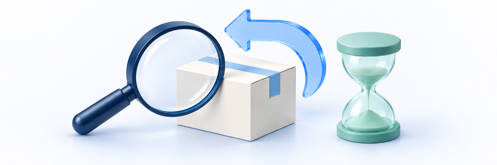

# 취소·반품·교환 처리 지연

> **이용 전 확인** · 실제 서비스 화면·동작이 아직 확인되지 않은 항목이 있습니다. 문서의 제한·주의사항을 따르고, **실행 보류**로 표시한 작업은 진행하지 마세요.

<figure><figcaption></figcaption></figure>

**강사·질답 조교라면:** 먼저 학원 사이트·로그인 계정과 오류 문구를 확인하세요. 해결되지 않으면 기존 주문·신청과 학생이 요청한 내용을 학원 운영자에게 전달합니다. 비밀번호·인증번호나 학생 개인정보 원문은 보내지 않습니다. 아래 상세 점검과 설정·거래 처리는 해당 업무 담당자를 위한 안내이며, 문의를 받은 것만으로 실행 권한이 생기는 것은 아닙니다.

신청이 보이지 않거나, 승인 금액을 확인할 수 없거나, 반품·교환의 다음 단계로 진행되지 않을 때 운영자가 확인할 순서입니다. **신청 접수·심사/검수 저장·환불 승인·금융 확정·권리/재고 반영·실제 물류 완료는 서로 다른 결과**입니다.

같은 원 주문의 **신청 하나·구성품·수량·유형**부터 확인하세요. 상태가 멈춘 것처럼 보여도 새 신청·중복 승인·재배송을 먼저 하지 않습니다. 이미 처리한 요청의 결과가 불명확하면 최신 상세와 이력부터 대조합니다.

> **문제 해결 시 주의**
> 관련 안내의 정상 절차를 오류 복구 방법으로 처음부터 반복하지 마세요. 먼저 같은 주문·파일·신청의 최신 결과를 확인하고 본문의 실행 보류 조건을 따르세요.

## 먼저 증상 고르기 

| 지금 상황 | 먼저 확인할 것 | 이어서 볼 안내 |
| --- | --- | --- |
| 학생은 신청했다고 하는데 목록에 없어요 | 문의와 정식 신청·원 주문/계정·신청일·조회 조건 | 아래 1번 |
| 취소·반품·교환 신청이 제한돼요 | 대상 구성품/수량·진행 신청·이용/발송·원 결제 근거 | 아래 2번 |
| 금액 미확정이거나 승인할 수 없어요 | 신청 유형·심사/검수·승인 전에 다시 조회한 조건·금액·처리 가능 여부 | 아래 3번 |
| 회수 승인 뒤 반품이 계속 진행 중이에요 | 실제 회수/입고·검수값·별도 환불 승인 | 아래 4번 |
| 교환의 다음 버튼이 없거나 비활성이에요 | 현재 단계·적용 대기·처리 권한·사유/새 송장 입력 | 아래 5번 |
| 송장을 등록하거나 수령을 기록했는데 교환 완료가 아니에요 | 원/새 배송·수령 기록과 후속 동기화 | 아래 5번 |
| 승인 후 처리 중이거나 거절 후 이용이 안 돼요 | 금융 결과·해당 신청 제한/해제·후속 반영 | 아래 6번 |
| 조건 변경·충돌·연결 끊김이 나왔어요 | 마지막 요청·최신 신청/금액·조회 성공 여부 | 아래 6번 |

강사·질답조교에게 처리 권한이 없으면 지정 운영자에게 전달합니다. 학생 계정으로 대신 신청하거나 다른 담당자 계정·직접 요청으로 우회하지 않습니다. 다른 사이트나 타인의 신청이 보이면 열람·처리를 중단합니다.

## 1. 원 주문과 같은 신청 찾기 

1. 구매한 학원 사이트·구매 계정·원 주문번호와 정식 신청 여부를 대조합니다. 1:1 문의나 전화 접수만으로 클킷 신청이 생성됐다고 판단하지 않습니다.
2. 관리자 **결제/정산관리 → 취소·반품·교환 내역**에서 주문번호 등 검색 조건과 신청 유형·상태·구성품 유형·처리 경로를 확인합니다.
3. 기간은 **신청일 기준**입니다. 구매일이나 택배 발송일만 생각하고 범위를 좁히지 말고, 적용된 기간·검색/필터와 다른 페이지를 확인합니다.
4. 상세의 신청 식별정보·원 주문·구매 당시 구성품·구매/신청 수량·신청 사유와 이력을 대조합니다. 같은 이름의 상품이나 같은 주문의 다른 신청을 섞지 않습니다.
5. 조회 오류·빈 결과·이전 진행 신청·신규 접수 결과를 구분합니다. 목록의 대표 금액만으로 대상 수량·확정 환불액을 판단하지 않습니다.

| 확인한 결과 | 다음에 확인할 것 | 바로 하지 않을 일 |
| --- | --- | --- |
| 조회 오류 | 권한·조회 조건·오류 문구와 마지막 정상 조회 시각 | 신청 없음으로 안내하거나 재접수시키지 않음 |
| 조건에 맞는 결과 없음 | 사이트/구매 계정·정식 접수·신청일/유형/상태·원 주문 | 조건을 확인하지 않고 새 신청을 만들지 않음 |
| 같은 구성품의 진행 신청이 있음 | 기존 신청의 수량·유형·접수 시각·현재 결과 | 새로 입력한 수량/사유로 새 접수됐다고 판단하지 않음 |
| 예상액 확인이나 심사 접수만 확인됨 | 실제 제출/접수 결과와 다음 업무 | 예상액 조회·심사 접수를 환불 완료로 설명하지 않음 |
| 환불 기록만 있고 해당 신청을 찾을 수 없음 | 원 주문·환불 기록과 처리하려는 구성품별 신청의 관계 | 다른 환불 기록의 식별정보·화면을 해당 신청 대신 사용하지 않음 |

정상 업무는 [신청 확인·승인·거절](../cancellations-and-returns/request-review-approve-and-reject.md)을 참고합니다. 처리 내역 조회 권한과 심사/승인·단계 저장 권한은 다릅니다. 필요한 원 주문·권리·배송 정보를 조회할 수 없으면 해당 담당자에게 확인합니다.

> **화면 예시 준비 중** · 같은 원 주문의 신청과 조회 조건을 먼저 확인합니다.

> **동작 예시 준비 중** · 기존 신청의 현재 단계와 이력을 확인하는 예시입니다.

## 2. 대상·수량과 제한 사유 확인하기 

취소·반품·동일 교재 교환은 목적과 허용 조건이 다릅니다. 같은 주문이라도 강좌·교재·디지털 자료의 이용 근거와 처리 결과를 각각 확인합니다.

| 제한·차이가 있는 항목 | 점검할 것 | 피할 대응 |
| --- | --- | --- |
| 구성품/수량 | 이번 구매 구성품·원 구매/기처리/진행 신청·남은 수량 | 한 신청을 주문 전체 취소로 바꾸거나 수량/대상을 임의 수정하지 않음 |
| 강좌 | 해당 구매 수강권·기간·검증된 이용/첨부 발급 근거 | 학습 진도율·다른 구매 기록·현재 강좌 길이로 금액을 재계산하지 않음 |
| 디지털 자료 | 구매 권리/파일 버전·기간·최초 다운로드 URL 발급과 조회 가능 여부 | 기기 저장 실패나 파일 삭제를 미발급으로 보지 않음 |
| 교재 | 실제 발송 이력·원 수령 사실·신청 유형/시점·유효 수량 | 반품을 출고 전 취소로 바꾸기 위해 원 배송을 되돌리지 않음 |
| 판매자 귀책·이용 기록 이의 | 신청 사유에 맞는 심사 대상·원본 근거와 인정 기록 | 사유 선택만으로 전액 환불하거나 원본 이용 기록을 지우지 않음 |
| 원 결제·에스크로·잔액·과거 금액 | 시스템에서 확인한 제한 사유·구매 당시 배분/기취소·구매확정 근거 | 현재 상품가로 과거 금액을 채우거나 별도 전체 취소로 우회하지 않음 |

제한 사유가 다르면 필요한 확인도 다릅니다. 일반 기간 초과·근거 부족·조회 실패·현재 권리 제한을 하나의 ‘환불 불가’로 묶지 않습니다. 귀책/이의 심사와 일반 취소는 [구성품별 취소·환불 기준](../cancellations-and-returns/component-cancellation-and-refund.md)을 따릅니다. 이 안내는 기존 기간·이용률·비용 기준을 바꾸지 않습니다.

문제 확인이나 문의 자료 준비를 위해 영상을 재생하거나 자료를 다시 발급받지 않습니다. 그런 행동도 이번 구매의 이용 근거에 영향을 줄 수 있습니다. 진행 신청 때문에 이용이 제한된 경우에는 원 신청 상태와 적용 결과부터 확인합니다.

> **화면 예시 준비 중** · 신청 유형과 대상·수량에 맞는 제한 사유를 확인합니다.

## 3. 금액 미확정·심사 저장·승인 결과 구분하기 

**금액 미확정과 실제 0원은 다릅니다.** 심사/검수 내용을 저장했다는 안내도 환불 승인이나 환불 완료가 아닙니다. 교환은 취소액을 승인하는 흐름이 아니므로 일반 취소 승인으로 대신 처리하지 않습니다.

| 보이는 결과 | 확인할 것 | 대응 기준 |
| --- | --- | --- |
| 심사 필요·금액 미확정 | 귀책/이용 기록·원 결제/배송 근거·반품 검수 등 남은 확인 | 임의 금액·0원으로 채우거나 바로 승인하지 않음 |
| 귀책/이용 기록 심사 저장 안내 | 인정 내용·해당 신청의 최신 이력과 새 승인 전 조건/금액 | 저장을 자동 환불·전체 기록 제외로 해석하지 않음 |
| 최신 금액 확인에 금액 변경 안내 | 같은 구성품/수량·최신 가능 여부·시스템에서 확인한 금액과 변경 사유 | 구매자가 처음 본 금액·이전 확인창 금액을 자동 승인하지 않음 |
| 처리 가능·실제 0원 | 미확정이 아닌지, 해당 신청의 처리 가능 여부·후속 결과 | 입금이 새로 생긴다고 안내하지 않음 |
| 승인 요청 전송 안내 | 같은 신청의 최신 상태·확정액·처리 이력·후속 반영 | 성공 알림만으로 실제 카드/계좌 반영·전체 완료를 확정하지 않음 |
| 승인 전 결과를 확인하지 못함 | 오류·현재 상태·심사/검수·결제/배송/재고 근거 | 기존 금액으로 승인하거나 별도 환불 요청을 만들지 않음 |

**취소 승인**에서 최신 금액 확인창을 여는 단계와 확인창 안에서 실제로 승인하는 단계는 다릅니다. 금액 확인을 목적으로 최종 승인 버튼을 누르지 않습니다. 반품은 검수 합격 이후 최신 조건·금액 확인과 별도 승인이 필요합니다.

금액 표의 구성품 결제액·전체 결제액·예상액·확정액·검수 반품비/실제 차감을 구분합니다. 요약 문구나 반품비 입력값만으로 최종 환불액을 다시 계산하지 말고 **시스템에서 확인한 최신 처리 가능 여부·금액과 구매 당시 금액 근거**를 대조합니다. 서로 다르거나 근거를 확인할 수 없으면 승인을 멈추고 문의합니다.

> **화면 예시 준비 중** · 심사 저장·최신 금액 확인·환불 승인은 다릅니다.

## 4. 반품 회수·입고·검수에서 막혔을 때 

반품의 **회수 승인 → 실물 입고 → 검수 기록 → 최신 금액 확인·별도 승인 → 금융/후속 결과**를 나눠 확인합니다. 화면의 단계 저장은 택배 회수 자동 접수나 실물 도착의 증거가 아닙니다.

| 현재 상황 | 확인할 것 | 바로 하지 않을 일 |
| --- | --- | --- |
| 회수 승인 뒤 반품 진행 중 | 실제 회수 안내·접수/이동·교재 도착과 현재 기록 단계 | 회수 승인만으로 자동 수거·입고 완료를 안내하지 않음 |
| 입고 기록을 할 수 없음 | 선행 회수 단계·권한·해당 교재/신청 수량·실제 도착 | 실물이 없는데 입고하거나 다른 주문 교재를 맞춰 넣지 않음 |
| 검수 저장이 비활성/거절됨 | 필수 사유·원 수령 시각·귀책/가치 감소·확정 반품비·재입고 수량·최신 상태 | 필수 값이라는 이유로 날짜·비용·수량을 추정하지 않음 |
| 단순 변심인데 가치 감소가 확인됨 | 실물·근거와 허용된 거절 상태/사유 | 합격을 위해 가치 감소를 숨기거나 귀책을 바꾸지 않음 |
| 검수 합격인데 환불/재고가 그대로 | 승인 전에 다시 조회한 조건·금액·처리 가능 여부와 별도 승인 여부·금융/후속 처리 | 검수를 반복하거나 환불 전에 수동 재고 증가로 맞추지 않음 |
| 합격 후 잘못된 검수값 발견 | 저장된 값·이력·현재 처리 단계와 영향 범위 | 같은 합격 기록 재저장·이전 단계 복원으로 덮어쓰지 않음 |

검수의 **확정 수령 시각은 학생이 원 교재를 받은 시각**입니다. 반품 교재가 학원에 도착한 입고 시각이 아닙니다. 원 신청 시각보다 뒤인 날짜를 넣어 통과시키거나 화면 입력 가능 범위만 보고 올바른 날짜라고 판단하지 않습니다.

**신청 수량과 재입고 가능 수량도 다릅니다.** 재입고 0이나 일부 수량은 정상적인 검수 결과일 수 있습니다. 입력의 초기값을 실물 검수 결과로 받아들이지 않고, 판매 가능한 수량과 원 구매의 재고 근거를 확인합니다. 최초 배송비·안내 반품비·검수 확정 비용·실제 차감액도 나눠 확인합니다.

불합격과 정보 부족은 구분합니다. 불합격은 거절 가능한 상태에서 사유를 남기는 정상 업무로 연결하고, 정보가 부족하면 확인을 먼저 요청합니다. 자세한 기준은 [교재 반품 처리](../cancellations-and-returns/textbook-return.md)를 따릅니다.

> **화면 예시 준비 중** · 원 교재 수령일과 반품 입고일·검수 수량을 구분합니다.

## 5. 교환의 다음 단계·재배송·수령 확인하기 

교환은 **동일 교재의 회수·입고·검수 → 별도 재배송 기록 → 실제 수령 확인·후속 동기화**로 확인합니다. 원 결제를 취소하거나 다른 교재/판본으로 임의 변경하는 흐름이 아닙니다.

| 현재 상황 | 확인할 것 | 대응 기준 |
| --- | --- | --- |
| 다음 단계 버튼이 없거나 비활성 | 처리 권한·현재 단계·제한 적용/교환 동기화 대기·현재 단계의 처리 사유 | 버튼 부재를 무조건 권한 문제로 단정하거나 다른 계정/직접 요청으로 우회하지 않음 |
| 회수 중·검수 중 | 실제 교재 도착/검수 사실과 선행 기록 | 회수 안내 문구만으로 안내 발송·회수 접수/완료를 확정하지 않음 |
| 검수 통과인데 재배송 저장 불가 | 처리 기록 영역의 사유·지원 택배사/실제 새 송장·단계/동기화 | 원 송장·가상 숫자로 통과시키거나 중복 재배송하지 않음 |
| 재배송 기록 뒤 처리 중 | 같은 신청의 새 송장·별도 배송 기록과 동기화 결과 | 응답 지연을 미등록으로 해석해 새 송장을 다시 등록하지 않음 |
| 수령을 기록했는데 완료가 아님 | 수령 기록·처리 이력·교환 배송/제한 해제 후속 적용 | 수령 안내가 남았다는 이유로 수령 확인을 반복하지 않음 |
| 재배송 이후 거절/수정 불가 | 재배송 등록 요청 내용·현재 단계·잘못된 값과 영향 | 원 배송 보정·새 신청·일반 환불로 우회하지 않음 |

교환의 후속 단계에서는 **처리 기록 영역의 현재 단계 사유**를 확인합니다. 재배송 정보를 저장하는 단계에는 실제 택배사·새 송장도 필요합니다. 회수 승인 창과 이후 화면의 입력 위치가 같다고 가정하거나 모든 버튼에 추가 확인창이 있다고 안내하지 않습니다. 입력값이 있어도 최신 상태·권한·동기화 조건으로 거절될 수 있습니다.

**원 배송과 교환 재배송은 별도 기록**입니다. 새 송장이 보인다고 원 배송이 수정됐거나 자동 택배 접수가 끝난 것은 아닙니다. 원 송장을 덮어쓰거나 새 재배송 식별자를 일반 배송 상세 주소에 넣지 않습니다. 원 배송의 출고·송장·주소 문제는 [배송 점검](dispatch-tracking-and-address.md)과 구분합니다.

재배송 등록 뒤에는 거절·다른 송장 재등록으로 해결하지 않습니다. 잘못된 값이나 결과 불명확은 같은 신청의 최신 이력·새 배송과 함께 담당자에게 전달합니다. 실제 교재 확보·택배 인계·이동·수령은 외부 근거로 따로 확인합니다.

교환 완료는 환불 완료가 아닙니다. 화면의 ‘결제 변경 없음’이나 취소 예상액 0을 0원 환불 거래로 해석하지 않습니다. 원 결제·원 배송·서비스 재고를 자동 취소/조정하는 업무로 안내하지 않으며 비용도 자동 청구·환불 공제로 보지 않습니다. 상세 기준은 [교재 교환 처리](../cancellations-and-returns/textbook-exchange.md)를 따릅니다.

> **화면 예시 준비 중** · 재배송·수령 기록과 후속 동기화 완료를 구분합니다.

## 6. 처리 중·거절 후 제한·변경 충돌 확인하기 

처리 상태를 다시 읽는 것과 승인·환불·단계 저장을 다시 실행하는 것은 다릅니다. **상태 재조회/처리 상태 확인** 안내가 있으면 같은 신청의 결과를 확인하고, 조회 실패를 최신 상태 반영으로 판단하지 않습니다.

| 상황 | 확인할 것 | 피할 대응 |
| --- | --- | --- |
| 승인 뒤 처리 중 | 원 요청의 금융 결과 확인·확정액·권리/배송/재고 후속 상태 | 오류/응답 유실을 실패로 단정해 중복 승인·별도 PG 취소하지 않음 |
| 확정액은 있는데 전체 완료가 아님 | 해당 신청의 금융 확정과 후속 반영을 구분 | 확정액만으로 모든 권리·재고·배송 완료를 안내하지 않음 |
| 거절됐는데 이용 제한이 남음 | 거절 사유·같은 신청의 제한 해제 적용과 다른 제한 | 무조건 수강권 재지급·기간 연장·보류 삭제하지 않음 |
| 반품 후 재고/남은 배송 수량 차이 | 원 구매의 재고 차감 기록·검수 재입고 수량·후속 이력·남은 유효 품목 | 신청 수량만큼 중복 재입고하거나 남은 품목까지 취소하지 않음 |
| 조건/금액 변경·다른 담당자 선행 처리 | 최신 상세/이력·원 구성품/수량·승인 전에 다시 조회한 조건·금액·처리 가능 여부 | 오래된 값/금액으로 덮어쓰기·자동 재승인하지 않음 |
| 저장 후 연결 끊김·결과 불명확 | 마지막 요청 시각/종류·최신 단계/금액/이력과 실제 외부 결과 | 새 신청·회수/재배송·수령 확인을 반복하지 않음 |
| 완료 안내와 실제 결과가 다름 | 같은 신청의 최종 결과·해당 권리/물류와 카드/계좌 반영 | 화면 배지만으로 외부 결과를 대신 확정하지 않음 |

처리 중에는 내부 적용이나 금융/배송 후속 확인이 남아 있을 수 있습니다. 화면 갱신 주기는 해결 기한이 아니며 임의 시간 뒤 완료·자동 복구·입금을 약속하지 않습니다. 원인을 모르면 ‘지연’으로 확정하지 말고 마지막으로 확인한 단계부터 전달합니다.

거절 후 해제는 **해당 신청의 제한**을 대상으로 확인합니다. 다른 주문의 권리·기간 만료·다른 진행 신청이나 별도 보류까지 모두 복원된다고 안내하지 않습니다. 금융이 확정된 반품도 검수 재입고·원 구매의 재고 차감 기록에 따른 후속 결과와 실제 카드/계좌 반영은 나눠 확인합니다.

> **화면 예시 준비 중** · 원 요청의 결과를 확인하고 중복 처리하지 않습니다.

## 7. 기다릴 조건과 문의할 조건 정리하기 

같은 신청의 현재 처리/반영 대기가 확인됐을 때만 그 결과를 기다립니다. 조회 오류·필수 입력 부족·심사/검수 미완료·신청 제한·잘못된 원 배송·금액 근거 부족을 모두 자동 처리 대기로 묶지 않습니다.

| 문의로 넘길 상황 | 전달할 정보 |
| --- | --- |
| 정식 접수·신청을 찾을 수 없음 | 사이트·원 주문/신청 식별정보·접수 시각·구성품/수량·조회 조건/오류 |
| 금액/처리 가능 여부 충돌 | 신청 유형·현재 상태·심사/검수 여부·최신 결과와 이전 결과의 차이 |
| 반품 회수/검수·후속 반영 문제 | 원 교재 수령/반품 입고 사실·현재 단계·확정 검수 항목·마지막 저장 결과 |
| 교환 등록/수령·동기화 불명확 | 원/새 배송 구분·현재 단계·각 요청/확인 시각·실제 인계/수령 여부 |
| 승인/거절 후 권리·금융·재고 차이 | 원 요청·확정액·제한/해제·후속 이력과 확인된 차이만 최소한으로 정리 |

강사·질답조교는 학원의 지정 운영자에게, 운영자는 해결되지 않으면 확인된 클킷 지원 경로로 문의합니다. 물류 확인은 회수/출고 담당자와 확인된 택배사 대응으로 구분합니다. 실제 지원 주소·운영 시간·처리 기한은 확인된 안내를 사용합니다.

가상 문의 예시:

> 교재 A 반품 신청의 검수 합격 기록까지 확인했지만 최신 금액 확인에서 원 결제·배송·재고 근거를 확인할 수 없다는 안내가 나옵니다. 원 주문/신청과 검수값·오류 시각을 정리했고 별도 환불·재고 조정은 하지 않았습니다. 승인 제한과 후속 처리에 필요한 근거를 확인해 주세요.

> 동일 교재 교환의 새 송장은 저장돼 있고 수령 확인 기록 뒤에도 처리 중으로 보입니다. 같은 신청의 이력·후속 동기화와 실제 수령 사실을 구분해 정리했으며 새 송장 재등록·중복 배송·수령 확인 반복은 하지 않았습니다. 남은 적용 결과를 확인해 주세요.

> **화면 예시 준비 중** · 현재 단계·마지막 결과와 이미 한 일을 전달합니다.

문의 식별정보·금액·사유는 확인된 비공개 지원 경로에 필요한 최소한으로 제공합니다. **비밀번호·인증번호·토큰·학생 명단·전체 연락처/주소·전체 카드/계좌번호·결제키·서명된 자료 URL·배송 조회 URL·개발자 도구·네트워크 요청 기록 원문은 일반 문의에 보내지 않습니다.** 직접 저장 기록을 고치거나 내부 처리 작업을 다시 실행하지 않습니다. 별도 결제 취소·수동 이용 권한/재고 보정·중복 회수/배송도 이 안내의 해결 절차가 아니므로 담당자에게 확인을 요청하세요.

## 완료 후 확인 

- [ ] 같은 사이트·구매 계정·원 주문·신청 하나와 담당 권한을 구분했습니다.
- [ ] 정식 접수/예상 조회·신청일/필터·조회 오류/빈 결과와 기존 진행 신청을 나눴습니다.
- [ ] 구매 구성품·구매/기처리/진행/신청 수량과 유형별 제한 사유를 확인했습니다.
- [ ] 미확정/실제 0원·원 금액/시스템의 최신 예상액·심사 저장/환불 승인을 구분했습니다.
- [ ] 반품 회수/입고·원 교재 수령일·검수값·재입고 수량과 별도 승인을 나눴습니다.
- [ ] 교환 단계·현재 사유/새 송장 입력·권한/적용 대기와 제한을 구분했습니다.
- [ ] 원/새 배송·실제 인계/수령·수령 기록/후속 동기화와 전체 완료를 따로 확인했습니다.
- [ ] 금융 확정·권리/배송/재고 반영·거절 후 해당 제한 해제와 다른 권리를 구분했습니다.
- [ ] 충돌/불명확 결과는 최신 상세·이력과 대조하고 중복 신청/승인/배송하지 않았습니다.
- [ ] 기다릴 조건과 문의 필요를 나누고 최소 정보로 담당자에게 전달할 준비를 했습니다.

이 체크리스트는 점검 내용과 문의 정보를 정리하기 위한 것입니다. 모두 확인했더라도 실제 환불·권리/재고 반영·회수/배송/수령 성공이나 서비스 화면·동작의 확인 완료를 뜻하지 않습니다.

## 관련 안내 

- [신청 확인·승인·거절](../cancellations-and-returns/request-review-approve-and-reject.md)
- [구성품별 취소·환불](../cancellations-and-returns/component-cancellation-and-refund.md)
- [교재 반품](../cancellations-and-returns/textbook-return.md)
- [교재 교환](../cancellations-and-returns/textbook-exchange.md)
- [주문·결제 상태](../orders-and-shipping/order-and-payment-status.md)
- [구매 후 지급 확인](../orders-and-shipping/content-fulfillment-check.md)
- 수강생 가이드의 [상품 취소·환불 신청하기](https://klekit.gitbook.io/learner-guide/cancellations/request-cancellation)
- 수강생 가이드의 [교재 반품·교환 신청하기](https://klekit.gitbook.io/learner-guide/cancellations/request-return-or-exchange)
- 수강생 가이드의 [취소·반품·교환 처리 상태](https://klekit.gitbook.io/learner-guide/cancellations/request-status)
- [판매·결제 문제](product-sales-and-payment.md)
- [영상·자료·수강권 문제](video-resource-and-access.md)
- [배송 문제](dispatch-tracking-and-address.md)
- [가이드 홈](../README.md)
