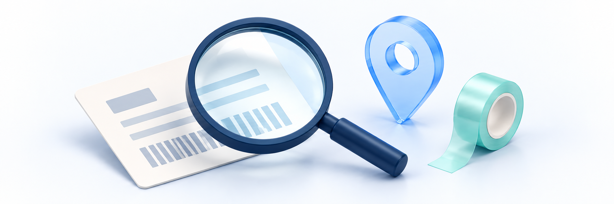

# 출고·송장·배송지 처리가 안 돼요

<figure><figcaption></figcaption></figure>

**강사·질답 조교라면:** 먼저 학원 사이트·로그인 계정과 오류 문구를 확인하세요. 해결되지 않으면 해당 주문·교재와 알고 있는 배송 상태를 학원 운영자에게 전달합니다. 비밀번호·인증번호나 학생 개인정보 원문은 보내지 않습니다. 아래 상세 점검과 설정·거래 처리는 해당 업무 담당자를 위한 안내이며, 문의를 받은 것만으로 실행 권한이 생기는 것은 아닙니다.

결제한 교재의 배송 건이 보이지 않거나, 출고·송장·발송 처리가 막히거나, 배송지를 바꿀 수 없을 때 운영자가 확인할 순서입니다. **배송 대상 생성·송장 저장·클킷 발송 처리·실제 택배 인계·수령은 서로 다른 결과**입니다.

같은 원 주문과 배송 건부터 확인하세요. 배송이 보이지 않는다고 새 주문을 만들거나 중복 출고하지 않습니다. 송장/상태/주소 저장 결과가 불명확하면 같은 요청을 반복하기 전에 최신 상세와 이력을 확인합니다.

> **문제 해결 시 주의**
> 관련 안내의 정상 절차를 오류 복구 방법으로 처음부터 반복하지 마세요. 먼저 같은 주문·파일·신청의 최신 결과를 확인하고 본문의 실행 보류 조건을 따르세요.

## 먼저 증상 고르기 

| 지금 상황 | 먼저 확인할 것 | 이어서 볼 안내 |
| --- | --- | --- |
| 결제 완료인데 배송 건이 안 보여요 | 원 주문·교재 포함 구성·검색/기간·배송 생성 결과 | 아래 1번 |
| 배송 준비/발송 버튼이 없거나 거절돼요 | 조회/변경 권한·주문/취소·유효 품목·현재 배송 상태 | 아래 2번 |
| 송장을 저장했는데 배송 준비로 남아요 | 송장 저장과 발송 변경의 각각의 결과 | 아래 3번 |
| 송장은 있지만 조회가 안 되거나 교재가 안 와요 | 택배사·송장·실제 인계와 외부 조회 결과 | 아래 4번 |
| 주소록을 바꿨는데 배송지는 그대로예요 | 주소록·원 주문·해당 배송 건의 주소 구분 | 아래 5번 |
| 준비로 되돌렸는데 주소 변경이 안 돼요 | 현재 상태뿐 아니라 최초 발송 이력·권한 | 아래 5번 |
| 다른 작업으로 변경됐거나 저장 결과를 모르겠어요 | 같은 배송 건의 최신 값·변경 이력과 마지막 요청 | 아래 6번 |
| 설정/CSV를 바꿨는데 배송이 처리되지 않아요 | 신규 정책·기존 주문·내보내기/출고 작업 구분 | 아래 6번 |

강사·질답조교에게 배송 조회/변경 권한이 없다면 지정 운영자에게 전달합니다. 학생 비밀번호를 받거나 다른 담당자 계정·직접 주소로 우회하지 않습니다. 다른 사이트나 타인의 배송 정보가 보이면 열람·변경·내보내기를 중단합니다.

## 1. 원 주문과 배송 대상부터 찾기 

1. 같은 학원 사이트의 원 주문번호·구매자·상품/교재·주문 시점을 대조합니다. 결제 결과가 불명확하면 [상품 판매·결제 문제 점검](product-sales-and-payment.md)을 먼저 따릅니다.
2. 관리자 **배송 관리** 목록에서 주문번호·구매자·상품명으로 검색하고 적용된 상태·기간을 확인합니다. 필요하면 **전체**와 다른 페이지를 확인합니다.
3. 기간은 **주문 기간**입니다. 발송일만 생각하고 범위를 좁혔다면 원 주문 생성일을 기준으로 다시 비교합니다. 검색어를 입력한 것과 검색/기간 조건이 적용된 상태를 구분합니다.
4. 대상 배송 상세에서 원 주문·포함 교재·현재 수량과 수령 정보를 확인합니다. 이름이나 상품명이 같다는 이유만으로 같은 배송 건이라고 판단하지 않습니다.
5. 목록 조회 오류·빈 결과·배송 생성 대기·실제 배송 건 없음 중 어떤 상황인지 구분합니다.

| 확인한 결과 | 다음에 확인할 것 | 단정하지 않을 것 |
| --- | --- | --- |
| 조회 오류가 있음 | 오류 문구·조건·권한과 마지막 정상 조회 시각 | 오류를 배송 0건·미구매로 해석하지 않음 |
| 조건에 맞는 배송이 없음 | 상태/검색/주문 기간·다른 페이지와 같은 원 주문 | 배송 없음만으로 재주문·재출고 필요를 판단하지 않음 |
| 주문에 교재가 포함됨 | 해당 교재의 유효 구성과 배송 대상 생성 결과 | 결제 완료만으로 배송 생성·발송을 확정하지 않음 |
| 학생 주문에 배송 정보를 준비 중이라는 안내 | 원 주문의 현재 처리 결과와 배송 생성 상태를 담당자가 확인 | 실제 자동 처리 중·택배 인계 중·정해진 시간 내 자동 완료로 단정하지 않음 |
| 학생 주문에 배송 영역이 없음 | 구매 당시 구성·조회 결과·과거 주문 기록을 대조 | 영역 없음만으로 교재가 없거나 배송이 불필요하다고 보지 않음 |
| 강좌/자료만 구매했거나 교재가 취소됨 | 원 구매 구성·취소 반영과 남은 유효 품목 | 주문 전체가 반드시 하나의 교재 배송 대상이라고 판단하지 않음 |

배송 업무 기준은 [구매 후 콘텐츠 지급 확인](../orders-and-shipping/content-fulfillment-check.md)과 [출고 준비·송장 등록](../orders-and-shipping/dispatch-and-tracking.md)을 참고합니다. 실제 서비스에서의 표시와 역할별 조회·처리 결과는 아직 확인이 필요합니다. 학생 주문에서 배송 정보를 찾을 수 없으면 같은 원 주문의 교재 구성·조회 결과와 본인 계정의 권한을 확인하고 담당자에게 문의합니다. 배송 정보가 안 보인다는 이유만으로 배송 기능이나 배송 대상이 없다고 단정하지 않습니다.

> **화면 예시 준비 중** · 원 주문과 배송 생성·조회 결과를 구분합니다.

> **동작 예시 준비 중** · 기존 배송 건을 찾아 최신 상태와 이력을 확인하는 예시입니다.

## 2. 출고 제한과 유효 수량 확인하기 

목록/상세를 읽을 수 있는 권한과 송장·상태·주소를 변경할 권한은 다릅니다. 결제 상세 접근도 별도이므로 배송 화면에서 주문/환불을 충분히 확인할 수 없다면 담당 권한이 있는 운영자에게 전달합니다.

| 상태·증상 | 확인할 것 | 바로 하지 않을 일 |
| --- | --- | --- |
| 배송 대기·배송 준비 | 원 주문·배송 품목·현재 수령 정보와 실제 출고 계획 | 버튼 표시를 실제 출고 승인이나 택배 인계 증거로 사용하지 않음 |
| 주문·환불 상태를 확인해야 발송 가능하다는 안내 | 같은 주문의 결제·취소/반품/교환 진행·유효 품목과 필요한 후속 확인 | 취소를 거절하거나 상태를 바꿔 발송 제한을 우회하지 않음 |
| 일부 교재가 취소됨 | 취소된 대상과 남은 유효 수량을 각각 확인 | 원 수량에서 취소 수량을 두 번 빼거나 주문 전체를 임의 취소하지 않음 |
| 발송/수정 버튼이 없음·비활성 | 현재 상태·변경 권한·송장/주문 조건과 오류 | 다른 계정이나 직접 요청으로 우회하지 않음 |
| 배송 취소로 표시됨 | 해당 배송의 확정 취소와 원 주문/품목의 현재 결과 | 같은 배송을 임의 복원·재발송하지 않음 |

상품/교재명·대표 이미지·화면 행 수만으로 출고 수량을 확정하지 않습니다. **현재 유효한 교재 구성과 배송 건의 수량**을 기준으로 확인하고 주문·취소·표시가 서로 다르면 출고 전에 문의합니다. 취소 표시가 있는 품목의 숫자를 그대로 출고 지시로 사용하지 않습니다.

결제 완료·출고 가능 안내·권한·실제 인계 확인은 각각 필요합니다. 재고 조회나 CSV 생성도 발송 완료의 증거가 아닙니다. 설정 보완이나 실제 출고는 원인을 확인한 담당자가 해당 업무 가이드에 따라 별도로 진행합니다. 진행 중인 신청·환불 때문에 출고가 제한됐다면 [취소·반품·교환 점검](cancellation-return-and-exchange.md)을 참고해 담당자에게 전달하고, 배송 상태를 바꿔 제한을 우회하지 않습니다.

> **화면 예시 준비 중** · 현재 유효 품목과 출고 제한 사유를 함께 확인합니다.

## 3. 송장 저장과 발송 결과 따로 확인하기 

현재 상세의 **송장 저장**과 **저장 후 발송 완료**는 같은 결과가 아닙니다. 후자는 송장 저장 뒤 발송 상태 변경이 이어질 수 있어, 앞 단계가 성공하고 뒤 단계가 제한/실패한 경우를 나눠 확인합니다. 이 버튼들은 확인용 조회가 아닙니다.

| 보이는 결과 | 확인할 것 | 대응 기준 |
| --- | --- | --- |
| 송장 정보를 저장했다는 안내 | 같은 배송 상세의 택배사·송장·현재 상태 | 송장 저장만으로 발송/인계·외부 보고 성공을 확정하지 않음 |
| 송장은 저장했지만 발송할 수 없다는 안내 | 저장된 송장과 최신 주문/환불·배송 상태 | 송장까지 실패했다고 보고 전체 저장을 반복하지 않음 |
| 발송 완료로 변경하지 못했다는 안내 | 송장 저장 결과·현재 상태·변경 이력·실제 인계 여부 | 새 송장 생성·중복 출고로 해결하지 않음 |
| 택배사/송장 형식 오류 | 실제 이용 택배사와 입력값·현재 화면의 형식 안내 | 숫자를 임의로 보완하거나 가상 송장으로 통과시키지 않음 |
| 성공 여부 없이 연결이 끊김 | 같은 배송 건의 최신 송장·상태·이력과 마지막 요청 시각 | 실패/성공을 단정해 같은 요청을 바로 반복하지 않음 |

송장 정정은 발송 상태 변경과 별도입니다. 택배사·송장을 고쳤다고 실제 접수/인계·택배사 기록·구매자 수령까지 자동 수정되는 것은 아닙니다. 담당자는 필요한 정정과 영향 범위를 확인한 뒤 [출고·송장 업무 기준](../orders-and-shipping/dispatch-and-tracking.md)에 따라 처리합니다.

**발송 완료 표시와 실제 택배 인계가 다르면 먼저 사실을 확인합니다.** 오류 확인이나 배송지 잠금 해제를 위해 상태를 대기/준비로 되돌리거나 다시 발송 처리하지 않습니다. 상태 보정이 현재 송장 표시를 해제해도 최초 발송 이력이 없어지는 것은 아닙니다.

> **화면 예시 준비 중** · 송장 저장과 발송 상태 변경은 별도 결과입니다.

## 4. 배송 조회와 실제 물류 결과 확인하기 

배송 상세에 **배송 조회**가 있으면 연결 대상은 택배사의 조회 경로입니다. 링크가 생겼다는 것과 실제 택배사에 물품이 접수됐다는 것은 다릅니다. 운영자는 실제 이용 택배사·송장·출고 담당자의 인계 기록을 구분해 확인합니다.

| 상황 | 확인할 것 | 단정하지 않을 것 |
| --- | --- | --- |
| 배송 조회 링크가 없음 | 지원 택배사·저장된 송장·형식과 실제 배송 정보 | 링크 없음만으로 미발송·택배 분실로 판단하지 않음 |
| 공식 조회에 정보가 없음 | 택배사/송장 일치·실제 접수/인계와 조회 시각 | 정해진 시간 뒤 조회/배송이 완료된다고 약속하지 않음 |
| 클킷은 발송 완료인데 아직 못 받음 | 원 배송·인계·택배사 실제 진행과 수령 여부 | 발송 완료를 배송 완료/수령 완료로 바꾸어 설명하지 않음 |
| 외부 후속 처리 문제가 의심됨 | 클킷의 발송 기록과 외부 보고/조회 결과를 담당자가 분리 확인 | 외부 결과 확인을 위해 중복 발송하거나 직접 내부 재처리를 안내하지 않음 |
| 오배송/분실/수령 차이 문의 | 실제 배송 건·택배사 진행·학원의 확인된 대응 경로 | 학생에게 임의 반송·새 교재 주문·비공식 주소/계좌 이용을 지시하지 않음 |

학생에게는 수강생 가이드의 [교재 배송과 배송지 확인하기](https://klekit.gitbook.io/learner-guide/orders/textbook-shipping-and-address)를 안내합니다. 반품·교환은 [교재 반품](../cancellations-and-returns/textbook-return.md)·[교재 교환](../cancellations-and-returns/textbook-exchange.md)의 별도 기준을 따릅니다. 원 배송의 송장 정정과 교환 재배송은 같은 업무가 아닙니다. 자동 회수·자동 교환 재배송을 약속하지 않습니다.

> **화면 예시 준비 중** · 발송 표시와 실제 택배 인계·수령을 구분합니다.

## 5. 배송지 변경이 안 될 때 

**주소록·구매 당시 원 주문 주소·해당 배송 건의 현재 주소**를 먼저 구분합니다. 주소록 수정이나 배송 설정 변경으로 기존 배송의 주소가 자동 변경되는 것은 아닙니다. 같은 주문에 관련 배송이 여러 개라면 변경하려는 건도 특정합니다.

| 확인 항목 | 운영자 점검 기준 |
| --- | --- |
| 변경 대상 | 실제 출고에 사용할 해당 배송 상세의 수령 정보인지 확인. 원 주문·주소록 화면으로 대신하지 않음 |
| 역할/권한 | 구매자 직접 변경과 운영자 변경의 허용 상태·권한이 다름 |
| 현재 상태 | 구매자는 배송 대기, 운영자는 배송 대기/준비 상태가 기본 확인 범위. 학생에게 둘 다 상품 준비 중으로 보일 수 있으므로 표시 문구만으로 자격을 확정하지 않음 |
| 발송 이력 | 현재 상태뿐 아니라 이전 발송 사실이 없는지 확인. 준비로 되돌려도 잠금이 풀린다고 보지 않음 |
| 새 정보 | 수령인·연락처·우편번호/주소와 상세 주소·요청사항의 유지/삭제 의도를 구분 |
| 반영 결과 | 해당 배송의 최신 주소/변경 이력과 실제 출고 담당자에게 전달된 정보를 대조 |

운영자에게 **주소 수정**이 보이거나 학생에게 변경 버튼이 보여도 요청이 반드시 허용되는 것은 아닙니다. 저장 시점의 최신 상태나 동시에 진행된 발송·취소 처리 때문에 거절될 수 있습니다. 학생이 직접 바꿀 수 없는 경우 지정 운영자가 현재 상태와 실제 출고 상황을 확인합니다.

상세 주소·요청사항은 빈 값으로 저장하면 지워질 수 있습니다. 필요한 값이 누락됐거나 결과가 달라졌다면 최신 상세와 변경 이력부터 비교하고 오래된 주소를 다시 저장하지 않습니다. 전체 주소를 일반 문의나 공개 댓글에 붙이지 않습니다.

클킷 배송지 변경은 출력한 송장·택배사 접수/전달 정보를 자동 수정하지 않습니다. 원 주문 주소가 그대로 남아 있어도 해당 배송이 실패했다고 판단하지 말고 **실제 출고에 사용할 배송 상세**와 외부 전달 결과를 따로 확인합니다. 발송 후 요청은 상태 보정·재주문으로 우회하지 말고 출고 담당자와 확인된 택배사 대응으로 연결합니다.

배송지 정정 기준은 [배송지 변경 기준](../orders-and-shipping/change-shipping-address.md)을 참고합니다. 실제 저장 결과와 역할별 허용 범위는 아직 확인이 필요합니다. 확인되지 않은 입력·저장 방법을 추가로 안내하지 않습니다.

> **화면 예시 준비 중** · 같은 배송 건의 주소와 변경 가능한 조건을 확인합니다.

## 6. 충돌·설정·CSV 문제 구분하기 

다른 담당자의 변경 안내가 나오면 상세·이력이 갱신되는지 확인하고, 마지막으로 시도한 작업과 최신 값을 비교합니다. 오래된 값으로 자동 덮어쓰거나 같은 요청을 반복하지 않습니다. 조회 자체가 실패하면 갱신 완료라고 판단하지 않습니다.

| 상황 | 확인할 것 | 구분할 업무 |
| --- | --- | --- |
| 다른 작업으로 배송 정보가 변경됐다는 안내 | 같은 배송 건의 최신 상태·송장·주소·변경 이력 | 충돌 재조회와 변경 요청 재실행은 다름 |
| 저장 안내 후 예전 값처럼 보임 | 최신 조회 성공 여부·대상 배송·마지막 변경 시각 | 창이 닫힘/알림과 실제 저장 결과는 다름 |
| 배송 설정 저장이 거절됨 | [배송 설정 기준](../orders-and-shipping/shipping-settings.md)의 권한·필수 정보·최신 변경과 오류 | 배송 정책 저장과 개별 배송의 송장/주소 정정은 다름 |
| 설정을 바꿨는데 이전 주문 비용/주소는 그대로 | 기존 주문에 기록된 기준과 신규 정책 적용 범위 | 신규 정책을 과거 주문에 소급 계산하거나 임의 금액/주소로 맞추지 않음 |
| 배송비 설정을 껐는데 배송 대상이 남음 | 배송비 정책과 원 주문의 교재/배송 건 | 정책 비활성과 배송 중지/취소는 다름 |
| CSV를 내려받았는데 송장이 등록되지 않음 | 현재 CSV는 조회 조건에 따른 내보내기인지 확인 | 내보내기와 CSV 업로드·송장 등록·일괄 출고는 다름 |
| CSV 건수/내용이 예상과 다름 | 적용된 검색/기간/상태·페이지 범위와 최신 원 내역 | 한 화면의 행 수와 전체 내보내기 대상 수를 같다고 보지 않음 |

배송 CSV에는 수령인·연락처·주소 등 개인정보가 포함될 수 있습니다. 문제 확인용으로 내려받거나 일반 문의에 첨부하지 않습니다. 내보내기 성공 안내도 실제 기기 저장·파일 내용/권한·출고 완료를 보장하지 않습니다. CSV 업로드·자동 출고 기능이 있는 것처럼 안내하지 않습니다.

> **화면 예시 준비 중** · 최신 배송 정보와 정책·내보내기 업무를 구분합니다.

## 7. 기다릴 조건과 문의할 조건 정리하기 

같은 원 주문의 배송 생성/후속 상태가 확인되고 갱신 안내가 있을 때만 해당 결과를 기다립니다. 검색 오류·권한 제한·발송 차단·주소 잠금·저장 결과 불명확을 모두 생성 지연으로 묶지 않습니다. 처리 시간·택배 조회 반영/도착일·자동 복구를 임의로 약속하지 않습니다.

| 문의로 넘길 상황 | 전달할 정보 |
| --- | --- |
| 교재 포함 주문인데 배송 건을 확인할 수 없음 | 사이트·원 주문번호/시각·유효 교재 구성·조회 조건·생성/오류 안내 |
| 송장 저장과 발송 결과가 다름 | 같은 배송 식별 정보·택배사·각 단계의 알림/오류·최신 상태와 실제 인계 여부 |
| 주소 정정/저장 제한·충돌 | 담당 역할·대상 배송·현재 상태/발송 이력·변경하려던 항목·마지막 요청 시각 |
| 클킷과 택배사/수령 결과가 다름 | 원 배송·인계 사실과 확인된 외부 진행, 차이를 확인한 시각 |
| 설정/CSV·타인 정보가 관련됨 | 업무·조회/변경 범위·오류만 최소한으로 전달. 파일/주소 전체를 일반 경로에 붙이지 않음 |

강사·질답조교는 학원의 지정 운영자에게, 운영자는 해결되지 않으면 확인된 클킷 지원 경로로 문의합니다. 실제 물류는 출고 담당자와 확인된 택배사 대응 경로를 통해 별도로 확인합니다. 문의 식별자는 확인된 비공개 경로에 필요한 최소한으로 제공합니다.

가상 문의 예시:

> 원 주문에 교재 A가 포함돼 있지만 전체 배송 목록에서도 건을 찾지 못했습니다. 주문 생성일 기준으로 검색/기간을 확인했고 학생 주문에는 배송 정보를 준비 중이라는 안내가 있습니다. 원 주문번호와 오류/조회 시각을 정리했으며 재주문·중복 출고는 하지 않았습니다. 해당 주문의 배송 생성 결과를 확인해 주세요.

> 송장 저장 안내 뒤 발송 완료로 변경하지 못했다는 오류가 나왔습니다. 최신 상세에는 송장이 남아 있고 배송 준비 상태입니다. 원 배송과 마지막 요청 시각·실제 인계 여부를 정리했으며 송장 재저장·새 송장·중복 출고는 하지 않았습니다. 저장 결과와 발송 제한을 나눠 확인해 주세요.

> **화면 예시 준비 중** · 같은 배송 건의 마지막 결과와 이미 한 일을 전달합니다.

**비밀번호·인증번호·토큰·학생 명단·전체 수령인 연락처/주소·송장/배송 조회 URL·결제키·전체 카드/계좌번호·CSV 원문·개발자 도구·네트워크 요청 기록 원문은 일반 문의에 보내지 않습니다.** 저장 기록을 직접 고치거나 내부 처리 작업을 다시 실행하지 않습니다. 임의 배송 복원·중복 출고·무단 반송/재배송도 이 안내의 해결 절차가 아니므로 담당자에게 확인을 요청하세요.

## 완료 후 확인 

- [ ] 같은 사이트·원 주문·배송 건과 담당 조회/변경 권한을 구분했습니다.
- [ ] 주문 생성일 기준의 검색/기간·상태·페이지와 빈 결과/오류를 확인했습니다.
- [ ] 교재 유효 구성·현재 수량·배송 생성과 결제 완료를 구분했습니다.
- [ ] 현재 배송 상태·주문/취소·발송 제한과 실제 인계 여부를 따로 확인했습니다.
- [ ] 송장 저장·발송 상태 변경·물류 인계·수령을 각각 확인했습니다.
- [ ] 공식 조회 링크·택배사 실제 결과와 내부 후속 처리를 구분했습니다.
- [ ] 주소록·원 주문·현재 배송 주소와 역할/발송 이력 제한을 나눴습니다.
- [ ] 충돌/불명확 결과는 최신 상세·이력과 대조하고 반복 저장/출고하지 않았습니다.
- [ ] 신규 배송 정책·기존 주문·CSV 내보내기를 개별 출고/정정과 구분했습니다.
- [ ] 처리 대기와 문의 필요를 나누고 최소 정보로 담당자에게 전달할 준비를 했습니다.

이 체크리스트는 점검 내용과 문의 정보를 정리하기 위한 것입니다. 모두 확인했더라도 실제 출고·주소 저장·택배 인계/수령·외부 연동 성공을 뜻하지 않습니다.

## 관련 안내 

- [주문·결제 상태](../orders-and-shipping/order-and-payment-status.md)
- [구매 후 지급 확인](../orders-and-shipping/content-fulfillment-check.md)
- [배송 설정](../orders-and-shipping/shipping-settings.md)
- [출고·송장](../orders-and-shipping/dispatch-and-tracking.md)
- [배송지 변경](../orders-and-shipping/change-shipping-address.md)
- 수강생 가이드의 [교재 배송과 배송지 확인하기](https://klekit.gitbook.io/learner-guide/orders/textbook-shipping-and-address)
- [교재 반품](../cancellations-and-returns/textbook-return.md)
- [교재 교환](../cancellations-and-returns/textbook-exchange.md)
- [판매·결제 문제](product-sales-and-payment.md)
- [영상·자료·수강권 문제](video-resource-and-access.md)
- [가이드 홈](../README.md)
